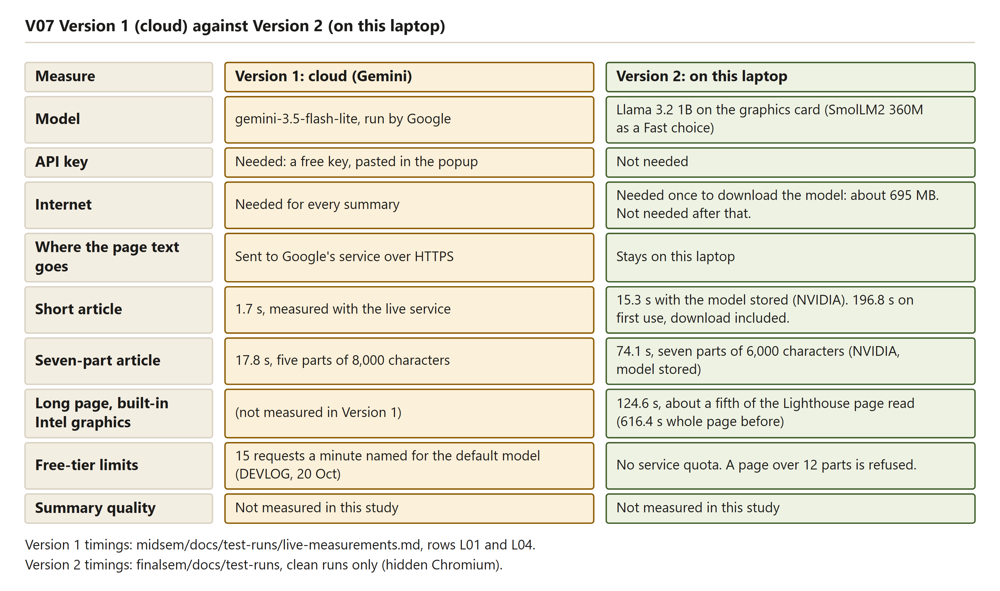
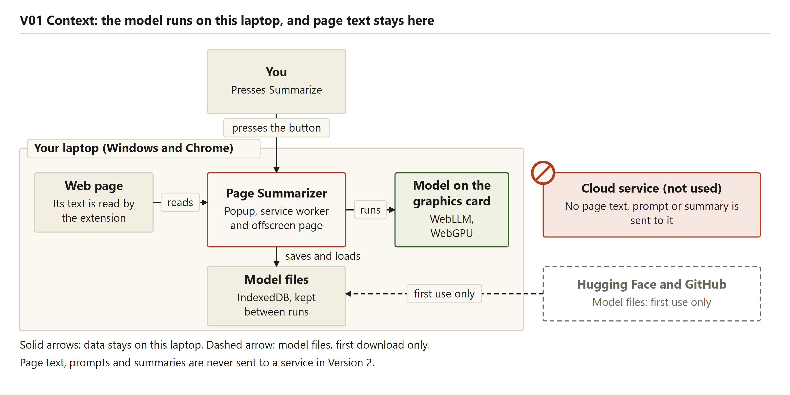

# Introduction

## The problem

Long web pages hide the one fact a reader needs. A news article, a documentation page or an encyclopedia entry can run to several thousand words. Menus, banners, cookie notices and lists of related links surround the text. To learn whether a page is worth reading, the reader has to scroll through much of it first.

A one-click summary saves that time. The reader presses one button while the page is open and gets a short account of what the page says, beside the page and without leaving it.

Two more concerns apply to many summary tools. The first is where the text goes. A summary tool reads the page, and that text travels to whoever runs the tool. For a public article this does not matter. For a private document, an internal wiki or an email, it may matter a great deal. The second is access. Many summary tools need an account, a subscription or a key before the first summary is made.

## Where Version 1 stopped

Version 1 is a Google Chrome extension in the folder `midsem/`. It works. When the reader presses Summarize, the extension reads the main text of the open tab with Mozilla's Readability library, splits long text into parts of about 8,000 characters, sends each part to Google's Gemini service, and merges the part summaries into one. The summary appears in the popup, the small window that opens from the toolbar button.

On real pages, Version 1 worked. Seven live pages were summarized in 1.7 to 23 seconds each (`midsem/docs/test-runs/live-measurements.md`). The limits come from the cloud service and from the design of the cloud route, not from a fault in the code. Each limit is a reason for Version 2.

Table: The limits met in Version 1 and what Version 2 does about each

| Limit in Version 1 | What was seen | What Version 2 does |
|---|---|---|
| A key is needed | The reader creates a free key with Google's AI Studio website and pastes it into the popup once. | No key. The model runs inside Chrome. |
| The free allowance runs out | On 20 October 2026 the first three live pages worked with gemini-3.8-flash. The next four failed with HTTP 429, "Quota exceeded ... limit: 20", and a retry time of about 7 hours (`DEVLOG.md`). The smaller models have per-minute limits. | No service quota. Once the model is stored, the only limit is the laptop itself. |
| The page text leaves the computer | The extracted text, a short instruction and the page title are sent to Google for every request. The connection is encrypted, but Google receives the text. | The page text stays in the browser. The model runs on the laptop. |
| The internet is needed every time | The project requirements list the network as needed on every summary (`prd.md`). | The internet is needed once, to download the model. After that the summary works offline. |

The first version chose the cloud route on purpose. A local model needed a capable graphics card and a large first download, and nobody yet knew how good its summaries would be. The cloud route let the core flow (read, split, summarize, merge, show) be built and tested first. Version 2 is the local route that Version 1 left open.

Reading the figure: a table with one row per measure, and two columns. Version 1 (cloud, Gemini) needs a free key pasted into the popup, needs the internet for every summary, and sends the page text to Google over HTTPS. Version 2 needs no key, needs the internet only once to download the model (about 695 MB), and keeps the page text on the laptop. The model row names Llama 3.2 1B, with SmolLM2 360M as a Fast choice. The timing rows show 1.7 seconds for the short article in Version 1, measured with the live service, and 15.3 seconds for the short article in Version 2 with the model stored, or 196.8 seconds on first use with the download included. The seven-part row shows 17.8 seconds for Version 1 and 74.1 seconds for Version 2 on the NVIDIA card. The long-page row shows that Version 1 did not measure this case, and that Version 2 took 124.6 seconds on built-in Intel graphics, having read about a fifth of the Lighthouse page (616.4 seconds for the whole page before). The free-tier row shows 15 requests a minute for the default cloud model, and no service quota for Version 2. The summary-quality row says that neither version was measured.

## What Version 2 changes

Version 2 is in the folder `finalsem/`. It keeps everything around the summarizing step and replaces only the engine. Reading the page, splitting long text, merging the part summaries and the popup come from Version 1. The shared files were copied, not linked, so each version runs from its own folder (`finalsem/docs/DECISIONS.md`, D6).

The new parts are these.

- A language model runs inside Chrome, on the graphics card. The default is Llama 3.2 1B on every chip. A smaller model, SmolLM2 360M, is used only when the reader chooses the faster setting, after a memory failure, or on a computer that reports less than 8 GB of memory.
- The WebLLM library loads the model and runs it. It is copied into the project as one file, so the project needs no build step.
- The model is downloaded once, with a progress bar, and stored in the browser's IndexedDB storage. Later summaries use the stored copy.
- At start, the extension checks that Chrome can use the graphics card for the model. If it cannot, the popup says why in plain words.
- The cloud engine and the key box are removed from Version 2. Version 1 stays as it was.

Reading the figure: "You" press Summarize, and the arrow leads into the box "Your laptop (Windows and Chrome)". Inside it, the extension reads the web page, the box "Page Summarizer" (popup, service worker and offscreen page) saves and loads the model files in IndexedDB, and it runs the model on the graphics card through WebLLM and WebGPU. A crossed-out box marks the cloud service as not used, with no page text, prompt or summary sent to it. A dashed arrow from Hugging Face and GitHub brings the model files in on first use only. The footer says that page text, prompts and summaries are never sent to a service in Version 2.

## Objectives

The objectives come from the project abstract and the product requirements. The table shows what Version 2 delivers and what remains open.

Table: Project objectives and the state of Version 2

| No. | Objective | State in Version 2 |
|---|---|---|
| 1 | Run a small language model inside the browser, with no key and no network once it is stored. | Delivered. One run with outside websites blocked gave a summary (`v2-local-nvidia-offline.md`). |
| 2 | Download the model once, with a progress bar, and cache it. | Delivered. The first-use runs show the download and the percentages. |
| 3 | Check at startup whether WebGPU and the 16-bit math are available, and show a clear message if not. | Delivered. The codes NO_WEBGPU and NO_SHADER_F16 are shown in the popup, and the button is disabled. |
| 4 | Choose a small model of about 1 to 3 billion parameters after testing it. | Partly. Llama 3.2 1B and SmolLM2 360M were chosen and measured. Other models in the library's list were set aside for the reasons in `DECISIONS.md`, D1. None of them was run. |
| 5 | Make summaries work with no network. | Delivered for one computer and two pages, with outside websites blocked. The client's laptop is not tested. |
| 6 | Compare the cloud engine and the local engine on speed, summary quality and memory use. | Partly. Speed was measured for both. Memory use and summary quality were not compared side by side. |
| 7 | Confirm the client laptop's system, memory and graphics card, because they set the model size. | Details received (`finalsem/docs/CLIENT_LAPTOP.md`): built-in Intel Iris Xe graphics only, 16 GB, Chrome 156. Not yet run on that laptop. |
| 8 | Make a long page quick enough on built-in graphics, the only graphics the client's laptop has. | Partly. A benchmark on the developer laptop's Intel chip led to a shortened read of long pages: the Wikipedia article on lighthouses went from about 10 minutes to 124.6 seconds in the hidden browser, and to 101.7 to 118.7 seconds in three visible-window runs on 28 October. Not yet measured on the client's laptop. |

## Scope

### What is built

- The local engine, with the model download, the cache in IndexedDB and the load into the graphics card.
- The graphics card check, with the messages for missing WebGPU and missing 16-bit math.
- A Settings choice, "Quality: Fast", that uses the smaller model, and a one-line note on built-in graphics.
- Speed work for built-in graphics: a benchmark of the models on the Intel chip, removal of back matter and citation marks before reading, a shortened read of long pages with a "Read the whole page" button, shorter answers on built-in graphics, and preloading of a stored model.
- A fallback to the smaller model after a memory failure, remembered for later, with a notice in the popup when the smaller model wrote the summary.
- Halving a part that the model's window cannot take at once, and a plain refusal when a half is still too long.
- The offscreen page that holds the model and its messages, and the job that runs in the background.
- Setup and run scripts for Windows (`setup.bat`, `run.bat`), a computer check (`scripts/check-computer.ps1`) and an opt-in script that asks Windows to run Chrome on the separate graphics card.
- Tests: 93 unit tests, 31 browser scenarios that use a pretend model, 15 Windows script checks, and real-model runs on the NVIDIA chip and on the built-in Intel chip.

### What is not built or not verified

- Other models beyond the two in `src/core/config.js`.
- A summary-quality comparison between Version 1 and Version 2.
- Clearing the saved switch to the smaller model. Once it is saved, it stays until the stored settings are cleared. Closing a tab during the download does not stop the download either.
- Languages other than English. The model is small and is meant for English text.
- Chrome's built-in Summarizer API. It was studied as background only.
- A test on the client's laptop, a test of the `setup.bat --gpu` option in a real Chrome installation, and a full manual click-through in a visible Chrome window on the client's laptop. On 28 October the developer laptop's Lighthouse page was timed three times in a visible Chrome window. Apart from that and one page the owner ran in real Chrome on 24 October, the other runs used a hidden Chromium browser.

## Test machines

The developer laptop is an Acer Aspire Lite with an Intel Core i5-12450H processor, 15.7 GB of memory, a built-in Intel graphics chip and a separate NVIDIA GeForce RTX 3050 with 6 GB of graphics memory. The Chrome version on it was 155 (`DECISIONS.md`, D1). The Version 2 numbers in this report were measured on that laptop, with Chrome's graphics setting used in two ways: the NVIDIA chip forced by a test flag, and the built-in Intel chip with no change. The client's laptop is an HP Laptop 15 with a 13th Gen Intel Core i7-1355U, 16 GB of memory, Intel Iris Xe graphics built into the processor (no separate card) and Chrome 156. Its facts were read from the client's photos (`finalsem/docs/CLIENT_LAPTOP.md`). The extension has not been run on that laptop, and it was timed in a visible Chrome window only on the developer laptop (28 October), so the report describes what the developer laptop does and says so wherever a number depends on it.

## How to read this report

The chapters after this one explain the AI in plain terms, then the browser work, then the design and the choices. Chapter 2 explains what a language model is, what its numbers and tokens are, how it reads and writes, and why it makes mistakes. Chapter 3 explains how the model gets into Chrome and runs on the graphics card, and why the first use is slow. The later chapters cover the requirements, the design, the technology choices, the offscreen page and its messages, the user interface, the errors and fallbacks, setup, testing, the problems that were met, the limits, and the conclusion. The appendices list the files and the messages.

Each technical section ends with a short paragraph headed "What this means in plain words". Numbers come from the test-run files and the source code. Where a number was not measured, the report says so. Runs that were disturbed by other programs on the same laptop are labelled as such, and their times are not used as clean figures. Personal details are left as placeholders.

### What this means in plain words

Version 1 works, but it needs a key, a service quota and a network connection, and it sends the page text to Google. Version 2 keeps the same reading, splitting and merging steps and runs the summary on the laptop. On built-in graphics, which is the client's only option, it is slow: reading a long page is the expensive part, and the first use is long. The extension therefore reads less of a long page and says so. The rest of the report explains each of these points with the measured numbers.
