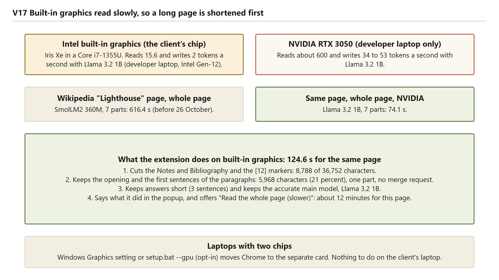
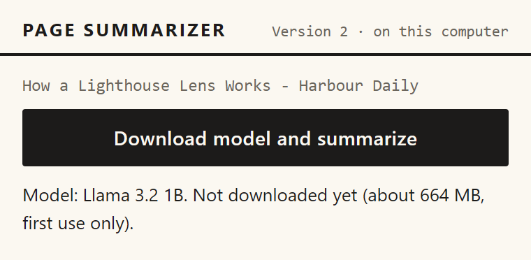

# Technology choices

This chapter records the big choices behind Version 2 as decision records. The records come from `finalsem/docs/DECISIONS.md`, decisions D1 to D7. Decision D3 is superseded by D7 (26 October 2026), and its record below says so. Each record gives the options, the choice, why the others were rejected, the trade-off accepted and what was measured afterwards. A later section says which problems found in review are fixed and which remain.

## Plain terms used in these records

- **Token**: a piece of text the model reads or writes, such as a word or part of a word. Speed is counted in tokens per second.
- **Context window**: how much text the model can read at once. The Llama 3.2 1B model has a 4,096-token window (D1).
- **Quantization (4-bit)**: storing each number in fewer bits, so the file is much smaller, at the cost of a little accuracy.
- **Warm-up**: the first answer compiles the graphics card's programs, which took about 28 to 30 seconds on the first run.

## How the first choice was checked before building

Before any code was written, the first choice (whether a model could run inside a Chrome extension, and how) was put in writing to a second, stronger model, which the decision record calls "Opus". Its answer gave a confidence of medium, and high for three of the six items. The developer laptop then had an Intel i5-12450H, 15.7 GB of memory, an Intel built-in graphics chip and an NVIDIA RTX 3050 with 6 GB, and ran Chrome 155. The client's laptop was unknown at that time. Its details came back on 26 October (`docs/CLIENT_LAPTOP.md`): a 15-watt Intel Core i7-1355U with built-in Iris Xe graphics and no separate card.

Table: The first choice, question by question, from decision D1

| # | Question | Advice given | What was done |
|---|---|---|---|
| 1 | Library | WebLLM 0.2.86, pinned, one file; Transformers.js only as plan B | Followed. The spike worked |
| 2 | Where it runs | Offscreen page with one module web worker; job stays in the service worker; keepalive; close after about five idle minutes | Followed. Keepalive every 10 s |
| 3 | Which model | Llama 3.2 1B by default, SmolLM2 360M as fallback, chosen by computer | Followed. The automatic switch to SmolLM2 on built-in graphics (D3) was later superseded by D7 |
| 4 | Piece size and prompt | 6,000 characters a part; at most 300 tokens an answer; temperature 0.2; halve the part if the window is exceeded | Followed. The halving step was missing until 24 October, when it was built after a failure in the real Chrome |
| 5 | Keep the cloud engine? | Local only; remove the key box | Followed |
| 6 | Biggest risk | WebLLM without a bundler in an offscreen page on a weak chip; test first in a throw-away extension | Done as a spike, which found the storage problem (D2) |

The advice named three conditions that would change it: a client laptop without WebGPU, a failed spike, and one part taking more than about 60 seconds. The first two did not happen. The third did, on the Intel chip, where the first part of the two-part article took about 65 s with SmolLM2. The response was narrower than the advice: SmolLM2 became the default on Intel graphics (D3). On 26 October that switch was removed, and Llama 3.2 1B became the default everywhere (D7). The halving step was left out at first, because no run had yet hit a window error. The first real-Chrome failure, on 24 October, was a dense page that did not fit the window, so the step was built then.

**What this means in plain words.** Most of the advice was followed. One condition came true, the answer was first a rule for one kind of chip, and a later measurement reversed that rule.

## Decision records

### Library: WebLLM, pinned in one file

- **Options.** WebLLM, or Transformers.js (kept only as plan B if the spike failed).
- **Choice.** WebLLM 0.2.86, copied as one file into `src/lib/web-llm.js`, with no bundler.
- **Why the other was rejected.** The spike worked, so the fallback was not needed.
- **Trade-off accepted.** Upgrades are manual, because the file is copied by hand.
- **Measured afterwards.** All six real-model runs used the library, and so did all later runs.

**What this means in plain words.** One library, copied in as one file, so nothing has to be built before the extension runs.

### Where the model runs: an offscreen page with a worker

- **Options.** The service worker alone, or a hidden offscreen page hosting a web worker. The offscreen page's header comment gives the reason against the service worker: Chrome stops an idle worker, and a stopped worker would lose the loaded model.
- **Choice.** An offscreen page, with reason WORKERS, hosting one module web worker. The job stays in the service worker.
- **Trade-off accepted.** One more page to manage. The page is not closed while a message is running, and the five-minute countdown starts only when the last message finishes.
- **Measured afterwards.** Scenario V20 (worker stopped mid-job) and scenario V23 (idle close, then a working summary) pass. A long answer no longer makes its job look dead (scenario V26).

**What this means in plain words.** The model lives in a hidden page that stays alive while there is work, and it closes after five quiet minutes.

### Which model: Llama 3.2 1B, with SmolLM2 360M as the fast choice and fallback

- **Options.** Four models, shown below.
- **Choice.** Llama 3.2 1B by default, on built-in graphics too (D7). SmolLM2 360M is used when the person chooses Quality: Fast in Settings, when memory is under 8 GB, or after a memory or load failure with the main model (the saved `modelOverride`).
- **Why the others were rejected.** DECISIONS.md skips Qwen2.5 0.5B as bigger than the 1B model and weaker, and Qwen3 0.6B for its graphics memory and thinking mode.
- **Trade-offs accepted.** A 1B model writes weaker summaries than a large cloud model, as the PRD states. A saved fallback stays until the stored settings are cleared, because `modelOverride` is never cleared. The reader is told when the fallback wrote the summary (scenario V10).
- **Measured afterwards.** In the saved clean NVIDIA runs, writing speed was 34 to 53 tokens a second, each value from the last request of its job. The offline run after the label fix wrote at 65 tokens a second for its single request (short article) and 45 for the two-part article. On the built-in Intel chip, SmolLM2 wrote at 4 to 5 tokens a second, and Llama 3.2 1B at 1.8 to 2.0 (`v2-local-intel-better`). A speed test recorded only in DEVLOG gave about 63 tokens a second writing and 600 reading on NVIDIA; that row does not say which text was used.

Table: The four models considered, with the graphics memory from DECISIONS.md

| Model | Graphics memory | Outcome |
|---|---|---|
| Llama 3.2 1B | 879 MB | Chosen as the default everywhere; 4,096-token window |
| Qwen2.5 0.5B | 945 MB | Skipped: bigger than the 1B model and weaker |
| SmolLM2 360M | 376 MB | Chosen as the Quality: Fast choice and the fallback |
| Qwen3 0.6B | 1,403 MB | Skipped: the largest of the four, with a thinking mode |

**What this means in plain words.** The 1B model is the default on every computer, and the smaller model is a visible choice or the fallback where memory is short or the main model fails.

### Piece size and prompt

- **Options.** Version 1 used 8,000 characters a part. DECISIONS.md does not record the other sizes tried.
- **Choice.** 6,000 characters a part, about 1,500 tokens, with part answers capped at 300 tokens, the final answer at 320, and temperature 0.2. On built-in graphics the answers are shorter still (three sentences for one part, two per part, four or five for a merge), and the page is shortened to 6,000 characters before it is read (D7).
- **Trade-off accepted.** Long pages need more requests, and pages over 12 parts are refused (`maxChunks`).
- **Measured afterwards.** The clean NVIDIA runs took 15.9 s for the two-part article and 74.1 s for the seven-part article. No real run hit a window error.
- **Built on 24 October.** The halve-and-retry step was in the advice (D1, item 4) and had been left out. In the real Chrome, the project owner ran the Wikipedia article on the Intel chip and got "Something went wrong inside the extension. Try again." with no reason. WebLLM had refused a dense part with "Prompt tokens exceed context window size", and the code reported that as a generic service error. The fix recognises the message as CONTEXT_TOO_LONG. `summarizeChunk` then cuts the part in half at a paragraph or sentence break and summarizes each half, up to three levels deep and not for text under 600 characters. The job counts the cut parts in `stats.halvedParts`. The unit tests and scenario V25 pass. No part of the 24 October run needed cutting, so the effect on a real page is not yet measured.
- **Answer limit.** The limit on one answer rose from 180 seconds to 10 minutes (`generateTimeoutMs`). In the failing run, one answer on the Intel chip ran past 180 s: parts 1 and 2 took 76 s and 127 s, and part 6 had not answered within 180 s.

**What this means in plain words.** Each piece is small enough for the model to read at once, and very long pages are refused before the wait starts.

### Keep a cloud engine, or go local only

- **Options.** A selectable cloud engine with the key box, or a local-only Version 2.
- **Choice.** Local only. Version 1 stays the cloud version.
- **Why the other was rejected.** The PRD goal is no API key and no page text leaving the machine, which a selectable cloud engine would break.
- **Trade-off accepted.** A computer without WebGPU gets no summary. The advice said the cloud engine would return for such a laptop. The client's laptop has WebGPU hardware acceleration (`docs/CLIENT_LAPTOP.md`), so that case is not expected there.
- **Measured afterwards.** Scenarios V07 and V08 (no WebGPU, no 16-bit support) pass.

**What this means in plain words.** The product makes no outside call for a summary and needs no key.

### The spike: the riskiest step, tested first

- **Options.** Build the whole extension first, or first run a throw-away extension in a hidden browser, measuring download, cache load and time per part, then again with the network off.
- **Choice.** The spike, as advised. DECISIONS.md names this step as the biggest risk.
- **Trade-off accepted.** The throw-away extension differs from the real one, so each finding was checked again in the real extension.
- **Measured afterwards.** DECISIONS.md says the spike found two problems and points to D2, which describes only one. The second, a silent offscreen page, is in the development log only.

**What this means in plain words.** The riskiest step was tried in a small copy before the real extension depended on it.

### Where the model files are stored

- **Options.** Cache Storage (WebLLM's default), or IndexedDB.
- **Choice.** IndexedDB, set with `cacheBackend: "indexeddb"`.
- **Why the other was rejected.** Cache Storage failed inside the offscreen page with "UnknownError: Failed to execute 'open' on 'CacheStorage'". IndexedDB worked there, with about 10.7 GB of quota in the test.
- **Trade-off accepted.** The extension needs `unlimitedStorage`, so the browser does not delete the model of about 700 MB when disk space runs low.
- **Measured afterwards.** Loading the stored model took 6.9 s before the label fix and 11.6 s after it. The spike found 8 to 13 s (DEVLOG).

**What this means in plain words.** The model is kept in the browser's own database, the storage that worked inside the offscreen page.

### Built-in graphics: the smaller model by itself (D3), superseded by D7

This record is kept as the reference for what D3 built and why it was changed. D3 in DECISIONS.md still reads as it was written.

- **Status.** Superseded on 26 October 2026 by D7.
- **What D3 chose.** When WebGPU reported an Intel built-in chip, the extension used SmolLM2 360M by itself, and showed a one-line note that a separate card is much faster.
- **Why it was chosen.** On Intel the 1B model wrote about 2 tokens a second, and the first answer took 36 s to prepare. The development log says the weak chip "is not an error", so the choice was a note and a smaller model rather than a refusal.
- **Measured under D3.** The Intel short article took 199.2 s on first use (81 s download, about 40 s warm-up, 76 s writing). The two-part article took 149.1 s with the model stored. The seven-part Wikipedia article took 616.4 s with the new code, and 704.5 s on a second try with the old code. The first try, under the old 180-second limit, failed with TIMEOUT.
- **Why it was superseded.** The benchmark of 26 October showed that reading is most of the cost on this chip (about 80 percent of one part), so a smaller model saves less time than hoped. The smaller models were also less accurate: the SmolLM2 summary of the whole Lighthouse page in the old-code second try contains invented facts, which must not be quoted. The client's laptop has no other graphics chip, so the default had to be the accurate model.
- **Trade-off still true.** Detection covers Intel only, so an AMD or Apple built-in chip is not recognised as built-in. This limit remains.

This is the single Intel run of the D3 period. The note reads "Graphics: Intel (built into the processor). Answers can be slow. A separate graphics card is much faster." The model line names SmolLM2 360M, which was the automatic choice then. The result begins with the copied marker line, because the run predates the marker fix.

Reading the figure: The NVIDIA bars show 34 to 53 tokens a second for the clean runs. The Intel bars show 4 and 5 for SmolLM2, the automatic choice before 26 October, and a dashed bar marks the DEVLOG speed-test value of about 2 for the 1B model. The figure does not show the Llama 3.2 1B runs of 26 October, which are in the D7 record below.

**What this means in plain words.** D3 made the weak chip usable by giving it a smaller model. Measuring the whole path showed that reading was the real cost, so D7 kept the accurate model and read less of each page.

### Speed on the client's laptop: read less, keep the accurate model (D7, 26 October)

The client's laptop has only built-in graphics, and the owner asked for a page to be as fast as possible, with a bigger model accepted if it fits. A long Wikipedia page had taken about 10 minutes on the developer laptop's Intel chip. The question went to the same second model, as a written brief with the benchmark numbers, and its five answers are in the table below.

Table: Speed on the client's laptop: the five answers and what was done (from DECISIONS.md, D7)

| # | Question | Answer | What was done |
|---|---|---|---|
| 1 | Default model on built-in graphics | Llama 3.2 1B (accurate, 2.4 times slower per part). Do not show a model choice on the main screen; put "Quality: Better / Fast" under Settings | Done. The popup has a closed Settings section. The automatic switch to SmolLM2 (D3) is removed; SmolLM2 is used on built-in graphics only when the person chooses Fast, or after a memory failure |
| 2 | How much of a page to read on built-in graphics | Keep 6,000 characters (exactly one part, so no merge request). Aim for about 2 minutes warm and 3 minutes with the first-answer warm-up | Done (`readBudgetIntegrated` 6000, `src/core/condense.js`) |
| 3 | Shorter answers | 3 sentences for a single part (130 tokens), 2 per part (90), 4 to 5 for the merge (180), and every cut-off answer ends at its last full stop | Done for built-in graphics only |
| 4 | A different runtime (Transformers.js or ONNX Runtime Web) | First run the same benchmark in a visible Chrome window on mains power. Try a different runtime only if reading is still slow, for half a day at most, and switch only if reading is at least 2 times faster | **Not done.** Everything measured so far ran in a hidden Chromium; the visible-window run was not made |
| 5 | Biggest risk | No number is from the client's chip or a real Chrome window. First action: run the extension on the client's laptop with a timing log for both models on the same page | **Open.** See the manual smoke test notes in `docs/MANUAL_SMOKE_TEST.md` |

The benchmark behind the answers ran on the developer laptop's Intel chip in hidden Chromium, with one realistic part of 6,000 characters:

Table: Speed of four models on the built-in Intel chip (`docs/test-runs/bench-models.md`)

| Model | Reading (tokens a second) | Writing (tokens a second) | One realistic part |
|---|---|---|---|
| SmolLM2 360M (4-bit) | 28.7 | 4.8 | 66.2 s |
| SmolLM2 135M | 40.2 | 13.6 | 43.2 s |
| Qwen2.5 0.5B (4-bit) | 24.1 | 3.5 | 53.9 s |
| Llama 3.2 1B (4-bit) | 15.6 | 2.0 | 161.6 s |

Reading is slow for every model on this chip, and it is most of the time of one part. DECISIONS.md records that Llama 3.2 1B was the only one of the models tried whose summary of the same part had no invented details.

The measured result on the developer laptop's Intel chip (`docs/test-runs/v2-local-intel-better.md`, Llama 3.2 1B, hidden Chromium):

- The Lighthouse article took 124.6 s with the model stored. The extension cut 8,788 characters of back matter and markers, then read 5,968 of the 27,964 that were left (21 percent). The popup estimated 692 s for reading all of it. That estimate is a rough guess and was not measured with Llama.
- The long fixture article took 103.8 s, with 5,302 of 10,532 characters read.
- A first use, with the 695 MB download and the warm-up, took 200.6 s; the warm-up took about 28 s.
- The three summaries are described as accurate and fluent in the run notes. No second reader has checked them against the pages.

The Quality: Fast choice (SmolLM2) took 39.5 s for the short article with the model stored, and 64.7 s for the Lighthouse article. That Lighthouse summary was a failed answer, which only repeated the prompt's safety sentence and an empty "Summary:" label. The run was made before that repeat was removed, so it is kept as a record and not as a summary.

**Not done, and still open.** The visible-window timing run on mains power has not been made, so no speed has been measured on the client's laptop, whose Iris Xe graphics shares memory and runs at 15 watts. A different runtime has not been tried. The whole-page option with Llama 3.2 1B has not been measured, and the earlier whole-page runs used SmolLM2 (616.4 s and 704.5 s, before 26 October).

**What this means in plain words.** The default now reads less of a long page and writes shorter answers, so the Lighthouse article takes about two minutes instead of about ten. The accurate model stays the default. The speed on the client's own laptop is still unknown.

### Making Chrome use the stronger chip: opt-in only

- **Options.** Set Windows by hand, run `setup.bat --gpu` (one per-user registry value), or change nothing.
- **Choice.** Both ways are offered, and neither runs by default. The script runs only when `--gpu` is given.
- **Why the default was rejected.** The change alters a Windows setting, and the project owner does not want settings changed without asking.
- **Trade-off accepted.** Most laptops with two chips start on the weak one until someone acts. The client's laptop has one graphics chip, so there is nothing to switch there.
- **Measured afterwards.** The registry change was tested only against a throw-away key. The undo command, `powershell -File scripts\set-chrome-gpu.ps1 -Remove`, now works without a Chrome path. If the change fails, `setup.bat --gpu` says so and setup continues.

Reading the figure: The figure shows Chrome on the Intel chip by default, and the Windows setting or `setup.bat --gpu` moving it to the NVIDIA card. Its speed boxes are the D3-period values (4 to 5 tokens a second with SmolLM2 on Intel), and its undo line still shows the optional `-ChromePath` argument, which the script accepts without needing it.

**What this means in plain words.** The project offers the faster chip but does not change the computer's settings on its own, and the client's laptop has no second chip to choose.

### Pretend model for most tests, one real run for proof

- **Options.** Real model only, or a pretend model for most tests with real runs for proof.
- **Choice.** Both. Most browser scenarios use the pretend model selected with `?mock=<mode>`, of which there are 12 modes.
- **Why the first option was rejected.** A real model cannot be made to fail on demand.
- **Trade-off accepted.** The pretend model says nothing about summary quality or real memory limits. Its fixed numbers, such as 664 MB and 300 MB, are not measurements.
- **Measured afterwards.** The current code has 93 unit tests, 31 browser scenarios and 15 batch-script checks, from the change notes. `run-1.md` records three full browser runs made before the later fixes.

**What this means in plain words.** Most tests are quick and repeatable, and a few real runs show that the model works on the developer's laptop.

### Version 1 stays untouched

- **Options.** Link the shared code, copy it, or change Version 1 in place.
- **Choice.** Copy the shared parts into `finalsem/`, and leave `midsem/` as it was.
- **Why the others were rejected.** DECISIONS.md says the parts were copied so that each version runs from its own folder.
- **Trade-off accepted.** A fix to shared code has to be made in both places by hand.
- **Measured afterwards.** Eight of the 19 Version 1 source files are byte-for-byte the same in Version 2, eight changed, three were removed, and twelve new files make the 28 Version 2 files (system design chapter).

**What this means in plain words.** Each version runs from its own folder, at the cost of two copies of the shared code.

## Problems found in review: what is fixed and what remains

Reading the code and the runs turned up problems, and the 26 October changes answered some of them. The table shows where each stands now.

Table: Problems found in review, and their status

| Problem | Status now | Where |
|---|---|---|
| Unused key-box and options CSS | **Fixed.** Removed from `ui.css`; one rule added for the notice | Chapter 5, reuse |
| Intel detection | **Still open.** Only an Intel built-in chip is recognised. It now sets the short answers, the reading budget and the note, not the model choice | This chapter, D3 and D7; FR9 |
| TIMEOUT untested | **Still open.** No automated test runs the 10-minute timer; the pretend model has no timeout | Chapter 5, failures; FR8 |
| Copied page markers in answers | Fixed. `stripPageMarkers` also removes a repeated safety sentence and an empty "Summary:" label | Chapter 5, engine seam |
| Silent fallback to the smaller model | Fixed. A notice shows on the result (scenario V10) | Chapter 5, failures |
| Stale "Not downloaded yet" after both models fail | Fixed for the end of a job. The line is still not refreshed during download or warm-up | Chapter 5, first use |
| "Downloading" shown for a stored model | Fixed, with a unit test. The earlier offline run keeps its timings | Chapter 5, first use |
| Offscreen page closed during a long answer | Fixed. Messages in flight are counted, with a unit test | Chapter 5, offscreen page |
| "oom" matched inside words such as "room" | Fixed, with a unit test | Chapter 4, FR8 |
| Stale limit of three minutes | Changed to five minutes; Version 1 kept three | Chapter 5, job record |
| The real-Chrome failure with no reason (24 October) | Fixed. The popup shows a technical-detail line under SERVICE_ERROR and MODEL_LOAD_FAILED (scenario V27) | Chapter 5, failures |
| A dense part refused by WebLLM and reported as a vague error | Fixed. CONTEXT_TOO_LONG is recognised, and the part is cut in half (scenario V25) | Chapter 5; this chapter |
| Answer limit of 180 s too short on the Intel chip | Fixed. Changed to 10 minutes; the TIMEOUT message is unchanged | Chapter 5, job record |
| A long answer shown as dead (interrupted) | Fixed. The KEEPALIVE message refreshes running jobs (scenario V26) | Chapter 5, job record |
| The test setup reused an old service-worker script | Fixed. `scripts/local-run.mjs` deletes the profile's Service Worker and Code Cache folders before a run; the downloaded model is kept | Test setup |
| Undo command needed `-ChromePath` | Fixed. The README command works | This chapter, D4 |
| The built-in default was SmolLM2 (D3) | Fixed on 26 October. Llama 3.2 1B is the default everywhere (D7) | This chapter, D7 |
| A long page took 10 to 12 minutes on the built-in chip | Improved. The Lighthouse article takes 124.6 s with shortening and the default model. The whole page with Llama 3.2 1B is not measured | This chapter, D7 |
| SmolLM2 echoed the safety sentence and an empty "Summary:" label | Fixed. Both are removed, and such an answer is EMPTY_ANSWER | Chapter 5, engine seam |
| The first answer waited 30 to 40 s for the warm-up | Improved. A stored model is preloaded when the popup opens (`PRELOAD_MODEL`) | Chapter 5, later use |
| Speed on the client's laptop | **Still open.** The extension has not been run there; the Iris Xe speed is unknown. Target: about 2 minutes warm | Chapter 4, NF11; this chapter, D7 |
| Timing in a visible Chrome window | **Still open.** Not made; the second opinion advised it | This chapter, D7 |
| A different runtime (Transformers.js or ONNX Runtime Web) | **Not tried.** Only if reading stays slow | This chapter, D7 |

Other points remain open, though none is a code change. `v2-local-nvidia.md` repeats the second NVIDIA attempt. D2's description does not match DECISIONS' "two problems". The download size is quoted as 664 MB in a DEVLOG row and as about 660 MB in a script comment, while the popup reports about 695 MB, which this report uses. The "slower" note on an older offline run holds only for the long article.

The limits that remain true of the code are these. `modelOverride` is never cleared, so the smaller model stays in use after a fallback until the stored settings are cleared. Closing a tab during a download does not stop it, because `prepare()` ignores the abort signal. The merge answer can repeat the prompt's own wording, and small models make factual slips. The model line is not refreshed during the download or warm-up. A load-stage error containing "cache" counts as a download failure. The secret-scan script knows only the Version 1 Gemini key. The under-8-GB rule has not been seen on low-memory hardware. The dashboard fixture is used by no Version 2 browser scenario. The warm-up took about 28 to 30 s on the first answer and about 0.4 to 0.5 s in the later runs, and the reason is not measured.

The shortened summary covers about a fifth of a long page, and the popup's estimate for the whole page is a rough guess. The whole-page runs on record used SmolLM2 (616.4 s and 704.5 s, before 26 October). The new-code run of 24 October, also with SmolLM2 on the whole page, gave three short generic points: a history and significance point, a count of 14,700 lighthouses, and counts of 54 diagrams and 651 photographs. Those counts were not checked against the page, and the old-code second try contains invented facts, which must not be quoted.

**What this means in plain words.** The fixes cover the defects a reader would see, and the built-in default is now the accurate model. The open items are the chip detection, the untested timeout, the speed on the client's own laptop, and several limits of the test setup.

## Why the interface keeps the Version 1 look

This is a pretend-model picture. The "about 664 MB" figure is the pretend model's number, not a measurement. The style is a paper background, dark ink, one red accent, a serif summary font and numbered points.

DECISIONS.md holds no record about the look. The reasons come from the PRD, which states that "Only the summarization engine differs between versions", and from the Version 1 development log, which records that the owner said the first design looked AI-made and that it was redrawn in this style. The look has not been tested with readers.

**What this means in plain words.** Version 2 looks like Version 1 because the PRD changes only the engine, and the look had already been accepted.

## Why no cloud engine remains

D1 answered the question of keeping the cloud engine with "local only". The reason follows the PRD goal of no key and no page text leaving the machine. Version 1 stays as the cloud version, so `engines/gemini.js`, the Options page and the key form are not in Version 2. A laptop without WebGPU or 16-bit support cannot run Version 2, and the extension says so. The client's laptop has WebGPU hardware acceleration, but the extension has not yet been run on it.

**What this means in plain words.** The product makes no outside call for a summary and needs no key, and it has no fallback to the cloud.

## Questions this chapter answers

**Why WebLLM and not Transformers.js?**
WebLLM was the first answer, and the spike ran, so Transformers.js was kept only as plan B. The library is one copied file, so there is no build step, and upgrades are manual.

**Why did the team change its choice of model after measuring?**
On the Intel chip the 1B model wrote about 2 tokens a second, so the extension first switched to SmolLM2 by itself on built-in graphics (D3). The 26 October benchmark showed that reading is most of the cost, and the smaller model's answers were less accurate. Llama 3.2 1B became the default everywhere, with SmolLM2 as a visible Quality choice, and the reading budget keeps a long page to about two minutes (D7).

**Why is the model stored in IndexedDB?**
Cache Storage failed inside the offscreen page, and IndexedDB worked there. The extension asks for `unlimitedStorage` so the browser keeps the model when disk space runs low.

**Why no cloud engine?**
The PRD goal of no API key and no page text leaving the machine would be broken by a cloud engine. A laptop without WebGPU gets a clear refusal rather than a fallback.

**Did another model check the choices, and was its advice followed?**
Yes. The first question went to a stronger model in writing before building, with a stated confidence of medium. Most of that advice was followed, and one condition came true on the Intel chip. A second question on 26 October gave five answers: three were built, one (a different runtime) was not done, and the biggest risk, a timing run on the client's laptop, is still open.
