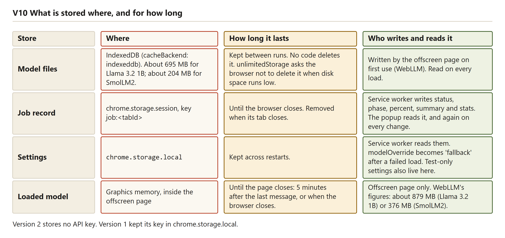
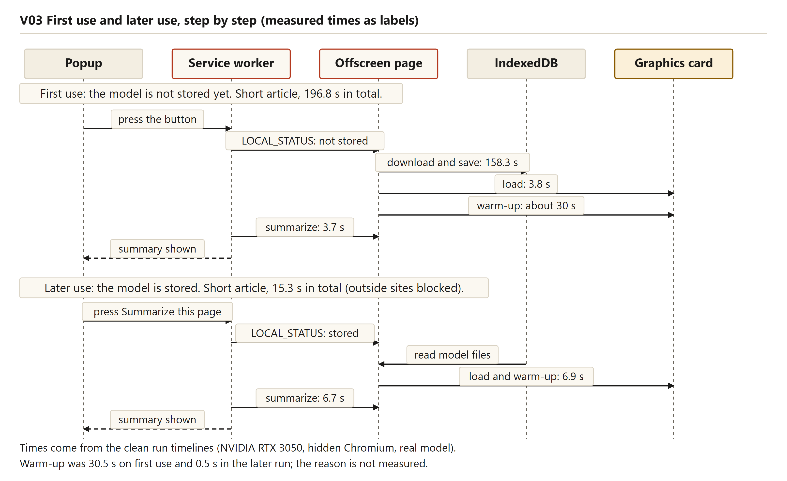
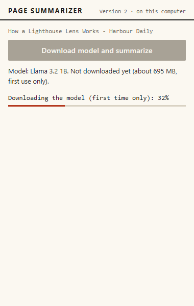
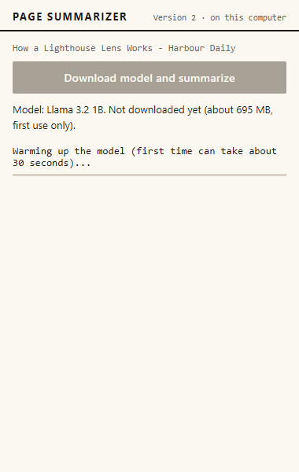
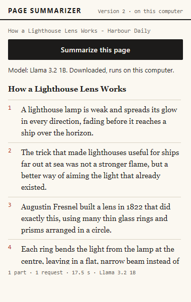

# Getting the model onto the laptop

## What this part does and why it exists

The first time a reader presses the button, the model has to arrive on the laptop. The 1B model is about 695 MB of weights, and it also needs a graphics library and a tokenizer. The download and the load take most of the waiting. After that the model stays in the browser, so later summaries start in seconds. The offscreen page asks WebLLM to download and load the model, and the service worker writes the progress into the job record that the popup reads. The only outside traffic is that first download. Chapter 5 walks through the first use step by step, and chapter 3 explains the model file and where it is kept.

## The first-use phases

Table: First use on the NVIDIA chip, from the clean cold run

| Phase | Starts (s) | Ends (s) | Seconds |
|---|---|---|---|
| Read and check | 0 | 0.5 | 0.5 |
| Download | 0.5 | 158.8 | 158.3 |
| Load into the card | 158.8 | 162.6 | 3.8 |
| Warm-up | 162.6 | 193.1 | 30.5 |
| Summary | 193.1 | 196.8 | 3.7 |

The full 32-row timeline, with the label the popup showed at each change, is in `docs/test-runs/v2-local-nvidia-cold-first-attempt.md`. The engine reports 192,580 ms from the start of the load to the end of the warm-up, which is the `Load (ms)` value in that file.


Reading the figure: the timeline is 196.8 seconds long, and the download is the widest block at 158.3 seconds from 0 to 100 percent. The load, the warm-up and the summary follow as 3.8, 30.5 and 3.7 seconds. A footnote says that a "Loading 0%" line at 5.1 seconds, during the download, is not drawn.

**What this means in plain words.** A first summary has five steps. The download is about 80 percent of the wait on this laptop, so most of the time goes to the network and the disk.

## How download progress becomes the percentages

WebLLM reports its progress through a callback. Since the label fix, the offscreen page first checks whether the model is stored, and it passes that answer to the mapping.

`src/offscreen/offscreen.js`
```js
        const wasCached = await hasModelInCache(modelId, APP_CONFIG).catch(() => false);
        ...
          initProgressCallback: (report) => emitProgress(mapInitProgress(report, { cached: wasCached })),
```

`src/core/gpu-check.js`
```js
  const phase = !cached && /fetch/i.test(text) ? 'downloading' : 'loading';
```

The mapping clamps WebLLM's fraction to the range 0 to 1 and rounds it to a whole percentage. For a model that is not stored, the phase is "downloading" when the text contains "fetch", and "loading" otherwise. For a stored model the phase is always "loading". The offscreen page sends the result as a `MODEL_PROGRESS` message, and the service worker writes it into the job record. The popup turns that record into a label such as "Downloading the model (first time only): 32%". The run files do not say whether WebLLM's fraction counts bytes or files, so what the percentage measures is [to be measured].

**Before the label fix.** In the clean offline run, which read a model already stored, the popup showed "Downloading the model (first time only): 0%" at 3.9 seconds, for about 0.8 seconds. Any WebLLM text containing "fetch" counted as a download, and WebLLM uses that word when it reads a stored model too. The stored check before the load fixed it, and the unit test "mapInitProgress never says downloading when the model is already stored" covers it (DEVLOG, 2026-10-21, "V2 popup wording"; chapter 15 tells this).

**Still true after the fix.** For a model that is not stored, the phase still depends on WebLLM's words. The cold run shows a "Loading ... 0%" line at 5.1 seconds, during the download, and the reason is [to be measured].

**What this means in plain words.** The percentages are WebLLM's fraction, turned into whole numbers. The label now checks the store first, so a stored model is never shown as a download. A model that is not stored still relies on WebLLM's wording.

## The size shown before the download

The popup states the download size before the reader presses the button. The code reads the model's own file list from Hugging Face.

`src/offscreen/offscreen.js`
```js
    const bytes = (json.records ?? []).reduce((sum, r) => sum + (Number(r.nbytes) || 0), 0);
```

The function fetches `ndarray-cache.json` and adds up the byte counts of its records, in decimal megabytes. The request stops after 8 seconds, and any failure returns null, so the popup writes "about several hundred MB" instead. The file lists only the weights. The library and the tokenizer are not in the sum, and their sizes are not recorded in the repository. The real runs showed about 695 MB for the main model and about 204 MB for SmolLM2. The 879 MB in `config.js` is graphics memory, not a download size.

**What this means in plain words.** The size shown is the total of the weight files, read from the model's own list, without the small library and tokenizer files.

## Storage in IndexedDB, and the stored check

The model is kept in IndexedDB, because WebLLM's default store, Cache Storage, failed inside the offscreen page. The first try stopped with `UnknownError: Failed to execute 'open' on 'CacheStorage'`, while IndexedDB had about 10.7 GB of quota (DEVLOG, 2026-10-21, "V2 spike: model cache"). The setting is one line.

`src/offscreen/offscreen.js`
```js
const APP_CONFIG = { ...prebuiltAppConfig, cacheBackend: 'indexeddb' };
```

The stored check looks at the weights only, in the scope `webllm/model`. The graphics library is kept in a separate scope, `webllm/wasm`. Both are in IndexedDB, so a load with no network succeeds, which is what the offline runs show. If the check throws, the model counts as not stored and the popup offers the download again. The test runs keep the browser profile in a fixed folder (`.model-profile` in `scripts/local-run.mjs`). Chapter 9 explains the manifest permissions behind the download, including `unlimitedStorage`.

Figure: what is stored, where, and for how long.



Reading the figure: the drawing is a table of four stores. The model files stay in IndexedDB, about 695 MB for Llama 3.2 1B and about 204 MB for SmolLM2, and no code deletes them. The job record lasts until the browser or its tab closes, and the loaded model is freed five minutes after the last message. Version 2 stores no API key.

**What this means in plain words.** The model lives in the browser's own database, and the library sits beside it. A stored check that fails is read as "not stored".

## The warm-up after loading

After the load, the page writes one token before it reports success, so the slow first answer happens while the popup explains it.

`src/offscreen/offscreen.js`
```js
        emitProgress({ phase: 'loading', percent: 100, text: 'Warming up the model (first time only)' });
        await engine.chat.completions.create({ messages: [{ role: 'user', content: 'Say ok.' }], max_tokens: 1, temperature: 0 });
```

The first answer on a graphics card compiles the programs the model runs. The popup shows "Warming up the model (first time can take about 30 seconds)...", with an empty bar. The code comment and the message say "first time only", but the code runs the warm-up on every load into a fresh offscreen page. The timings are about 30.5 seconds on the cold NVIDIA run, about 39.4 seconds on the Intel run, about 0.5 seconds on the clean offline run and about 0.4 seconds on the after-fix offline run. The offline runs use the same profile as the cold run, and the reason for the short offline warm-up is [to be measured].

**What this means in plain words.** The extension runs one tiny answer right after loading. The short warm-ups later are measured, and their cause is not.

## The second use and the two offline runs

After the first use, the model is in IndexedDB, so a later summary needs only the card check, a load from the stored copy and the warm-up. Two clean offline runs show this. The first was made before the label fix and has the wrong "Downloading" line. The second was made after the fix, with nothing else running. The table below puts them side by side, once.

Table: The two clean offline runs, before and after the label fix (same laptop, outside websites blocked)

| Offline run (test-run file) | Popup label | Load in page (ms) | Warm-up | Short article: total | Summary step | Writing speed, short and long | Long article: total |
|---|---|---|---|---|---|---|---|
| Before the label fix (`v2-local-nvidia-offline.md`) | "Downloading ... 0%" at 3.9 s, about 0.8 s | 6,890 | 8.1 to 8.6 s | 15.3 s | about 6.7 s | 40 and 42 tokens a second | 16.5 s |
| After the label fix (`v2-local-nvidia-offline-after-label-fix.md`) | None | 11,621 | 13.1 to 13.5 s | 17.7 s | about 4.2 s | 65 and 45 tokens a second | 16 s |

The after-fix load took longer, 11.6 seconds against 6.9 seconds. The run's own note says differences of this size are normal on this laptop, and the cause is not measured here. The clean runs give 34 to 53 tokens a second, each value for the last request of its job. The 65 tokens a second is above that range, and the file does not explain it. The summary-step times are for reference only, because the answers differ in length.

The Intel first use (SmolLM2, clean run) took 199.2 seconds: a download from 0.9 to 81.2 seconds for about 204 MB, a warm-up of about 39.4 seconds, and writing at 4 to 5 tokens a second. The NVIDIA first use run while other programs were using the processor took 207 seconds, with a warm-up of about 56 seconds. That run is labelled as disturbed in the test-run folder.

Figure: first use and later use as two sequences.



Reading the figure: the top sequence is the first use, with the download taking 158.3 seconds and the whole short article 196.8 seconds. The lower sequence is the later use, with outside sites blocked: the model files are read from IndexedDB, the load and warm-up take 6.9 seconds, and the whole short article takes 15.3 seconds. A footnote gives the two warm-ups, 30.5 seconds and 0.5 seconds.

**What this means in plain words.** Once the model is stored, the same article takes about 15 to 18 seconds, not about 200 seconds. Chapter 3 explains the second use in more depth.

## The offline proof

The offline runs use a host resolver rule, `MAP * ~NOTFOUND, EXCLUDE 127.0.0.1`. It maps every host name to "not found", except the address where the fixture pages are served.

Table: What the offline runs blocked, and what they did not

| Item | Blocked? | Why, and what the run shows |
|---|---|---|
| Outside host names | Yes | Each name maps to "not found", so a download cannot start |
| Fixture pages at 127.0.0.1 | No | The rule excludes that address |
| The extension's own pages | No | The browser loads them from the extension folder. Playwright's offline switch had blocked them, which is why a host rule was used |
| Weights, library and tokenizer | Not needed | Read from IndexedDB |
| IP addresses, and whether any blocked request was tried | Not covered, not recorded | The rule matches host names. The script records outcomes, not requests, and no probe checks a blocked name |

The offline runs prove one thing: a summary completes when the model is stored and the outside names do not resolve. They do not prove that no request was attempted, and no traffic was captured, so they do not prove that the page text never leaves the computer. The Wikipedia page was not run offline. The first offline attempt failed because the test script copied the extension to a new folder on each launch, so Chrome gave it a new extension ID and it could not see the earlier storage. The fix was a fixed folder (DEVLOG, 2026-10-21, "V2 offline check"). The test setup also adds a wider host permission for its copy of the extension, and no run used the shipped manifest alone.

**What this means in plain words.** The offline runs show that the stored model works with the outside names switched off, before and after the label fix. They do not show that nothing tried to reach the internet.

## Design decisions

Table: Design decisions for storing and loading the model

| Decision | Options considered | Choice | Why | Trade-off accepted |
|---|---|---|---|---|
| Where the model is kept | Cache Storage (WebLLM default); IndexedDB | IndexedDB | Cache Storage failed in the offscreen page | The `unlimitedStorage` permission is needed |
| Where the warm-up runs | Inside the load; on the first answer | Inside the load, with a message | The first answer would otherwise look frozen (code comment) | The load time includes the warm-up |
| Size before the download | A fixed size; the model's own file list | The file list | The size follows the model's own record | Needs Hugging Face to answer within 8 s |
| Stored check | Load and see; ask the store | `hasModelInCache` before the load | Avoids a download attempt, and lets the label say "loading" | A failed check reads as "not stored" |

**What this means in plain words.** IndexedDB and the warm-up inside the load both make the reader wait less. The cost is a larger permission and a longer load.

## Screenshots



Reading the screenshot: the progress line reads "Downloading the model (first time only): 32%", with the bar about one third full. The model line reads "Not downloaded yet (about 695 MB, first use only)", and the button is greyed out while the job runs.



Reading the screenshot: the line reads "Warming up the model (first time can take about 30 seconds)...", and the bar is empty because no measured progress exists during the compile. The model line still says "Not downloaded yet", because that line is refreshed when a job ends.


Reading the screenshot: the model line reads "Downloaded, runs on this computer", and the summary appears as numbered points. The stats line reads "1 part · 1 request · 14.8 s · Llama 3.2 1B", which matches the clean offline run. This picture was taken before the label fix.



Reading the screenshot: the model line reads "Downloaded, runs on this computer", and the stats line reads "1 part · 1 request · 17.5 s · Llama 3.2 1B". No "Downloading" line appears at any point in that run.

## Failure cases

Most failures in this part end with a message and leave the stored model alone. Four are worth naming here, and chapter 12 explains the rest, including downloads and computers that cannot run the model.

- A stored check that throws counts as "not stored", so a stored model may be offered again.
- A size estimate that fails, or takes more than 8 seconds, shows "about several hundred MB".
- A download that stops gives `MODEL_DOWNLOAD_FAILED`. It is not retried with the small model, and nothing is saved (browser test V12). The message says that what was already downloaded is kept. No real network break has tested that claim.
- A load or warm-up that is silent for more than 5 minutes is shown as interrupted, even if it is still working. The load has no timeout of its own. The stale limit was 3 minutes before the fix, which was the same length as the 180-second answer timeout. It is now 5 minutes (DEVLOG, 2026-10-21, "V2 review while writing the report", item 2).

**What this means in plain words.** Most failures show a clear message and leave the stored model alone. The one remaining gap is a very long silent wait, which the popup reports as an interruption.

## What went wrong while building it

Chapter 15 tells the stories behind this part: the model cache that refused to open, the offline check that failed because the folder moved, and the "Downloading" line for a stored model. The spike loaded the model from the cache in about 8 to 13 seconds, and the clean run measured 6.9 seconds.

## How it was tested

The browser test V01 runs the whole first use. It checks that the percentages never go down, that a warm-up appears, that the summary arrives, and that the model is then shown as downloaded. V02 checks the order of the job phases, V12 a failed download, V15 a closed popup, V16 a finished job that persists, V20 a stopped service worker, and V22 a closed tab. The unit tests include "prepare reports checking, then downloading when the model is not cached, then loads it" and "prepare reports loading, not downloading, when the model is already cached". The unit suite has 70 tests, and the browser suite has 26. The real-model runs are the clean cold NVIDIA run, the two clean offline runs and the clean Intel run.

## Limitations

- The timeline is sampled every 0.4 seconds, so a short label can be missing.
- The meaning of WebLLM's percentage is not recorded, and for a model that is not stored the label still depends on WebLLM's wording.
- The size shown leaves out the library and the tokenizer.
- The claim that a partial download is kept has not been tested with a real network break.
- The first-use runs used the test setup's copy, which has a wider host permission than the shipped extension.
- The offline runs do not log requests, and they cover only the short and long fixtures.
- The after-fix offline load took 11.6 seconds against 6.9 seconds, and the cause is not measured.
- The warm-up label still says "first time only" in the code, while the code runs the warm-up on every load.
- The client's laptop has not been tested, so every time here is from the developer laptop.

## Questions this chapter answers

**How long does the first use take?**
On the developer laptop with the NVIDIA chip, the clean cold run took 196.8 seconds for a short article. The download took 158.3 seconds, the load 3.8 seconds, the warm-up 30.5 seconds and the summary 3.7 seconds. The client's laptop has not been measured.

**Why is a later use fast?**
The model and its library are stored in IndexedDB, so the load reads them from the browser instead of the network. The clean offline run loaded in 6.9 seconds and finished the short article in 15.3 seconds. The after-fix offline run loaded in 11.6 seconds and finished in 17.7 seconds. Both warm-ups were under a second.

**Does the summary still work with no internet?**
Yes, in both offline runs, with the outside host names switched off and the model stored. The runs do not log requests, so they cannot show that none was tried. Wikipedia was not run offline.

**Did the popup ever say "Downloading" for a stored model?**
Yes, before the label fix. The clean offline run showed that line for about 0.8 seconds. The fix checks the store before the load and reports "loading" for a stored model, and the after-fix run shows no such line. A model that is not stored still relies on WebLLM's wording.
