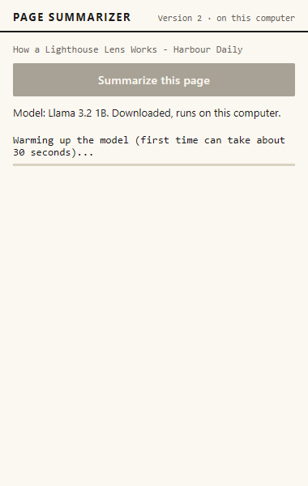

# User interface

The popup is the only screen the reader sees. It opens from the toolbar, is 380 pixels wide, and holds one button, a line about the model, and the result. It contains no logic for summarizing. It asks the service worker to start a job, reads the job record from Chrome's session storage, and draws what it finds (`src/ui/popup.js`). This chapter lists what the popup shows in each state, explains why nothing opens in a new tab, and describes the look that `src/ui/ui.css` gives it.

The popup holds eight parts, in this order from top to bottom (`src/ui/popup.html`). Each one is shown or hidden with its `hidden` attribute.

Table: The parts of the popup

| Element | When it is visible | What it says |
|---|---|---|
| Header | Always | "Page Summarizer", and "Version 2 · on this computer" |
| Page title | When the tab has a title | The page title, in one truncated line |
| Button | Always | "Download model and summarize", "Summarize this page", or disabled while a job runs |
| Model line | Always | The model name, whether it is stored, and its size, or a blocking message |
| Graphics note | Only on integrated graphics | The note about the built-in Intel chip |
| Progress block | While a job runs | A label and a thin bar |
| Error block | After a failure, or for an interrupted job | The plain message for the error code |
| Result block | After a finished job | The summary and a stats line |

**What this means in plain words.** The reader sees one button and one line about the model. Below them appears whichever of progress, error or result applies now.

## What the popup shows, state by state

### Opening the popup

The popup first shows "Checking this computer..." in the model line. Then it asks the service worker for the model state, which gives the model name, whether the model is stored in the browser, and the size of the download. The button reads "Summarize this page" when the model is stored, and "Download model and summarize" when it is not. Opening the popup also starts the hidden page that holds the model, so that the graphics card can be checked. It does not load the model.


The real model reports "about 695 MB" for the same download. The pretend model reports 664 MB, which is why its picture shows a different size.


### Progress labels and the bar

Each phase has its own label. The bar is measured only where the label has a percentage or a part count. Elsewhere it is indeterminate, which the stylesheet draws as a red sweep moving along a grey track.


<!-- check against figure -->

Reading the figure: the phases run in the order the popup shows them. A model that is already stored skips the download label, and a page with one part skips the merge. The table below gives the wording and the bar for each phase.

Table: Progress labels and the bar, from `progressLabel` in `src/ui/popup.js`

| Phase | Label the reader sees | Bar |
|---|---|---|
| Extracting | Reading the page... | Indeterminate |
| Checking | Checking your graphics card... | Indeterminate |
| Downloading | Downloading the model (first time only): N% | Measured, 0 to 100 |
| Loading | Loading the model into the graphics card: N% | Measured, 0 to 100 |
| Warming up | Warming up the model (first time can take about 30 seconds)... | Indeterminate |
| Summarizing, one part | Summarizing... | Measured, but empty until the part is done |
| Summarizing, several parts | Summarizing part k of n..., where k is the part in progress | Measured by finished parts |
| Merging | Combining N summaries... | Indeterminate |

The bar for a single-part page stays empty for the whole answer, because its count moves only when the answer is complete. For several parts, the label names the part in progress, but the bar counts the parts already finished.

### First use: download, load and warm up

The first use goes through the download. The button is grey and cannot be pressed while the download runs. The real screenshot shows 32 percent, and the pretend one shows 25 percent.


Next comes the label "Loading the model into the graphics card", which moves in steps as the weights are placed on the card. The pretend model shows 45 percent.


The warm-up follows. The hidden page sends one short request, so that the graphics programs are compiled before the first part. The label says "about 30 seconds", and the bar is indeterminate.


The warm-up in the clean offline run lasted about half a second, against about 30 seconds in the clean first attempt on the same card. The repository does not explain the difference. The warm-up runs each time the model is loaded into a new hidden page, which happens after the five-minute idle close, so the label can return on a later job. The repository records no measured warm-up after an idle close: [to be measured].

A cached model still goes through loading. In the clean offline run, the popup showed "Downloading the model (first time only): 0%" for a moment during that load, although the model was already stored. The likely cause is `mapInitProgress` in `src/core/gpu-check.js`, which treats any progress text containing "fetch" as a download. The repository does not show WebLLM's exact text for a cached load, so this is a reading of the code: [to be checked]. The label is wrong in that moment, but no download happened.



### Summarizing and merging

With several parts, the popup names the part in progress and moves the bar forward after each finished part.


The merge follows, with the label "Combining N summaries..." and an indeterminate bar. No real-model screenshot of either state is in the repository.


### The result

The result block holds the summary and a stats line, for example "1 part · 1 request · 206.5 s · Llama 3.2 1B". The stats count requests, which are the part answers plus any merge. The field behind the number is still named `apiCalls`, a name kept from Version 1.

The summary sits in a box 360 pixels high that scrolls, so a long list needs scrolling to reach its last points. The pretend result shows the numbered points and the stats line.


After a result arrives, the popup asks for the model state again, so the model line should change to "Downloaded, runs on this computer." In two first-use results the line still reads "Not downloaded yet" under the finished summary. The screenshots are `v2-nvidia-short-popup.png` and `v2-intel-short-popup.png`. The second one is shown below. The code intends the line to change, and the repository does not show whether the screenshots caught the moment before the update, or whether the line failed to refresh: [to be checked].


### The integrated graphics note

On a computer whose graphics chip is built into the processor, the model line names the small model, and a note appears under it: "Graphics: Intel (built into the processor). Answers can be slow. A separate graphics card is much faster." The note has an ochre bar, which is a different colour from the red progress and error bars. It appears before the download.


The vendor name is capitalized because WebGPU reports it in lower case. A browser test caught the lower-case name, and `vendorName()` now maps it.

### Errors and the blocked state

Errors appear in the error block below the progress area, or, for a computer without WebGPU or without 16-bit shader support, in the model line with the button disabled. Each error has its own screenshot in the chapter on errors and fallbacks.

**What this means in plain words.** Each state has one place on the popup. A label that moves tells the reader the job is alive, and a message in the red block says what stopped it.

## Why everything stays in the popup

The popup is the only window. A summary does not open a tab, and Version 2 has no options page: its manifest has no `options_page` entry, and the key box from Version 1 is gone (`finalsem/docs/DECISIONS.md`, D1). This follows the owner's instruction recorded in the Version 1 DEVLOG of 20 October 2026, that the extension should open in a popup, not in a new tab. The browser test V24 checks it, and confirms that a normal summary adds only the popup window.

**What this means in plain words.** The reader never leaves the page to use the tool, and no extra tab appears in the browser.

## Why the popup can be closed and reopened mid-job

The job runs in the service worker, and the popup only reads its record. The record sits under the key `job:<tabId>` in Chrome's session storage. Every change to that record is written by the worker, and the popup listens for those changes and redraws. A popup opened in the middle of a job therefore shows the same progress as the one that was open before.

`src/background/service-worker.js`

```js
function writeJob(tabId, jobId, patch) {
  if (closedTabs.has(tabId)) return Promise.resolve();
  const key = jobKey(tabId);
  const prev = queues.get(tabId) ?? Promise.resolve();
  const next = prev
    .catch(() => {})
    .then(async () => {
      if (closedTabs.has(tabId)) return;
      const current = (await chrome.storage.session.get(key))[key];
      if (!current || current.jobId !== jobId) return; // replaced by a newer job, or removed
      await chrome.storage.session.set({ [key]: { ...current, ...patch, updatedAt: Date.now() } });
      // The tab may have closed while this write was in flight: do not leave the record behind.
      if (closedTabs.has(tabId)) await chrome.storage.session.remove(key);
    });
  queues.set(tabId, next);
  return next;
}
```

The popup also redraws every five seconds. Without that, a job whose worker had died would keep looking busy, because a dead worker writes nothing. The Version 1 DEVLOG records that fault. Browser test V15 checks that a reopened popup shows the same job and then the summary. A job that has not been updated for three minutes is shown as interrupted.

**What this means in plain words.** The summary belongs to the browser, not to the popup. Closing the popup does not stop it, and reopening the popup shows where it has got to.

## The look: a printed page

The stylesheet sets a small palette on `:root`, and every colour in the popup comes from it.

`src/ui/ui.css`

```css
:root {
  --paper: #fbf8f1;
  --ink: #1c1b1a;
  --muted: #6b665c;
  --rule: #d9d2c3;
  --accent: #b4391f;
  --ochre: #8a5a00;
  --serif: Georgia, "Times New Roman", serif;
  --sans: "Segoe UI", system-ui, sans-serif;
  --mono: Consolas, "Courier New", monospace;
}
```

The paper is a warm off-white and the ink is almost black. The one red accent, a brick colour, marks the hover state of the button, the progress bar, the error bar and the numbers of the points. The ochre marks the integrated graphics note. Sans-serif text is used for the controls and the model line, a serif for the summary, and a monospace for the page title, the progress labels and the stats line. The font stacks start with Windows fonts (Segoe UI and Consolas), with fallbacks.

The spacing is plain. The header has a 2-pixel ink rule underneath. The summary's points are divided by 1-pixel hairlines in the rule colour. The button is full width with a 2-pixel corner. The text inputs, which only the old key box used, have none. The stylesheet has no shadows, no icons, no images and no dark-mode rules. Its only gradient is the sweep of the indeterminate bar. Some rules for the Version 1 key box and Options page are still in the file, but the popup does not use them.

The look was chosen after the owner said that the first design looked as if an AI had made it, as `midsem/docs/report/05_technology_choices.md` records. Version 2 keeps the printed-page style.

**What this means in plain words.** The popup uses a few colours, two kinds of type and thin rules. It looks like a printed sheet, and it has no decoration to get in the way of the text.

## Accessibility facts from the markup

The page declares its language (`lang="en"`) and has a viewport tag. The model line and the progress block are marked `aria-live="polite"`, so a change is announced without interrupting. The error block has `role="alert"`. The progress bar is the browser's own `progress` element, not a drawn box. The buttons keep the browser's default focus outline, because the stylesheet does not remove it. The repository has no test of colour contrast or of a screen reader: [to be measured].

**What this means in plain words.** The markup gives the basic signals that assistive software needs. Whether they work with real screen readers has not been checked.

## What went wrong and what is left

The screenshots and timelines show four problems. The model line can lag behind a finished result. The "Downloading" label appears during a cached load. The warm-up label says "first time" each time a new hidden page loads the model. The summary box hides its last points unless the reader scrolls. The DEVLOG also records that the vendor name appeared in lower case, which a browser test caught, and the popup now capitalizes it.

## Limitations

The popup has a fixed width, and its summary is a scrolling box, so long answers need scrolling. There is no dark mode. Colour contrast and screen-reader behaviour have not been measured. The screenshots come from one laptop, not from the client's computer.

### Questions this chapter answers

**What does the reader see first?**
The reader sees one button and a line about the model. The button says "Download model and summarize" until the model is stored, and "Summarize this page" after that. A progress block, an error block or a result block appears below, depending on the job.

**Why does nothing open in a new tab?**
The tool was built to live in the popup. Version 2 has no options page, and the key box from Version 1 is gone. A browser test checks that a normal summary opens only the popup window.

**Can the reader close the popup during a summary?**
Yes. The job runs in the service worker and writes its progress to session storage. Reopening the popup reads the same record and shows the same progress.

**Why does the popup look like a printed page?**
The palette, the serif summary text and the hairline rules were chosen after the owner said the first design looked AI-made. The stylesheet has no shadows, icons or gradients, apart from the sweep of the indeterminate bar.

**What does the popup not yet show clearly?**
Two first-use results show the model as not downloaded under a finished summary, and a cached load can briefly show the download label. Neither is fixed in the repository, and the cause of the stale line is not yet confirmed.
