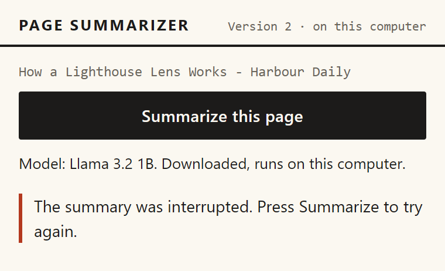
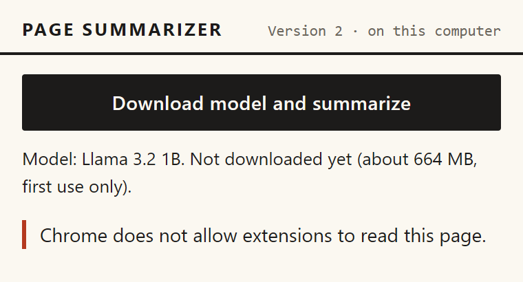
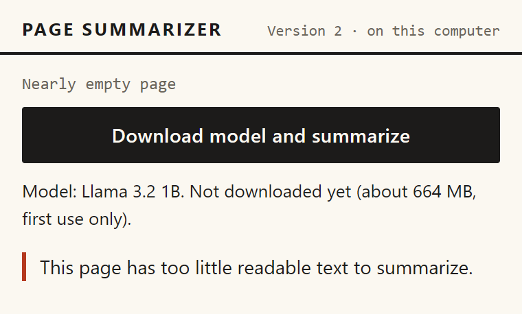
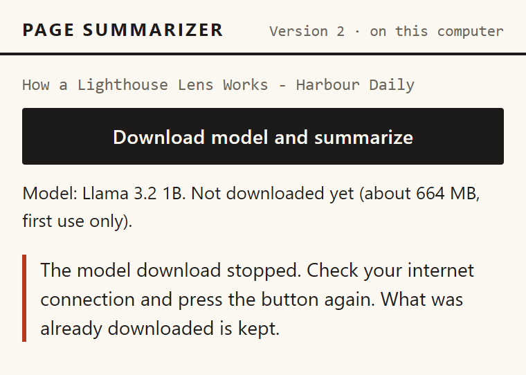
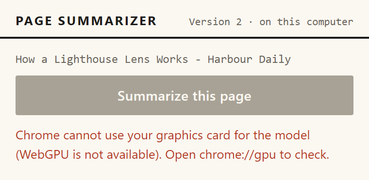
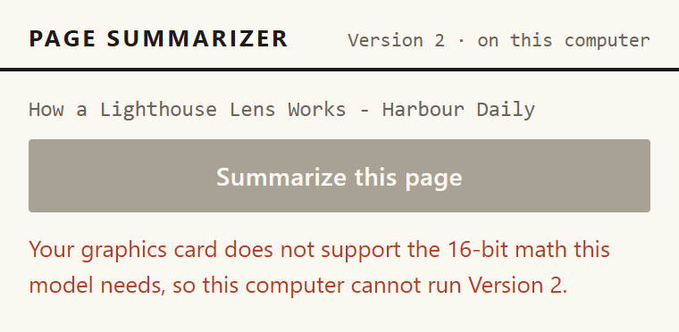
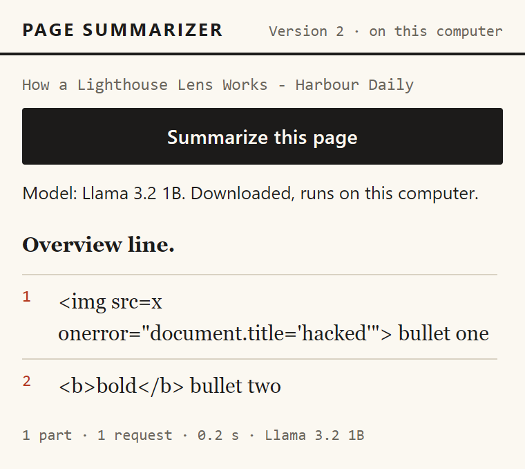
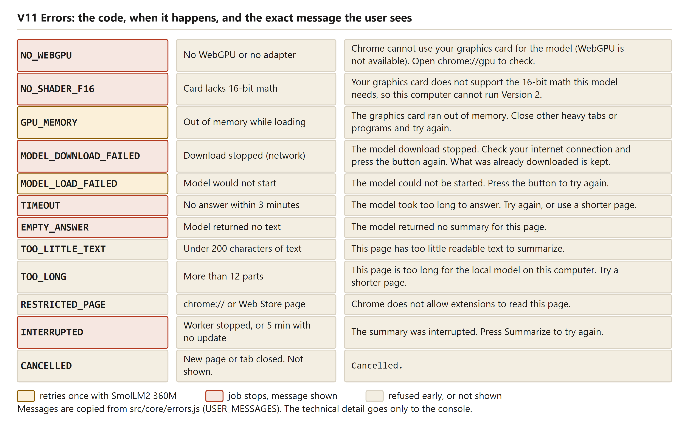

# Errors and fallbacks

Every failure in Version 2 ends in one code and one short plain message. The sentences are in `src/core/errors.js`, and the codes travel from the hidden page to the service worker and then to the popup. The extension never shows the reader a raw message from WebLLM or from Chrome. Some codes also trigger a change of plan, such as a retry with the smaller model, and then a notice explains it. This chapter lists every code, shows how the engine's free-text errors become codes, and says what is saved after each outcome. It describes the code as it is now. The behaviour seen before the fixes is kept only as a short note, and the DEVLOG rows dated 21 October 2026 tell those stories.

The raw detail of an error goes to the console. It is also stored in the job record, under the key `job:<tabId>` in session storage, although the popup never shows it. The comment at the top of `errors.js` says the detail "only goes to the console", which is true for the screen but not for the storage.

## The codes the reader can see

Table: Errors that come from the model, from `src/core/errors.js` and `src/offscreen/offscreen.js`

| Code | When it happens | Exact message | What the extension does next | What the reader can do |
|---|---|---|---|---|
| `NO_WEBGPU` | Chrome has no WebGPU or no graphics adapter | Chrome cannot use your graphics card for the model (WebGPU is not available). Open chrome://gpu to check. | The model line shows it and the button is disabled. No job starts. | Open chrome://gpu and check WebGPU. |
| `NO_SHADER_F16` | The adapter lacks the 16-bit math feature | Your graphics card does not support the 16-bit math this model needs, so this computer cannot run Version 2. | The same as above. | Nothing in the extension changes this. |
| `GPU_MEMORY` | Out of memory while loading, or during an answer | The graphics card ran out of memory. Close other heavy tabs or programs and try again. | While loading, retries once with the small model, and a finished summary carries a notice. During an answer, the job ends. | Close other tabs or programs, then press the button again. |
| `MODEL_DOWNLOAD_FAILED` | The download stops (see the classifier below) | The model download stopped. Check your internet connection and press the button again. What was already downloaded is kept. | The job ends. Nothing is saved as a choice. | Check the connection and press again. |
| `MODEL_LOAD_FAILED` | Loading fails for another reason | The model could not be started. Press the button to try again. | While loading the primary model, retries once with the small model. Otherwise the job ends. | Press again. |
| `TIMEOUT` | One answer takes longer than 10 minutes (it was 180 seconds until 24 October 2026) | The model took too long to answer. Try again, or use a shorter page. | The answer is interrupted, and the job ends with its finished parts dropped. | Try again, or use a shorter page. |
| `CONTEXT_TOO_LONG` | WebLLM refuses a prompt that does not fit the 4,096-token window. A dense part can use more tokens per character than the 6,000-character limit assumes. | A part of this page is too long for the model to read at once, even after it was cut in half. Try a shorter page. | The part is cut in half at a paragraph or sentence break, and each half is summarized, up to three levels deep. The message appears only if the cutting fails too, or if the text is under 600 characters. | Try a shorter page. |
| `EMPTY_ANSWER` | The model returns only spaces, or only a repeated safety sentence and an empty "Summary:" label (seen with SmolLM2 on a Wikipedia page) | The model returned no summary for this page. | The job ends. | Press again. |

Table: Errors from the page and the job, from `src/core/errors.js`, `pipeline.js` and `extract-tab.js`

| Code | When it happens | Exact message | What the extension does next | What the reader can do |
|---|---|---|---|---|
| `TOO_LITTLE_TEXT` | Less than 200 readable characters | This page has too little readable text to summarize. | Refused before any model step. Nothing is downloaded. | Use a page with more text. |
| `TOO_LONG` | More than 12 parts are needed | This page is too long for the local model on this computer. Try a shorter page. | Refused before any download. | Use a shorter page. |
| `RESTRICTED_PAGE` | Chrome internal, extension, file, data or blob pages, and the Chrome Web Store | Chrome does not allow extensions to read this page. | Refused before any model step. | Use another page. |
| `EXTRACT_FAILED` | Injecting the reader script fails for another reason, or the script returns nothing | Could not read the text of this page. | The job ends. | Press again. The popup offers no other step. |
| `SERVICE_ERROR` | The hidden page cannot be reached, sends no answer or an unknown message, or an unexpected error occurs during an answer | Something went wrong inside the extension. Try again. | The job ends, and the popup shows a "Technical detail" line under the message (the first 240 characters of the detail). | Try again. The detail line says what the extension knows. |
| `INTERRUPTED` | Chrome stopped the service worker during a job, or a job has had no update for five minutes | The summary was interrupted. Press Summarize to try again. | The record is marked as an error when the worker next starts. An open popup shows the message after five minutes without an update. | Press Summarize. |
| `CANCELLED` | The tab closed or moved to another page | Cancelled. | The job stops without writing an error. The message is never shown. | Nothing to do. |

Table: Messages the popup writes itself, which are not in `errors.js`

| Where | Message |
|---|---|
| Before the model state arrives | Checking this computer... |
| If the state cannot be read | Could not check this computer. |
| If no tab is open | No page is open in this window. |
| If the start message fails | Could not start the summary. Try again. |
| If an error has no text | Something went wrong. |

**What this means in plain words.** Every failure shows one short message that says what happened and, where possible, what to do. Some failures also change the plan, and the reader is told when the plan changed.

## How a thrown error becomes a code

`describeError` turns any thrown value into the three fields the popup needs: the code, the message and the detail. An error that is already an `AppError` keeps its code. Any other error becomes `SERVICE_ERROR`, and an abort becomes `CANCELLED`. When a code crosses a message channel as `{code, detail}`, `fromWire` rebuilds it, and an unknown code becomes `SERVICE_ERROR`. This keeps the list of codes closed. The popup shows one of the fifteen messages in `errors.js`, or one of the few it writes itself (listed above).

**What this means in plain words.** Whatever goes wrong, the popup only ever gets a known code, so it cannot show a raw error text by accident.

## Turning the engine's errors into codes

WebLLM throws plain errors with free text. The function `classifyEngineError` in `src/core/engine-errors.js` reads the text and picks a code:

`src/core/engine-errors.js`

```js
export function classifyEngineError(err, stage) {
  const text = String(err?.message ?? err ?? '').toLowerCase();
  // WebLLM: "Prompt tokens exceed context window size: number of prompt tokens: N; context window size: 4096"
  if (/prompt tokens exceed|context window size/.test(text)) return ERROR_CODES.CONTEXT_TOO_LONG;
  if (/shader-f16|f16/.test(text) && /(support|feature|require)/.test(text)) return ERROR_CODES.NO_SHADER_F16;
  if (/webgpu|gpu adapter|navigator\.gpu/.test(text) && /(not\s+|un)(supported|available)|no (gpu )?adapter|unavailable/.test(text)) {
    return ERROR_CODES.NO_WEBGPU;
  }
  if (/out of memory|\boom\b|device (was )?lost|maxbuffersize|exceeds the max|too large|allocation/.test(text)) {
    return ERROR_CODES.GPU_MEMORY;
  }
  if (stage === 'load' && /(fetch|network|failed to fetch|net::|timeout|offline|http \d{3}|cache)/.test(text)) {
    return ERROR_CODES.MODEL_DOWNLOAD_FAILED;
  }
  if (stage === 'load') return ERROR_CODES.MODEL_LOAD_FAILED;
  return ERROR_CODES.SERVICE_ERROR;
}
```

The rules run in order, and the first match wins. The `stage` argument separates the loading step from the answer step. The unit tests in `tests/unit/gpu-and-errors.test.js` and `tests/unit/local-engine.test.js` check these examples:

Table: Examples from the unit tests, and the code each one gives

| Message | Stage | Code |
|---|---|---|
| Failed to fetch | load | MODEL_DOWNLOAD_FAILED |
| net::ERR_INTERNET_DISCONNECTED while fetching | load | MODEL_DOWNLOAD_FAILED |
| GPUOutOfMemory: out of memory | load | GPU_MEMORY |
| Device was lost | generate | GPU_MEMORY |
| shader-f16 feature is not supported by this adapter | load | NO_SHADER_F16 |
| WebGPU is not supported in this environment | load | NO_WEBGPU |
| something strange | load | MODEL_LOAD_FAILED |
| something strange | generate | SERVICE_ERROR |
| network exploded | generate | SERVICE_ERROR |
| Prompt tokens exceed context window size: number of prompt tokens: N; context window size: 4096 | generate | CONTEXT_TOO_LONG |

The memory pattern now matches "oom" only as a whole word. Before the fix it matched the letters inside other words, so a message containing "room" would have been read as a memory error. A unit test covers the change.

One weakness remains. At the loading step, any message containing "cache" counts as a download failure. The spike error recorded in the DEVLOG, "Failed to execute 'open' on 'CacheStorage': Unexpected internal error", contains "cache". Under the current rules it would show the download message, which is wrong for that cause. The real WebLLM error texts are known only from that one spike message. The other patterns were written from expected wording and checked with sample strings.

The window message was the gap behind a vague error in the owner's real Chrome on 24 October. On the Intel chip, with the Wikipedia "Lighthouse" page, the popup said "Something went wrong inside the extension. Try again." with no reason. The DEVLOG attributes that message to the classifier, which did not know WebLLM's window message, so the error fell through to SERVICE_ERROR. The detail was not on screen at the time, so the exact text of that run is not in the repository. The window message now maps to CONTEXT_TOO_LONG.

**What this means in plain words.** The engine's free-text errors are sorted into the codes by looking for key words. The memory word now has to stand alone, but the download pattern still reads any "cache" message as a download problem.

## The fallback to the small model

The extension has three routes to the smaller model, SmolLM2 360M. The main model, Llama 3.2 1B, is the default everywhere, including on built-in graphics. Before 26 October the extension also switched to SmolLM2 by itself when the hidden page reported a built-in Intel chip. That automatic switch is removed. The first two routes are decided before anything loads, and the third only after a failed load.

1. Quality: Fast. The reader chooses SmolLM2 under Settings. The choice is stored, the model line follows it, and the stats record `modelSwitchReason` as `quality-fast`. Nothing is saved as a fallback, and no notice appears, because the reader chose it.
2. Small machines. `chooseModel` picks the small model when the browser reports less than 8 GB of memory. Chrome caps that report at 8, so only machines reporting less than 8 are affected. The rule has not been seen on real low-memory hardware: [to be measured].
3. A failed load. If the primary model fails to load with `GPU_MEMORY` or `MODEL_LOAD_FAILED`, the engine retries once with SmolLM2. This is the only route that saves a choice, and the only route that can show the notice.

`src/engines/local.js`

```js
      try {
        engine.loadInfo = await call({ type: 'LOCAL_LOAD', modelId: engine.model.id });
      } catch (err) {
        if (!(err instanceof AppError) || !RETRY_WITH_FALLBACK.has(err.code) || engine.model.id !== MODELS.primary.id) throw err;
        // The primary model did not fit or would not start: remember that and try the small one.
        await onFallback();
        engine.model = MODELS.fallback;
        engine.modelSwitchReason = err.code;
        const small = await call({ type: 'LOCAL_STATUS', modelId: engine.model.id });
        engine.status = small;
        onProgress(small.cached ? { phase: 'loading', percent: 0 } : { phase: 'downloading', percent: 0 });
        engine.loadInfo = await call({ type: 'LOCAL_LOAD', modelId: engine.model.id });
      }
```

The choice is written to `chrome.storage.local` by `onFallback` before the small model is tried. So a saved choice survives even if the small model then fails too. No code path clears it. Every later job, on every page, starts with SmolLM2 until the extension's stored settings are cleared. This is an open limit, not a fixed one. Other errors never retry: a download failure, a missing WebGPU, a missing shader feature, a timeout, and an out-of-memory error during an answer all stop the job.

When the small model writes a finished summary, the popup shows a notice in ochre above it: "The main model did not fit in the graphics card, so the smaller model wrote this summary. It may be less detailed." The popup builds the notice from the stats of the finished job, so the job record's notice field stays empty. No notice appears for Quality: Fast, which the reader chose. Before the fix, a fallback summary carried no notice, and the job record had a notice field that was never drawn.

The browser tests show both sides. Scenario V10 makes the primary model run out of memory: the summary still works on SmolLM2, the notice is shown, and the next popup shows the saved choice. Scenario V11 makes every model run out of memory: the reader sees the memory message, the choice is still saved, and the button is enabled again. The re-shot screenshot `ui-12-fallback-after-out-of-memory.png` shows the notice above a SmolLM2 summary. The re-shot `ui-13-out-of-memory-all.png` shows the memory message. Its model line now names SmolLM2 and says it is not downloaded. Before the fix, the model line stayed on the main model after both had failed.


**What this means in plain words.** A computer that cannot hold the big model is moved to the small one, once, and the reader is told when a summary came from it. After that the choice is remembered, and the big model is not tried again until the stored settings are cleared.

## Timeouts, empty answers and what is lost

Each answer has ten minutes. Until 24 October 2026 the limit was 180 seconds, and a real Intel run on the Wikipedia page hit it. The hidden page starts a race between the answer and a timer. When the timer wins, it calls `interruptGenerate` on the WebLLM engine and reports `TIMEOUT`:

`src/offscreen/offscreen.js`

```js
      const timeout = new Promise((_, reject) => {
        timer = setTimeout(() => {
          engine.interruptGenerate?.();
          reject(Object.assign(new Error('generation timed out'), { name: 'TimeoutError' }));
        }, timeoutMs);
      });
```

The job then stops. The parts already finished are discarded, because a summary is only saved when every part and the merge are done. The reader sees the timeout message and can press again. No automated test covers the TIMEOUT path. The pretend model has no timeout, and the logic lives in the real engine. The unit test checks only that a `TIMEOUT` code passes through unchanged. Whether `interruptGenerate` stops the earlier answer completely is not tested: [to be measured].

An empty answer is a different case. The engine trims the text, and if nothing is left it reports `EMPTY_ANSWER`. A second case is a repeated safety sentence. The small model sometimes answers with the safety sentence of its prompt and an empty "Summary:" label. `stripPageMarkers` now removes both, so such an answer becomes `EMPTY_ANSWER`. Before 26 October the saved Fast answer for the Lighthouse page was exactly that text and was shown as a summary (`docs/test-runs/v2-local-intel-fast.md`). The pretend model mode `empty` shows the message in scenario V13. Nothing is saved, and the reader can press again.

**What this means in plain words.** A slow answer is stopped at ten minutes, and the whole summary is dropped with it. An empty answer is reported as an empty answer, not as a success.

## Interrupted and cancelled jobs

### The service worker was stopped

Chrome can stop the service worker, even in the middle of a job. The job record would then still say "running", and nothing would ever update it. The start-up code finds such records and marks them as interrupted:

`src/background/service-worker.js`

```js
async function sweepOrphans() {
  const all = await chrome.storage.session.get(null);
  for (const [key, job] of Object.entries(all)) {
    if (key.startsWith('job:') && job?.status === 'running' && (job.updatedAt ?? 0) < bootTime) {
      console.warn(LOG, 'marking orphaned job as interrupted', key);
      await writeJob(Number(key.slice(4)), job.jobId, {
        status: 'error',
        phase: 'error',
        error: describeError(new AppError(ERROR_CODES.INTERRUPTED)),
      });
    }
  }
}
```

The popup has a second check. A job that has not been updated for five minutes is shown as interrupted, even if the record still says running. Before the fix, that limit was three minutes, the same length as the 180-second answer timeout, so a slow answer could appear interrupted while it was still running (DEVLOG, 21 October). The answer limit is now ten minutes, longer than this five-minute limit. So the keep-alive message that the hidden page sends to the worker every ten seconds while it works also refreshes the update time of every running job (DEVLOG, 24 October). A working job is not shown as dead, however long one answer takes. Scenario V20 stops the workers on purpose and checks that the job becomes `INTERRUPTED`. The screenshot `ui-17-interrupted.png` shows the popup (pretend model).



### The tab closed or the page changed

Two things cancel a job. When the tab closes, its record is removed and the job is told to stop. When the tab moves to another page and the reader presses again, the old job is stopped and replaced. Writes from the old job are dropped, because each write checks the job id.

The stop signal is checked only between parts and before each merge call. An answer that is already running finishes first. The download is not stopped either. `prepare()` in `src/engines/local.js` does not read the signal, so a download that is in progress when the tab closes runs to the end, the model is kept, and the job stops before its first part. This is an open limit. The repository does not test it: [to be measured].

A cancelled job returns without writing anything. The message "Cancelled." exists, but the reader never sees it. Scenarios V21 and V22 check the two visible results: a press on a new page gets a reply within four seconds, and no record is left for a closed tab.

**What this means in plain words.** When a reader leaves the page, the job stops at the next safe point, and its record is removed or replaced. A download that has already started is not stopped by that.

## Pages that cannot be read

Chrome does not let extensions read some pages. `isRestrictedUrl` in `extract-tab.js` lists the internal, extension, file, data and blob addresses, and the Chrome Web Store. The popup says so and makes no model call. Scenario V05 checks it with `chrome://version`, and the screenshot `ui-16-restricted-page.png` shows the message (pretend model).



A page with too little text, under 200 readable characters, is refused in the same way (`TOO_LITTLE_TEXT`). Scenario V04 checks a near-empty page, and scenario V18b checks a page whose text is still missing when the reader presses. The screenshot `ui-15-too-little-text.png` shows the first case (pretend model).



A page that needs more than 12 parts is refused as too long (`TOO_LONG`, scenario V06). This happens before any download.

**What this means in plain words.** Pages the extension cannot read, or that have nothing to read, are turned away at once with a sentence that says why.

## Downloads and computers that cannot run the model

A failed download is recorded as `MODEL_DOWNLOAD_FAILED`, and the reader sees the message in `ui-14-download-failed.png` (pretend model). Scenario V12 checks that nothing is saved, that the choice is not changed, that the model is not marked as stored, and that a later press succeeds once the download works. The message says that what was already downloaded is kept. The pretend model cannot show a real partial download, so this claim is untested: [to be measured].



A computer without WebGPU or without the 16-bit feature is blocked from the start. The button is disabled and the message sits in the model line, as in `ui-10-no-webgpu.png` and `ui-11-no-shader-f16.png` (pretend model). Scenarios V07 and V08 check both. The reader can do nothing inside the extension to change the result.





**What this means in plain words.** A failed download is safe to retry, and nothing is kept as if it had worked. A computer that cannot run the model is told so once, and the button stays off.

## Which errors were forced, and which were real

Almost every error above was forced with the pretend model. The offscreen page accepts a `mock` mode in its address, and each mode produces one failure on purpose. The 31 browser scenarios (the smoke run, V01 to V29 and V18b) all pass, with 93 unit tests and 15 script checks.

- `nowebgpu` gives `NO_WEBGPU` (scenario V07), and `nof16` gives `NO_SHADER_F16` (scenario V08).
- `oom` gives `GPU_MEMORY` on the primary model only (scenario V10), and `oomall` gives it on every model (scenario V11).
- `downloadfail` gives `MODEL_DOWNLOAD_FAILED` (scenario V12). `empty` gives `EMPTY_ANSWER` (scenario V13).
- `html` shows hostile markup as an answer (scenario V14). The popup prints it as text, and the screenshot `ui-18-hostile-output-as-text.png` shows it (pretend model).
- The service worker was stopped on purpose, which gives `INTERRUPTED` (scenario V20).
- `longprompt` refuses a prompt over 3,500 characters the way WebLLM does, which gives `CONTEXT_TOO_LONG` and the halving (scenario V25).
- `crash` fails with `SERVICE_ERROR` and the detail "mock: something unexpected happened" (scenario V27).
- The page choices in the browser tests give `TOO_LITTLE_TEXT` (V04, V18b), `TOO_LONG` (V06) and `RESTRICTED_PAGE` (V05).



Four codes have no browser scenario that asserts them. `TIMEOUT` and `MODEL_LOAD_FAILED` appear only in unit tests. `EXTRACT_FAILED` appears in no test. `CONTEXT_TOO_LONG` is forced by scenario V25 and `SERVICE_ERROR` by scenario V27. `CANCELLED` has a unit test for its conversion, and V21 and V22 exercise the path without asserting the code.

Three real failures are recorded in the repository. The first is the spike of 21 October 2026, where the DEVLOG records that Cache Storage failed inside the hidden page with `UnknownError: Failed to execute 'open' on 'CacheStorage': Unexpected internal error`. The fix was to store the model in IndexedDB, not a fallback. The real-model runs in `finalsem/docs/test-runs/` all ended with a summary except one. The second is the Intel Wikipedia run, `v2-local-intel-wikipedia-before-fix.md`, which ended in TIMEOUT after 615.6 seconds at the old 180-second limit. The third is the vague message in the owner's real Chrome on 24 October, described above. The slow Intel runs are slow, not failed. The DEVLOG also records that an offline test blocked the extension's own page. That was a fault in the test setup, not an error code.

**What this means in plain words.** Most errors were produced on purpose, so the handling has been checked. The real runs produced three failures: a spike error, a timeout on a long page, and a vague message in the owner's Chrome.

## What is kept after each outcome

Table: What survives each outcome

| Outcome | Model files | Saved choice | Job record |
|---|---|---|---|
| Success | Kept in IndexedDB | None | Done, with the summary |
| `MODEL_DOWNLOAD_FAILED` | Partial files may remain (untested) | None | Error |
| `GPU_MEMORY` while loading | Unchanged | `modelOverride` set to `fallback` | Error, or a summary from SmolLM2 with a notice |
| `TIMEOUT` or `EMPTY_ANSWER` | Unchanged | None | Error |
| `CANCELLED` | A download in progress runs on | None | Removed or replaced |
| `INTERRUPTED` | Unchanged | None | Error, marked at the next worker start, or shown by an open popup after five minutes without an update |

The model files live in IndexedDB, which is why a later job needs no download. The job record lives in session storage until the browser closes. The saved choice lives in extension storage until someone clears it.



Reading the figure: a table of twelve error codes. Each row gives the code, when it happens, and the popup message copied from `errors.js`, coloured by what follows. Yellow rows (GPU_MEMORY and MODEL_LOAD_FAILED) retry once with SmolLM2. Red rows (NO_WEBGPU, NO_SHADER_F16, MODEL_DOWNLOAD_FAILED, TIMEOUT, EMPTY_ANSWER and INTERRUPTED) stop the job with the message shown. Grey rows (TOO_LITTLE_TEXT, TOO_LONG, RESTRICTED_PAGE and CANCELLED) are refused early or not shown. The drawing leaves out SERVICE_ERROR and EXTRACT_FAILED, which the table above covers. It was drawn before CONTEXT_TOO_LONG existed, so that code is not in it. Its footer says the detail goes only to the console, but the code also keeps it in the job record, and the GPU_MEMORY row shows only the loading case.

**What this means in plain words.** A failure leaves the model files and the job record in a known state. Only a memory failure or a failed load while loading changes what the extension remembers.

### Questions this chapter answers

**What does the reader see when something fails?**
One short message, from a fixed list of fifteen codes. Sometimes the message sits in the model line, and sometimes in the error block below the progress area. The technical detail is kept in the console and in the job record, and the reader does not see it.

**Why does a memory error sometimes switch the model?**
When the big model fails to load with a memory error, the extension tries the small one once and saves that choice. A notice then tells the reader that the small model wrote the summary. A memory error during an answer does not switch the model, and the saved choice is never cleared by the extension.

**What happens if the model answers too slowly?**
After ten minutes the answer is interrupted, the job ends with a timeout message, and the parts already finished are dropped. The reader can press again. No automated test covers this path, and whether the stopped answer ends completely is not tested.

**What happens if the reader closes the tab during a summary?**
The job is stopped at the next part boundary, and its record is removed. A download that has already started keeps running, and the model is kept when it finishes. The reader sees nothing about the cancelled job.

**Can the extension tell every error apart?**
Not yet. The memory pattern now needs a whole word, but any "cache" message at loading reads as a download failure. Only two real engine errors are recorded, the spike's Cache Storage error and the window message seen on the Intel chip. Most of the patterns have not been checked against real messages.
