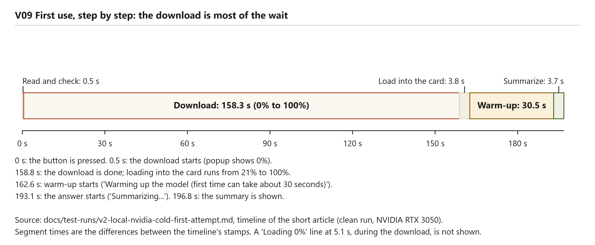
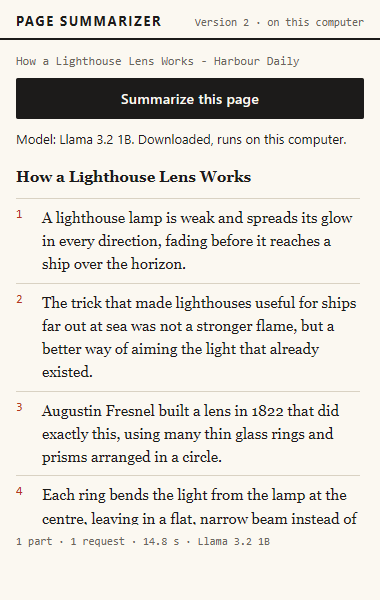
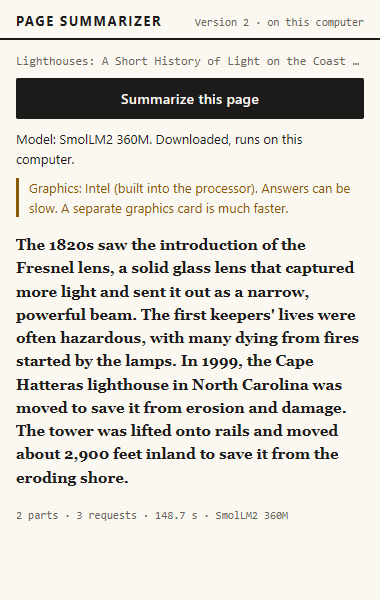
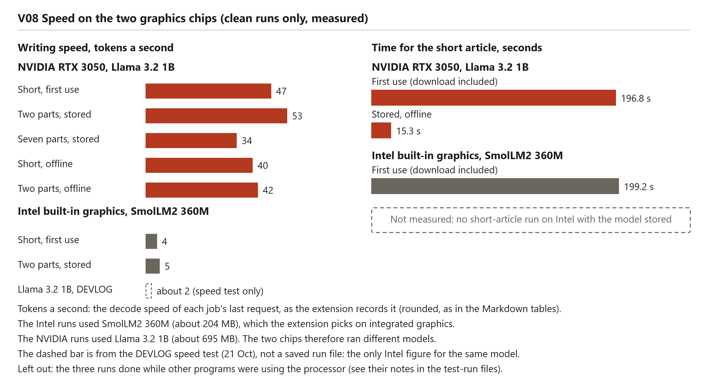

# Testing and results

This chapter reports how Version 2 was tested and what the measurements show. There are three kinds of evidence. Automated tests check the logic and the browser behaviour, with a pretend model that can be made to fail on purpose. A set of Windows checks runs the batch files. Real-model runs measure what the actual model does on the developer's laptop. Each kind answers different questions, so the results are kept apart.

Every saved result is labelled. A run marked **clean** was done with nothing else busy on the laptop, as far as the record says. A run marked **under load** was done while other programs were using the processor, according to the note in its record file. Under-load runs are kept because they were measured, but they are never presented as clean numbers.

## The four test layers

Table: The test layers, what each one covers and how to run it

| Layer | Files | Count | Where it runs | Model used | Command |
|---|---|---|---|---|---|
| Unit tests | `tests/unit/*.test.js` (six files) | 65 | Node.js only, no browser, no network | None; fakes and pure functions | `npm test` |
| Browser tests | `tests/e2e/smoke.test.js`, `tests/e2e/pipeline.test.js` | 26 (the smoke test plus V01 to V24, with V18b) | Hidden Playwright Chromium with the extension loaded | Pretend model (`?mock=<mode>`) | `npm run test:e2e` |
| Windows script checks | `tests/bat/test-bat-scripts.ps1` | 14 | Runs `setup.bat` and `run.bat` in throw-away copies | None | `powershell -File tests\bat\test-bat-scripts.ps1` |
| Real-model runs | `scripts/local-run.mjs` | Three modes, saved as six record files | Hidden Chromium, real model | Llama 3.2 1B or SmolLM2 360M | `node scripts/local-run.mjs nvidia` (and the other modes) |

The secret scan (`scripts/secret-scan.mjs`) is a check before pushing to the repository, not a test of the product. It is covered in chapter 16 and in Appendix A.

The layers answer different questions. The unit tests check the logic of each piece on its own. The browser tests check the whole chain from the button to the summary, with the extension loaded. The Windows checks check the batch files. Only the real-model runs show how fast the real model is and how it behaves on this laptop.

### What this means in plain words

Each layer tests something the others cannot. Only the real-model runs can say how long a real summary takes.

## Unit tests, file by file

Table: The six unit test files, the number of tests in each, and what they cover

| File | Tests | What they cover |
|---|---|---|
| `tests/unit/chunker.test.js` | 10 | Cutting text into parts: empty text, short text, packing paragraphs, splitting at sentence ends and at spaces, cutting a word longer than the limit, keeping the order, rejecting bad limits, and cleaning line endings. Reused from Version 1 unchanged. |
| `tests/unit/merger.test.js` | 8 | Grouping parts within the size limit, merging one part or many, merging in levels when there are too many, no model call for a single part, and failures and cancellation passing up. Reused from Version 1 unchanged. |
| `tests/unit/pipeline.test.js` | 7 | A short page in one call, a long page in parts merged in order, too little text stopping before any model call, extraction and engine failures, cancellation between parts, and the timing clock. Reused from Version 1 unchanged. |
| `tests/unit/local-engine.test.js` | 18 | The engine's contract with a fake offscreen page: the part and merge prompts, empty answers, error codes passed through, the checking, downloading and loading phases, no WebGPU, integrated graphics choosing the small model, a retry with the small model after running out of graphics memory, no retry after a download failure, one offscreen page reused, answers made one at a time, and the idle close. |
| `tests/unit/gpu-and-errors.test.js` | 9 | No WebGPU API, no adapter, no shader-f16 support, a good adapter; the model choice on a normal and on a small computer; the download and loading progress mapping; the classification of engine errors; and a network word during generation not being read as a download failure. |
| `tests/unit/small.test.js` | 13 | Summary formatting that never produces HTML, default settings and stored values, rejected silly values, the two model names, a plain message for every error code, technical detail kept apart from the user message, the prompt layout, restricted addresses, and the same-page check. |

The total is 65. Two of the six files are new in Version 2 (`gpu-and-errors` and `local-engine`), and one (`small`) was changed for it. The other three (`chunker`, `merger` and `pipeline`) are identical to the Version 1 files. The `local-engine` file is the largest because the engine has the most branches: first use, cached use, memory errors, download errors and the idle close.

### What this means in plain words

The 65 small tests check each piece of logic with fake parts. They need no browser and no internet, so they can be repeated at any time.

## Browser tests and the pretend model

The browser tests load the real extension into a hidden Chromium, serve the fixture pages from a small local server, press the real Summarize button and read what the popup shows. A test cannot click the toolbar icon, so the popup is opened as a small popup window. The test copy of the extension gets one extra host permission for the local server. The product manifest is not changed. The real toolbar grant is covered only by the manual smoke test, which is not yet recorded (chapter 16).

The browser tests choose their model through a test seam. The offscreen page reads the `mock` value from its address. The code that builds that address is short:

`src/background/offscreen-manager.js` (the test seam)

```
    if (typeof engineMode === 'string' && engineMode.startsWith('mock')) {
      const mode = engineMode.split(':')[1] ?? 'ok';
      const { mockDelayMs } = await api.storage.local.get('mockDelayMs');
      return `${path}?mock=${encodeURIComponent(mode)}&delay=${Number(mockDelayMs) || 0}`;
    }
```

Most browser tests use this pretend model. The project's decision record (`docs/DECISIONS.md`, D5) gives the reason. The pretend model is fast and free, and it needs no graphics card. It can also be made to fail in exactly the way a test needs: no WebGPU, out of memory, a failed download, an empty answer or hostile output. A real model cannot be made to fail on demand. The pretend model therefore proves the extension's own logic, and the real-model runs prove that the real model works. The browser tests say nothing about how good a real summary is.

A worked example shows the level of detail. Test V01 checks that download percentages never go down while the model downloads:

`tests/e2e/pipeline.test.js` (the V01 check, lines 180 to 185)

```
  const percents = downloadPercents(lines);
  assert.ok(percents.length >= 2, `expected several download percentages, the popup showed: ${JSON.stringify(lines)}`);
  for (let i = 1; i < percents.length; i += 1) {
    assert.ok(percents[i] >= percents[i - 1], `download percentage went down: ${percents.join(' -> ')}`);
  }
```

The saved run is `docs/test-runs/run-1.md`. It was run with `npm run test:e2e` on 21 October 2026. All 26 browser tests passed in each of three runs in a row, at about 77 seconds per run. The table below reproduces the scenarios in plain words. The scenario IDs are the same as in the test file.

Table: The 26 browser scenarios, what each one checks, and the result in run 1

| ID | What the scenario checks | Result |
|---|---|---|
| smoke | A first run shows the model line, a download bar and a summary. A second run skips the download. | Pass |
| V01 | A first run shows download percentages that only rise, a warm-up, and a summary. Afterwards the popup shows the model as downloaded. | Pass |
| V02 | The job passes through its phases in order: extracting, checking, downloading, loading, summarizing. | Pass |
| V03 | A long article is cut into four parts, summarized in order, and merged. The stats say four parts. | Pass |
| V04 | A near-empty page is refused for too little text, and the model is not downloaded. | Pass |
| V05 | A restricted Chrome page is refused before any model work starts. | Pass |
| V06 | A page that needs more parts than the limit is refused as too long, with no download. | Pass |
| V07 | A computer without WebGPU shows that in the model line. The button is disabled and a script press starts no job. | Pass |
| V08 | A computer without 16-bit shader support gets the same treatment. | Pass |
| V09 | Integrated graphics shows a note that names Intel, the small model is used, and a summary works. | Pass after fix 1 |
| V10 | When the main model runs out of memory, the small model writes the summary, the choice is saved, and the next popup shows it. | Pass |
| V11 | When every model runs out of memory, the error says so, the choice is saved, and Summarize is enabled again. | Pass |
| V12 | A failed download shows an error and saves nothing. A later press succeeds once the download works. | Pass |
| V13 | An empty answer from the model is reported as no summary. | Pass |
| V14 | Markup in the model's answer is shown as plain text and is never rendered. | Pass |
| V15 | A popup closed during a job shows the same job when it is reopened, then the summary. | Pass |
| V16 | A finished job is still shown when the popup reopens, and no new job starts. | Pass |
| V17 | After the tab moves to another page, the old summary is hidden and Summarize is enabled. | Pass |
| V18 | Text that arrives late, after 1.5 seconds, is still summarized. | Pass |
| V18b | Text still missing when Summarize is pressed is refused for too little text. | Pass |
| V19 | An article with a table is summarized without failure. | Pass |
| V20 | A service worker stopped during a job leaves the job marked interrupted, and the popup says so. | Pass |
| V21 | Pressing Summarize on a new page while an old job runs gets a reply within four seconds. | Pass |
| V22 | A tab closed during a job leaves no job record behind. | Pass after fix 2 |
| V23 | The offscreen page closes after the idle time, and the next summary still works. | Pass |
| V24 | A normal summary opens only the popup window. No tab and no options page open. | Pass |

Run 1 found two faults in the extension and fixed both. Fix 1 changed the vendor name in the graphics note (scenario V09). Fix 2 stopped a job record from coming back after its tab closed (scenario V22). Both are told in chapter 15. Run 1 also found three faults in the test setup itself, which are told in the same chapter.

### What this means in plain words

The browser tests press the real buttons, but on a fake model. They prove that the popup, the background worker and the offscreen page work together and handle failures, and they say nothing about the quality of a real summary.

## The real-model runs: how they were measured

The real-model script `scripts/local-run.mjs` measures the real model in hidden Chromium with the extension loaded. It has three modes, and each one keeps its own browser profile folder, so the downloaded model is kept between runs.

Table: The three real-model modes and their settings

| Mode | Chrome flags | Outside websites | Profile folder | Cases run |
|---|---|---|---|---|
| `nvidia` | `--force_high_performance_gpu` | Allowed | `.model-profile` | Short article, long article, Wikipedia "Lighthouse" (live) |
| `nvidia-offline` | The same flag, plus a host rule that maps every outside address to "not found" | Blocked; the cache only | `.model-profile`, the same folder as `nvidia` | Short article, long article |
| `intel` | None | Allowed | `.model-profile-intel` | Short article, long article |

The script records the popup's text with a time stamp every time it changes, the wall time from the click to the result, the job's own statistics (model, parts, requests, load time and writing speed) and three screenshots: the download, the warm-up and the final popup. Each run writes a JSON file and a Markdown table into `docs/test-runs`. A first use needs a profile that does not yet hold the model. Later runs in the same mode use the stored model.

The script's `nvidia-offline` mode works by making every outside address unreachable, so the summary has to come from the copy stored in the browser. The development log records why the extension folder must stay the same between runs (chapter 15).

Table: The saved real-model record files and their labels

| Record file | Mode and state | Label | Note |
|---|---|---|---|
| `v2-local-nvidia-cold-first-attempt.md` | `nvidia`, first use | Clean | Markdown only; no JSON file in the folder |
| `v2-local-nvidia.md` | `nvidia`, first use | Under load | JSON file present |
| `v2-local-nvidia-cold-second-attempt-with-load.md` | `nvidia`, first use | Under load | The same numbers as `v2-local-nvidia.md`; it looks like a copy |
| `v2-local-nvidia-offline.md` | `nvidia-offline`, cached | Clean | JSON file present |
| `v2-local-nvidia-offline-first-attempt-with-load.md` | `nvidia-offline`, cached | Under load | Markdown only |
| `v2-local-intel.md` | `intel`, first use | Clean | JSON file present |

The clean label follows the project's list of clean runs. The under-load label follows each file's own note. The JSON file `v2-local-nvidia.json` holds the same 207 s run as `v2-local-nvidia.md`, and the popup screenshot `v2-nvidia-short-popup.png` was taken from that same run.

### What this means in plain words

The real-model runs record every step the popup showed, with the time it showed it. Each result is labelled clean or under load, so a slow number cannot pass as a fast one.

## Results: first use on the NVIDIA chip

The first use means the model is downloaded and loaded for the first time. The clean run is in `v2-local-nvidia-cold-first-attempt.md`. The run under load is in `v2-local-nvidia.md`.

Table: First use on the NVIDIA chip, clean run and run under load

| Measure | Clean run | Run under load |
|---|---|---|
| Short article, total time | 196.8 s | 207 s |
| Long article, total time (2 parts) | 15.9 s | 17 s |
| Wikipedia "Lighthouse", total time (7 parts) | 74.1 s | 101.6 s |
| Writing speed, short article | 47 tokens a second | 38 tokens a second |
| Writing speed, long article | 53 tokens a second | 44 tokens a second |
| Writing speed, Wikipedia | 34 tokens a second | 39 tokens a second |

The first-use total is about 10 seconds longer under load. The timeline of the two runs shows where the time went. The table below splits the short article run into its stages.

Table: Stages of the short article's first use, in seconds after the click

| Stage | Clean run | Run under load |
|---|---|---|
| Download, from start to 100% | About 157.5 (from 0.5 to 158.0) | About 137 (from 1.8 to 138.7) |
| Loading into the graphics card | About 4.6 (158.0 to 162.6) | About 7.7 (138.7 to 146.4) |
| Warm-up, the first answer compiling the card's programs | About 30.5 (162.6 to 193.1) | About 56 (146.4 to 202.4) |
| Writing the answer | About 3.7 (193.1 to 196.8) | About 4.6 (202.4 to 207) |

The table shows that the clean run's download was slower, not faster. The under-load run's warm-up was about 25 seconds longer, and that stage is where a busy processor would show most. The download depends on the network speed, which the test did not control. These two runs cannot prove the cause of the difference. The file's own note says the slower numbers came from other programs running, but the timeline shows the extra time in the warm-up stage, not in the download.

Figure V09 shows the stages of the clean run as a timeline.


<!-- check against figure -->

Reading the figure: the bar for the download is the longest part of the first use. The warm-up is the second longest. The popup shows the warm-up message "Warming up the model (first time can take about 30 seconds)..." during that stage, so the reader is told why the wait is long.

The Wikipedia article shows the difference more clearly, because the same steps were slower one after another. Each line below is the time a part started in each run.

Table: Wikipedia "Lighthouse" (7 parts), time in seconds at which each step started

| Step | Clean run | Run under load |
|---|---|---|
| Part 1 | 3.2 | 5.1 |
| Part 2 | 7.8 | 12.4 |
| Part 3 | 17.0 | 21.7 |
| Part 4 | 22.5 | 30.6 |
| Part 5 | 30.1 | 37.2 |
| Part 6 | 38.1 | 50.1 |
| Part 7 | 54.7 | 65.8 |
| Combining the seven summaries | 60.2 | 80.5 |

In the Wikipedia run, every step was slower under load. That pattern is consistent with a busy processor, but the test does not measure the processor's use, so the cause is not proven.

The screenshot below is the popup after the under-load first-use run. The picture was taken at the moment the summary appeared.


Real-model screenshot, first-use run under load. The summary is the start of the Lighthouse article. The stats line reads 206.5 s, which is the job's own time, while the table above gives 207 s, the script's wall time. The model line still reads "Not downloaded yet". The popup refreshes that line after the summary appears, and the picture was taken as soon as the summary appeared, so it shows the state from before the press.

### What this means in plain words

The first use takes about three minutes on this laptop, most of it downloading and warming up. The clean run was not faster on every stage, so the 10 seconds between the two runs should not be read as a clear effect of other programs.

## Results: offline use on the NVIDIA chip

Offline use means the model is already stored in the browser, and every outside website is blocked. The summary still has to be made. The clean run is in `v2-local-nvidia-offline.md`. The run under load is in `v2-local-nvidia-offline-first-attempt-with-load.md`.

Table: Offline use on the NVIDIA chip, clean run and run under load

| Measure | Clean run | Run under load |
|---|---|---|
| Short article, total time | 15.3 s | 13.4 s |
| Long article, total time (2 parts) | 16.5 s | 32.2 s |
| Load time in the stats (loading and warm-up, the model already stored) | 6.9 s | 7.7 s |
| Writing speed, short article | 40 tokens a second | 48 tokens a second |
| Writing speed, long article | 42 tokens a second | 29 tokens a second |

The offline result is mixed. The short article was faster under load. The long article took about twice as long under load, and its writing speed fell to 29 tokens a second. The note in the under-load file says that run "is slower than the clean run". That is true for the long article only. Two pairs of runs are too few to say what load does to offline speed.

The load time of 6.9 seconds is faster than the 8 to 13 seconds recorded in the development log for the earlier spike. The log's figure came from an earlier test, and the saved clean run is the measurement used in this report.

The popup screenshot below is from the clean offline run.



Real-model screenshot, offline short article, clean run. The model line reads "Downloaded, runs on this computer", and the button reads "Summarize this page". The stats line reads 14.8 s. That is the job's own time, while the table above gives 15.3 s, the script's wall time, which includes the time the popup took to show the result.

### What this means in plain words

Once the model is stored, a short article takes about 15 seconds on this chip, and no internet is needed. Two pairs of runs are too few to say how much a busy laptop changes that.

## Results: the integrated Intel chip

The Intel chip is built into the processor. Its results come from the `intel` mode, which does not force the separate card. The extension chose the small model (SmolLM2 360M) by itself, because the chip is integrated. The clean run is in `v2-local-intel.md` and `v2-local-intel.json`.

Table: Clean run on the Intel chip, the automatic small model

| Measure | Short article | Long article (2 parts) |
|---|---|---|
| Total time | 199.2 s | 149.1 s |
| Download (small model, about 204 MB) | 0.9 to 81.2 s | Already stored |
| Loading into the graphics card | 81.6 to 83.3 s | Already stored |
| Warm-up | 83.7 to 123.1 s (about 39 s) | Already stored |
| Writing the answer | 123.1 to 199.0 s (about 76 s) | Parts: 0.9 s and 65.7 s; merge from 122.6 s |
| Writing speed | 4 tokens a second | 5 tokens a second |

The popup for the short article shows the graphics note that the extension adds for integrated chips. The note reads "Graphics: Intel (built into the processor). Answers can be slow. A separate graphics card is much faster."


Real-model screenshot, Intel chip, short article, first use. The graphics note and the model line are shown. The summary begins with the text `<<<PAGE TEXT START>>>`, which is a marker from the prompt, and it is shown as a plain first line. This is a defect, described below.



Real-model screenshot, Intel chip, long article, clean run with the model already stored. The stats line reads "2 parts · 3 requests · 148.7 s · SmolLM2 360M". The table above gives 149.1 s, the script's wall time.

The marker text is a real defect in the saved output. The short Intel summary begins with the prompt's start marker and ends with its end marker. The record text starts like this:

```
<<<PAGE TEXT START>>>
A lighthouse lens works by using many thin glass rings to bend the light.
```

No code in `src` removes the markers from an answer. The markers appear only in the prompt, so the most likely cause is that the small model repeats the marker text it was given. Of the seven summaries saved in the three JSON files, this is the only one that contains the markers.

### What this means in plain words

On the built-in chip, the small model writes a short summary in a little over three minutes on first use, and a two-part article in about two and a half minutes. The answers work but are slow. The first short answer also shows the prompt's marker text, which a reader would see as a fault.

## What the saved summaries show

The three JSON files hold seven summaries: three from the NVIDIA first-use run under load, two from the clean NVIDIA offline run, and two from the clean Intel run. The table lists each one and what a reader sees in it. The check is about form and the facts that can be checked from the repository. The Wikipedia article is live and is not in the repository, so its facts cannot be checked here.

Table: The seven saved summaries and what they show

| Record | Case | Bullets | What a reader sees |
|---|---|---|---|
| `v2-local-nvidia.json` | Short article, under load | 5 | Opens with a heading line and five bullets. No fault seen |
| `v2-local-nvidia.json` | Long article, under load | 10 | Repeats labels from the merge prompt ("Page title:", "These are summaries of consecutive parts", "Part 1:", "Part 2:"). Gives "around 3000 BC" for the Pharos lighthouse, where the page says "the third century BC" |
| `v2-local-nvidia.json` | Wikipedia, under load | 12 | Heading line and twelve bullets. The prompt asked for three to six |
| `v2-local-nvidia-offline.json` | Short article, clean | 8 | Heading line and eight bullets. The prompt asked for three to six |
| `v2-local-nvidia-offline.json` | Long article, clean | 5 | Opens with a heading. The first bullet is "Page title provides a brief overview of the content within.", which gives no fact |
| `v2-local-intel.json` | Short article, clean | 0 | Begins with the prompt's start marker. See the marker defect above |
| `v2-local-intel.json` | Long article, clean | 0 | One paragraph of five sentences. No fault seen in the form |

Three of the five summaries that use bullets go beyond the six the prompt allows. The NVIDIA long-article summary is the clearest case of a fault in the content, so its opening lines are shown here as they were saved:

```
Lighthouses: A Short History of Light on the Coast

- Page title: Lighthouses: A Short History of Light on the Coast
- These are summaries of consecutive parts of one web page
- Part 1: Lighthouses have been used for navigation and safety for thousands of years
- The first lighthouse was built on the island of Pharos in Egypt around 3000 BC
```

The fixture article says the Pharos lighthouse "was built in the third century BC during the reign of the Ptolemies". The model's date is therefore wrong, and the labels are copied from the instructions, not from the article. Each record is a single run, so the table shows what happened in those runs, not how often it happens.

### What this means in plain words

The model follows the structure of the prompt, but its answers can copy the prompt's labels, add a wrong date, or give a bullet that says nothing. A reader cannot tell which parts are right without checking the page.

## Speed: NVIDIA against Intel

The speed of writing is measured in tokens a second. A token is a piece of a word, so a higher number means the answer appears faster. The table below gathers the measured values and labels each one. The two chips were not compared with the same model in the saved runs, and that matters for reading the table.

Table: Writing speed on the two chips, with the model and the source of each number

| Chip | Model | Writing speed (tokens a second) | Source | Label |
|---|---|---|---|---|
| NVIDIA RTX 3050 | Llama 3.2 1B | 40 (short), 42 (long) | Clean offline run | Clean |
| NVIDIA RTX 3050 | Llama 3.2 1B | 47 (short), 53 (long), 34 (Wikipedia) | Clean first-use run | Clean |
| NVIDIA RTX 3050 | Llama 3.2 1B | Between 29 and 48 across the under-load runs | Two under-load records | Under load |
| Intel built-in | SmolLM2 360M (chosen automatically) | 4 (short), 5 (long) | Clean Intel run | Clean |
| Intel built-in | Llama 3.2 1B | About 2 | Earlier speed test, recorded in the development log; no saved run file | Not a saved run |

The development log records a separate figure for the separate card. Its speed test with the 1 billion parameter model measured about 63 tokens a second, against about 2 on the built-in chip. The log also records about 600 tokens a second for reading the prompt. That reading speed is not kept in any saved run file, because the runs do not store it.

The comparison that matters most is the same model on both chips. The saved runs do not contain that pair in full, because the Intel runs used the small model. The chart below uses the numbers above and labels each bar. The rule is that the Intel small-model bars are not a like-for-like comparison with the NVIDIA large-model bars.


<!-- check against figure -->

Reading the figure: the NVIDIA bars are from the clean runs with the 1 billion parameter model. The Intel bar with the small model is from the clean Intel run. The Intel bar with the large model is marked as an earlier speed test, not a saved run. Each bar carries its label.

### What this means in plain words

With the large model, the separate card wrote roughly 15 to 30 times as fast as the built-in chip, depending on which measured figure is used. The built-in chip is usable only with the smaller model, and even then it is slow.

## What these tests do not show

The honest limits of the results are listed here. The list is taken from `run-1.md` and the README, and it is kept as the authors wrote it, in plain words.

From run 1, the browser tests do not show:

- real summary quality, because the pretend model returns fixed text;
- real download speed, graphics-card behaviour or shader warm-up, which are covered only by the real-model records;
- the visible Chrome the client will use, because every test ran in hidden Chromium.

From the README, these items are not yet verified:

- a test on the client's laptop, because its details were requested and have not been received;
- `setup.bat --gpu` against a real Chrome installation;
- a manual click-through in the visible Chrome, using the V2 checklist;
- languages other than English, because the model is small and is meant for English text.

Two more limits apply to the real-model records. They cover only the pages named in the table of cases: two fixture articles and one live Wikipedia page. No formal rating of summary quality exists in the repository, so a claim that a summary is good or poor is an opinion, and this report does not make one.

### What this means in plain words

The tests prove the logic and the real model's speed on one laptop. They do not prove how good the summaries are, how the extension behaves in visible Chrome, or how it runs on the client's laptop.

## Questions this chapter answers

**Why do most browser tests use a pretend model?**
A real model cannot be made to fail on demand, and it needs a graphics card and a long download. The pretend model is fast, free and forced into each failure case, such as no WebGPU or out of memory. The real-model runs then cover what the pretend model cannot.

**Which results are clean, and which were done under load?**
The clean results are the NVIDIA first-use run in `v2-local-nvidia-cold-first-attempt.md`, the NVIDIA offline run in `v2-local-nvidia-offline.md`, and the Intel run in `v2-local-intel.md`. The first-use and Wikipedia runs in `v2-local-nvidia.md` were done while other programs were busy, and they are kept as records. The two sets are shown side by side and are not mixed.

**Why is the first use so much slower than later uses?**
The first use downloads the model, which took most of the time in the clean run. It then loads the model and warms up the graphics card, which takes about 30 seconds more. Later uses skip the download, so the offline short article takes about 15 seconds.

**How does the NVIDIA chip compare with the Intel chip?**
The NVIDIA chip wrote between about 29 and 53 tokens a second with the large model. The Intel chip wrote about 4 to 5 tokens a second with the small model that the extension chooses for it, and about 2 with the large model in an earlier speed test. The comparison of the same model on both chips rests on that earlier test, which has no saved run file.

**Can the results be trusted for the client's laptop?**
Not yet. Every real-model number comes from the developer's laptop, which has an NVIDIA RTX 3050 and a built-in Intel chip. The client's graphics chip, memory and free disk space have been requested and have not arrived, so the client's results are still [to be measured].
