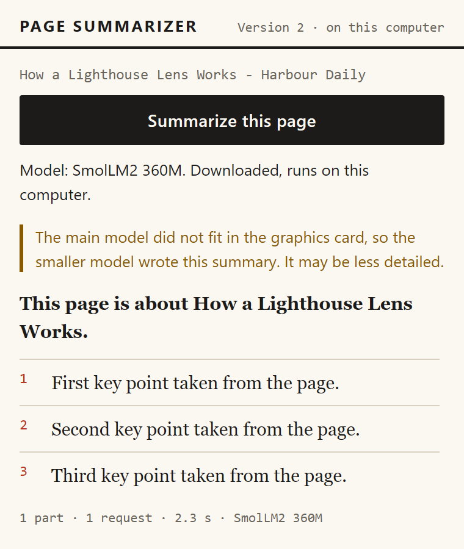
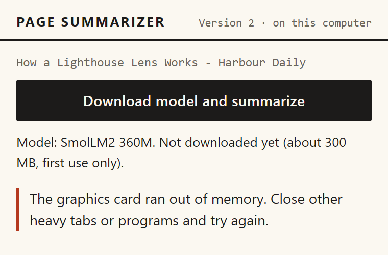

# Problems and solutions

This chapter tells the problems met while building Version 2. The sources are kept narrow on purpose. The stories come from the rows of the development log dated 21 October 2026, which are the Version 2 rows, and from the first browser test run, `docs/test-runs/run-1.md`. The rows dated 20 October 2026 belong to Version 1 and are not repeated here.

Each problem is told in the same order: what was seen, the cause, the fix, and then what it means in plain words. The fixes described are the ones in the code now. Where the record says a cause was not proved, this chapter says so. Problems 8 to 11 were found while the report was being written, by reading real summaries, by the screenshot run, and by reading the code. Problem 12 is the failure in the real Chrome on 24 October, problem 13 is the ten-minute page of 26 October, problem 14 is the echoed safety sentence of 26 October, and problem 15 is the set of faults in the test setup that run 1 found.

## The model cache refused to open

**What was seen.** The first real attempt to run the model library inside the hidden offscreen page stopped at once. The error was `UnknownError: Failed to execute 'open' on 'CacheStorage': Unexpected internal error`.

**Cause.** The library stores the model in Cache Storage by default. Inside the extension's offscreen page, Cache Storage did not work. IndexedDB did, with about 10.7 GB of quota in the test. A normal extension page had worked, so only this kind of page was affected.

**Fix.** The library is told to keep the model in IndexedDB. The setting is one line in the offscreen page.

`src/offscreen/offscreen.js` (the cache setting)

```
// Cache Storage fails inside an offscreen page ("Unexpected internal error"), IndexedDB works,
// so the model is stored in IndexedDB. (Found by a spike; see DEVLOG.md.)
const APP_CONFIG = { ...prebuiltAppConfig, cacheBackend: 'indexeddb' };
```

The change has a side effect. The extension asks for the `unlimitedStorage` permission, which is listed in `manifest.json`. Without it, the browser could delete the model of about 700 MB when disk space runs low (`docs/DECISIONS.md`, D2).

### What this means in plain words

A library's default storage can fail inside a particular kind of page. Test each browser feature in the exact page type that will use it before building on top of it.

## The spike that printed nothing

**What was seen.** The first spike printed nothing for two minutes. Later runs printed nothing either.

**Cause.** There were two separate causes. First, an offscreen page has only the runtime messaging API. It has no `chrome.storage`, so the logging call failed silently. Second, a later edit put an apostrophe in "lamp's" inside a single-quoted string, which broke the whole script. The first suspicion fell on the offline setting, which was not one of the two causes.

**Fix.** The offscreen page reports through messages, and the service worker stores what it receives. The header of `offscreen.js` states the rule: the page "has only the chrome.runtime API (no chrome.storage, no chrome.tabs), so it works purely by messages". Every script is also checked with `node --check` before a run, which catches syntax faults at once.

### What this means in plain words

A broken script looks like a broken environment. Check the syntax first, and remember that an offscreen page can only talk by messages.

## Chromium chose the weak graphics chip

**What was seen.** The 1 billion parameter model wrote about 2 tokens a second, and the first answer took 36 seconds. A token is a piece of a word, so this was far too slow for a useful summary.

**Cause.** Chromium picked the Intel graphics built into the processor, although the code asked for the high-performance card. The request is made in `offscreen.js` with `powerPreference: 'high-performance'`, but Chromium did not follow it on this laptop. Starting the browser with `--force_high_performance_gpu` made it choose the NVIDIA RTX 3050. The development log records about 63 tokens a second while writing, about 600 tokens a second while reading the prompt, and about 1.5 seconds for a prompt of 250 tokens. The log does not say which text was used for those figures, and no saved run file holds them. The first answer on either card also spends about 30 seconds compiling the graphics programs.

**Fix.** The extension warms the model up right after loading, and it shows the message "Warming up the model". The warm-up is the step that compiles the programs, so the first real part does not look frozen.

`src/offscreen/offscreen.js` (the warm-up after loading)

```
        emitProgress({ phase: 'loading', percent: 100, text: 'Warming up the model (first time only)' });
        await engine.chat.completions.create({ messages: [{ role: 'user', content: 'Say ok.' }], max_tokens: 1, temperature: 0 });
        return { ok: true, loadMs: Math.round(performance.now() - t0) };
```

At that time, on built-in graphics, the extension switched to the small model on its own and showed a note. That automatic switch was removed on 26 October (problem 13). The opt-in `setup.bat --gpu` offers the Windows setting that asks for the separate card (chapter 13).

### What this means in plain words

The same laptop can be about thirty times faster or slower depending on which chip Chrome uses. Measure on the path the client will use, and tell the reader on screen which chip is in use.

## The offline check and the moving folder

**What was seen.** With Playwright's offline switch on, the extension's own page never loaded. A second run, with every outside site blocked, reported "Not downloaded yet", even though the model was already stored.

**Cause.** There were two causes. Playwright's offline mode also blocks the extension's own pages. In addition, the test setup copied the extension into a new temporary folder at every launch. Chrome gave the copy a new extension ID, and the browser storage from earlier runs belonged to the old ID, so the new run could not see it.

**Fix.** Outside sites are blocked with a host-resolver rule, and the local test server stays reachable because it is excluded from that rule. The measuring script also loads the extension from one fixed folder, so its ID stays the same. The two relevant lines are in `scripts/local-run.mjs`.

`scripts/local-run.mjs` (the offline mode and the fixed folder)

```
  'nvidia-offline': { profile: '.model-profile', args: ['--force_high_performance_gpu', '--host-resolver-rules=MAP * ~NOTFOUND, EXCLUDE 127.0.0.1'], online: false, cases: ['short', 'long'] },
  ...
  extensionDir: path.join(root, plan.profile + '-ext'), // fixed folder: same extension id on every run
```

### What this means in plain words

An unpacked extension gets its identity from its folder. If the folder changes, the stored data is lost to the new copy. Keep the folder fixed whenever the stored model must survive between runs.

## The vendor name in lowercase

**What was seen.** Browser test V09 failed. The popup showed "Graphics: intel (built into the processor)", with the vendor name in lowercase. Run 1 lists the same fault as its first problem.

**Cause.** WebGPU reports the vendor name in lowercase, and the popup printed it exactly as it came.

**Fix.** The function `vendorName()` in `src/ui/popup.js` maps the known names to their usual spelling, and it capitalizes any other name.

`src/ui/popup.js` (the mapping of vendor names)

```
const VENDOR_NAMES = { intel: 'Intel', nvidia: 'NVIDIA', amd: 'AMD', apple: 'Apple', qualcomm: 'Qualcomm', arm: 'Arm' };
export function vendorName(vendor) {
  const v = String(vendor ?? '').toLowerCase();
  return VENDOR_NAMES[v] ?? (v ? v[0].toUpperCase() + v.slice(1) : 'built-in');
}
```

### What this means in plain words

A string from a system interface is data, not a sentence for the reader. It needs converting before it is shown, and the test that reads the screen is what caught it.

## A job record came back after its tab closed

**What was seen.** Browser test V22 found that after a tab was closed during a model download, a job record for that tab appeared again in `chrome.storage.session`.

**Cause.** The development log gives the most likely cause, though the failure was not caught in the act. Version 2 writes progress many times a second, for the download and the loading percentages. A write that was already queued when the tab closed could finish after the record had been removed, and so it wrote the record back. Run 1 notes that Version 1 had a similar fault (B4), which was fixed by remembering closed tabs. Version 2 adds many more writes, so the gap between checking and writing was wide enough to hit.

**Fix.** The handler that runs when a tab closes now removes the record only after the queued writes for that tab have finished. A write that finishes after the tab has closed removes its own record.

`src/background/service-worker.js` (the queued write and its cleanup)

```
      const current = (await chrome.storage.session.get(key))[key];
      if (!current || current.jobId !== jobId) return; // replaced by a newer job, or removed
      await chrome.storage.session.set({ [key]: { ...current, ...patch, updatedAt: Date.now() } });
      // The tab may have closed while this write was in flight: do not leave the record behind.
      if (closedTabs.has(tabId)) await chrome.storage.session.remove(key);
```

### What this means in plain words

Once a fault is found and fixed, look for the same pattern wherever the code now does more of the same work. Here the work was writing progress, and the fix had to cover every write that could still be running when the tab closed.

## The integrated chip is slow

**What was seen.** On the Intel chip, the short article took 199.2 seconds on first use. That time was made up of about 81 seconds of download, about 40 seconds of warm-up and 76 seconds of writing the answer. A two-part article took 149.1 seconds.

**Cause.** The built-in chip writes text slowly. The record shows 4 to 5 tokens a second with the small model SmolLM2, and about 2 tokens a second with the 1 billion parameter model in the earlier speed test.

**Fix.** The development log records no code change for this run. The automatic switch to the small model was in place at the time and kept the chip usable, though not fast. That switch was removed on 26 October (problem 13). The popup says that a separate graphics card is much faster. `setup.bat --gpu`, or the Windows Graphics setting, moves Chrome to the separate card.

### What this means in plain words

A weak chip is not an error. At the time, the extension gave a note and used a smaller model instead of refusing to run. Since 26 October the default model is the same on every chip, and a weak chip is handled by reading less of the page.

## The "Downloading" line for a stored model

**What was seen.** In the clean offline run, the popup said "Downloading the model (first time only): 0%" for about 0.8 seconds, although the model was already stored. The line appeared at 3.9 seconds in that run's timeline.

**Cause.** The progress mapping treated any library message containing "fetch" as a download. The library also says "fetch" at the start of a load from the browser's own storage, so a stored model was labelled as a download.

**Fix.** The offscreen page now checks whether the model is stored before it loads, and it passes that answer to the progress mapping. A stored model is always shown as "loading". A unit test covers the case.

`src/core/gpu-check.js` (the mapping now takes the stored flag)

```
export function mapInitProgress(report, { cached = false } = {}) {
  const text = String(report?.text ?? '');
  const fraction = Math.max(0, Math.min(1, Number(report?.progress) || 0));
  // "Start to fetch params" and "Fetching param cache[...]" both mean the download is happening.
  // But WebLLM also says "fetch" at the start of a load from the browser's own storage; when the
  // model is already stored, nothing is downloaded, so it is always "loading".
  const phase = !cached && /fetch/i.test(text) ? 'downloading' : 'loading';
  return { phase, percent: Math.round(fraction * 100), text };
}
```

The clean offline run that carries the wrong line is kept for its timings, and its note says so. The repeat after the fix shows no such line (chapter 14).

### What this means in plain words

A word in a library's message is not proof of what the library is doing. Use what the program already knows, here whether the model is stored, before showing a label to the reader.

## Copied markers in the answer

**What was seen.** The short Intel summary began with the prompt's start marker `<<<PAGE TEXT START>>>`. In the main model's merged answer, the line "These are summaries of consecutive parts of one web page" was repeated. Both were real output from real runs.

**Cause.** Small models copy parts of the prompt. The markers exist to stop a page giving orders to the model. They were not meant to be echoed, and nothing removed them from the answer.

**Fix.** Markers are now removed from every answer. The function `stripPageMarkers` in `src/core/prompts.js` takes the two marker strings out and tidies the blank lines that remain. `src/engines/local.js` applies it to every reply before the pipeline sees it. Two unit tests cover it.

`src/core/prompts.js` (removing the markers)

```
export function stripPageMarkers(text) {
  return String(text ?? '')
    .split(PAGE_START).join('')
    .split(PAGE_END).join('')
    .replace(/[ \t]+\n/g, '\n')
    .replace(/\n{3,}/g, '\n\n')
    .trim();
}
```

The fix is in the code, but the saved Intel summary was made before it, and the Intel run has not been repeated. The repeated preamble was not fixed. It stays on the list of limits of a 1 billion parameter model (chapter 16).

### What this means in plain words

A protection for the model can leak into the output. Check real answers as well as the pretend ones, and remove any text that only the model needed and the reader does not.

## The silent fallback

**What was seen.** After the main model ran out of graphics memory, the small model wrote the summary, and nothing on the screen said so. After both models failed, the model line still showed the main model as "Not downloaded yet".

**Cause.** The job record has a `notice` field, but nothing ever drew it for a finished job. The model line was refreshed only after a successful job.

**Fix.** A finished summary made by the small model after a memory failure now shows the notice "The main model did not fit in the graphics card, so the smaller model wrote this summary. It may be less detailed." The notice is worked out in the popup from the job's stats, not stored in the job record, which keeps the `notice` field always empty. The model line is now refreshed once when any job ends, success or failure. Browser test V10 checks the notice.

`src/ui/popup.js` (the notice for a finished job)

```
function switchNotice(reason) {
  if (reason === 'GPU_MEMORY' || reason === 'MODEL_LOAD_FAILED') {
    return 'The main model did not fit in the graphics card, so the smaller model wrote this summary. It may be less detailed.';
  }
  return null;
}
```

The notice does not appear for the Fast choice, because the reader picked that model in Settings. The picture below shows the notice in the popup, and it is a pretend-model capture.



Pretend-model screenshot, state 12. The amber notice sits above the summary. The model line reads "SmolLM2 360M. Downloaded, runs on this computer." The stats line reads 2.3 s, a value the pretend model produces.

When both models fail, the picture below shows the state after the refresh. The error message is drawn, and the model line names SmolLM2 360M, because the saved choice now points to the smaller model. Its text still says "Not downloaded yet", and the size of 300 MB is the pretend model's fixed number.



Pretend-model screenshot, state 13. The red-bordered message reads "The graphics card ran out of memory. Close other heavy tabs or programs and try again." The Summarize button is enabled again.

### What this means in plain words

A fallback that changes the result must be visible to the person reading it. The reader now sees when the smaller model wrote the summary.

## The code-reading review

**What was seen.** Six weak spots were found by reading the code, not by a failing test. Each one could mislead a reader or cost time in a way the tests had not shown.

**Cause.** Version 1 code had been copied and extended without rereading each assumption. The three-minute job limit was right for short cloud calls, but it was not right for a slow local model.

**Fix.**

- **The idle close during a load.** A quick status check could start the five-minute idle countdown while a model load was still running. The offscreen manager now counts the messages in flight, starts the countdown only when the last one finishes, and does nothing on close while any message is running. A unit test covers this.
- **The dead-job limit.** A job counted as dead after three minutes without an update, the same length as a slow answer's limit. A slow answer could then look interrupted while it was still running. The dead-job limit is now five minutes in the service worker and in the popup. The answer limit was 180 seconds at that point too. It is now 10 minutes, and a heartbeat keeps a job alive during one long answer (see the next story).
- **The word "oom".** The memory check matched "oom" inside other words, such as "room". It now matches only the whole word, and a unit test covers "room".
- **The undo command.** `scripts/set-chrome-gpu.ps1 -Remove` failed without `-ChromePath`, so the undo command in the README did not work. The script now finds Chrome itself when the path is not given. Test B10c checks that a plain `-Remove` works.
- **A silent registry failure.** `setup.bat --gpu` did not report when the registry write failed. It now prints "The graphics setting was NOT changed" and carries on, because the extension works without the setting, only more slowly.
- **Dead rules in the stylesheet.** Leftover rules for the key box and the options page were removed from `ui.css`, and one small rule was added for the notice's spacing.

The shape of the `oom` fix and the countdown fix is worth showing. The countdown uses a counter of messages in flight.

`src/background/offscreen-manager.js` (the countdown and the close)

```
  async function close() {
    clearTimeout(closeTimer);
    if (inFlight > 0) return; // a load or an answer is still running: closing now would cut it off
    ...
  }
  ...
    } finally {
      inFlight -= 1;
      // Only the last message to finish starts the idle countdown.
      if (inFlight === 0) void scheduleIdleClose();
    }
```

### What this means in plain words

A timeout copied from a fast cloud service does not fit a slow local one. Reading your own code a second time still finds things that the tests did not look for.

## A vague error in the real Chrome

**What was seen.** On 24 October the project owner ran the extension in the real Chrome, on the developer's laptop with the Intel chip (so SmolLM2), on the Wikipedia "Lighthouse" article. The popup said "Something went wrong inside the extension. Try again." and gave no reason. A hidden run of the same case failed with TIMEOUT after 615.6 seconds. Part 6 of 7 had not answered 180 seconds after it started at 435.8 seconds, and parts 1 and 2 had taken 76 and 127 seconds.

**Cause.** There were two separate weaknesses. First, one answer on the Intel chip can take longer than the 180-second limit, because reading a dense part and writing up to 300 tokens at 4 to 5 tokens a second adds up. Second, the model refuses a prompt that does not fit its 4096-token window, with the text "Prompt tokens exceed context window size". The code did not recognise that text, so the failure fell through to the general SERVICE_ERROR message. Dense parts (tables, numbers, references) use more tokens per character than the 6,000-character limit assumes. The decision record had planned to halve such a part and try again (D1, item 4), and that step had not been built.

**Fix.** The window error now has its own code, CONTEXT_TOO_LONG, which is the only message shown if halving also fails. The code that recognises the window error is short.

`src/core/engine-errors.js` (the window error is recognised)

```
  // WebLLM: "Prompt tokens exceed context window size: number of prompt tokens: N; context window size: 4096"
  if (/prompt tokens exceed|context window size/.test(text)) return ERROR_CODES.CONTEXT_TOO_LONG;
```

A part that does not fit is cut in half at a paragraph or sentence break, and each half is summarized. This goes up to three levels deep, and not for text under 600 characters. A page that was one part becomes two parts and a merge request, and the job records how many parts were cut (`stats.halvedParts`). The answer limit is now 10 minutes (`generateTimeoutMs` 600000). The offscreen page's ten-second heartbeat also refreshes the running job's record, so the five-minute dead-job rule cannot fire during one long answer. For SERVICE_ERROR and MODEL_LOAD_FAILED, the popup shows a "Technical detail" line with the first 240 characters of the error detail. Three browser scenarios cover the new paths (V25 to V27), and the unit tests now total 76.

A second finding came from the same episode. A persistent browser profile kept an old copy of the service worker script, so one real run ran old code. The real-run script now clears those folders before it starts (chapter 14).

### What this means in plain words

A vague message is a bug report with nothing in it, so the cause has to be shown to the reader. A long, dense page can fail on the slowest chip, so the parts that do not fit are now shortened and the answer is given more time. The lesson is to test long, dense pages on the slowest chip, not only on the fixtures, because the skipped recommendation to halve and retry came back as the first real-Chrome failure.

## Ten minutes for a page (26 October 2026)

**What was measured.** A benchmark on the developer laptop's Intel chip (`scripts/bench-models.mjs`, `docs/test-runs/bench-models.md`) found that the time goes into reading, not writing. The model reads only 15 to 40 tokens a second on this chip, whatever its size, and reading takes about 80 percent of the time of one part. The 7-part Lighthouse page took 616 seconds with SmolLM2, about ten minutes. The owner said that was far too long, asked for it to be made as fast as possible, and accepted a bigger model if it fits.

**What was decided.** The question went to a second, stronger model (Opus) as a written brief with the numbers. The answer, recorded in `docs/DECISIONS.md` (D7), was to read less rather than to change the chip: keep 6,000 characters as one part, keep the answers short, and keep the accurate Llama 3.2 1B model. It also advised measuring in a visible window on mains power before trying another runtime. That measurement has not been made (chapter 16).

**What was built.** Back matter, such as See also, References and Bibliography, and markers such as [12] are cut before reading (`src/core/trim-text.js`). On the Lighthouse page this removed 8,788 of 36,752 characters, 24 percent. On built-in graphics a long page is shortened to about 6,000 characters before reading (`src/core/condense.js`): the opening in full, then the first sentences of the paragraphs, spread over the page. The result is one part, so there is no merge request. The popup says that the page was shortened, gives the share that was read, and offers "Read the whole page (slower)" with a time estimate. Answers are shorter on built-in graphics. The main model is the default on every chip. SmolLM2 is used only when the reader picks Fast in Settings, after a memory or load failure, or on a computer with under 8 GB of memory. The model is loaded and warmed up while the popup is open, when it is already stored.

**Result.** On the developer laptop's Intel chip the Lighthouse page took 124.6 seconds, against 616 seconds before. The model read 5,968 of the 27,964 characters left after cutting, about 21 percent. The popup estimated 692 seconds to read all of it. The long fixture article took 103.8 seconds. The three summaries are recorded as accurate and fluent.

### What this means in plain words

On a slow chip the lever is how much text is read, not which model. An accurate slow model with a shorter input beat a fast model that invents facts.

## A safety sentence in the answer (26 October 2026)

**What was seen.** On the Intel chip, with SmolLM2 in the Fast setting, the Wikipedia Lighthouse run reported a summary. The saved text was only the prompt's own safety sentence, which says that the text between the page markers is web page content, followed by an empty "Summary:" label. The run still said "summary" in its outcome.

**Cause.** The small model copied the instruction that protects the model from the page. Nothing treated that copied text as a failed answer.

**Fix.** `stripPageMarkers` in `src/core/prompts.js` now also removes a repeated copy of the prompt's safety sentence and an empty "Summary:" label. If nothing is left, the answer is reported as EMPTY_ANSWER, and the reader sees "The model returned no summary for this page." The saved run was made before this fix.

### What this means in plain words

A protection for the model can leak into the output, and an answer that is only that protection is not a summary. A finished job is not the same as a useful answer, so the check has to look at the words, not only the outcome.

## Three faults in the test setup

Run 1 also found three faults in the test setup itself, not in the extension. Each was fixed in the test code.

**A leftover popup window.** The second summary in the smoke test acted on a popup window that the first one had left open. The helper now asks Chrome which tab is active, and the test closes any other popup windows first.

**A page from Version 1.** The test bridge page of Version 1, `options.html`, does not exist in Version 2. A small page, `src/ui/test-bridge.html`, is now written into the test copy of the extension only.

**A locked folder.** The secret scan failed with a "busy" error on a browser profile folder that Chrome still had open. The scan now skips the `.model-profile*` folders and `test-output`.

### What this means in plain words

A test has to clean up what earlier steps left behind, and a test setup copied from an older version has to be checked against the new files. The scan also has to skip folders that a running program still holds open.

## Questions this chapter answers

**Why was the first answer so slow?**
The code asked for the high-performance card, but Chromium used the built-in chip, which wrote about 2 tokens a second and took 36 seconds for the first answer. The cause was found by forcing the separate card with `--force_high_performance_gpu` and comparing the two speeds.

**Why did the first spike show nothing?**
Two separate faults were at work. The offscreen page cannot use `chrome.storage`, so its logging failed silently, and a stray apostrophe broke a string in the script. The page now reports by messages, and each script is checked with `node --check` first.

**What was the fault in the closed-tab test?**
A progress write that was already queued could finish after the tab closed and write the job record back. The fix makes the cleanup wait for the queued writes, and it removes any record written after the close.

**How does the reader now know that the smaller model wrote the summary?**
A finished summary made by the small model after a memory failure shows a notice above the text. The notice is worked out in the popup from the job's stats, and browser test V10 checks it.

**Did every problem come from the product?**
No. Three came from the test setup: a leftover popup window, a page from Version 1, and a folder that was still in use. Their fixes were made in the test code and the secret-scan script, not in the extension.
