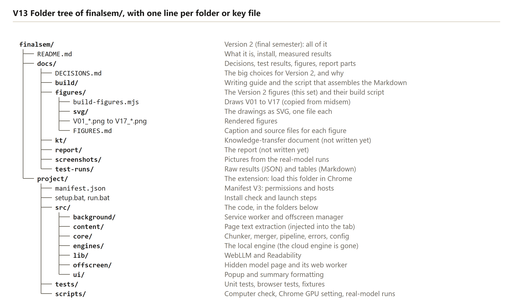
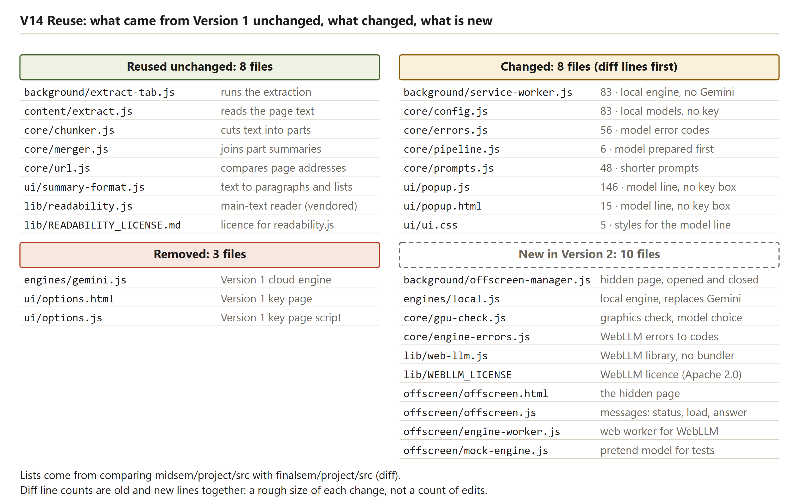

# [nonum] Appendix A: File guide

This appendix lists every file under `finalsem/project`, except `node_modules`, `test-output` and the `.model-profile*` browser profile folders. There are 60 files. Each row gives the path, what the file does, and whether it is reused from Version 1, changed from it, or new in Version 2. The status comes from a byte-by-byte comparison with `midsem/project`, not from memory. A file counts as **reused** only when it is identical to the Version 1 file, and as **changed** when it exists in both folders but differs. Files that exist only in Version 2 are **new**.

The figures below show the same folders from two sides: the tree of the whole Version 2 folder, and the reuse of the Version 1 modules in the source.

<!-- check against figure -->

Reading the figure: the tree lists the folders of `finalsem/`, with the role of each main folder beside it. The project folder holds the extension, and the docs folder holds the report material.

<!-- check against figure -->

Reading the figure: the reused modules are the chunker, the merger, the URL helper, the page extractor, the extractor run by the service worker, the Readability library and the summary formatter. Most of the new work sits in the engine, the offscreen page, the graphics check and the scripts.

Table: Every file under finalsem/project, with its purpose and its status against Version 1

| Path | What it does | Status |
|---|---|---|
| `.setup-ok` | Marker written by a successful setup. Holds the Chrome path and the date, and `run.bat` reads it | Changed (generated by setup, not source) |
| `icons/icon16.png` | Toolbar icon, 16 pixels | Reused unchanged |
| `icons/icon48.png` | Extensions page icon, 48 pixels | Reused unchanged |
| `icons/icon128.png` | Store and install icon, 128 pixels | Reused unchanged |
| `manifest.json` | Extension manifest: version 2.0.0, permissions for the offscreen page and unlimited storage, and the hosts that model files come from | Changed |
| `package.json` | Package details and the two test commands. Playwright is the only development dependency | Changed |
| `package-lock.json` | Locked versions of the packages in `package.json` | Changed |
| `run.bat` | Opens Chrome's extensions page and a sample article, and prints the four load steps | Changed |
| `setup.bat` | Five-step setup with the `--dev`, `--gpu` and `--reset` options | Changed |
| `setup.log` | Log of the last setup run (generated by setup, not source) | Changed (generated) |
| `scripts/check-computer.ps1` | Describes Windows, processor, memory, graphics chips and free disk space. Exits 1 only when disk space is short | New |
| `scripts/check-extension.ps1` | Checks that `manifest.json` parses, is Manifest V3, and names files that exist | Changed |
| `scripts/local-run.mjs` | Measures the real model in hidden Chromium, in the `nvidia`, `nvidia-offline` and `intel` modes | New |
| `scripts/secret-scan.mjs` | Checks the repository for the old Gemini key before a push | Changed |
| `scripts/set-chrome-gpu.ps1` | Writes or removes the per-user setting that asks Windows for the separate graphics card | New |
| `scripts/shoot-ui-states.mjs` | Takes the 18 pretend-model popup screenshots for the report | New |
| `src/background/extract-tab.js` | Runs the page extractor in a tab and refuses restricted pages | Reused unchanged |
| `src/background/offscreen-manager.js` | Creates, sends messages to and closes the offscreen page, with the idle close and the test seam | New |
| `src/background/service-worker.js` | Owns the summary job: start, progress writes, interrupted and orphaned jobs, and cleanup when a tab closes | Changed |
| `src/content/extract.js` | Injected into the page. Reads the main text with Readability, and falls back to the visible text under 200 characters | Reused unchanged |
| `src/core/chunker.js` | Splits long text into parts within a size limit | Reused unchanged |
| `src/core/config.js` | The two models, the default settings and the names of the stored settings | Changed |
| `src/core/engine-errors.js` | Turns the engine's error text into one of the project's error codes | New |
| `src/core/errors.js` | The error codes and the plain-English message for each one | Changed |
| `src/core/gpu-check.js` | Checks the graphics adapter and shader-f16 support, chooses the model, and maps download progress | New |
| `src/core/merger.js` | Joins the part summaries into one, in levels when there are many | Reused unchanged |
| `src/core/pipeline.js` | The flow of a job: extract, check the length, prepare the model, summarize the parts, merge | Changed |
| `src/core/prompts.js` | The prompt texts for a one-part page, a part and the merge | Changed |
| `src/core/url.js` | Compares two addresses while ignoring the part after `#` | Reused unchanged |
| `src/engines/local.js` | The local engine: graphics check, preparing the model, the fallback to the small model, and the generate calls | New |
| `src/lib/READABILITY_LICENSE.md` | Licence text of the Readability library | Reused unchanged |
| `src/lib/WEBLLM_LICENSE` | Licence text of WebLLM | New |
| `src/lib/readability.js` | Mozilla Readability, the library that finds an article's main text | Reused unchanged |
| `src/lib/web-llm.js` | WebLLM 0.2.86 in one file, so no build step is needed | New |
| `src/offscreen/engine-worker.js` | Web worker that runs WebLLM's handler, keeping the hidden page responsive | New |
| `src/offscreen/mock-engine.js` | The pretend model for the tests, with its modes (`ok`, `oom`, `html` and others) | New |
| `src/offscreen/offscreen.html` | The empty page shell of the offscreen page | New |
| `src/offscreen/offscreen.js` | The hidden page: graphics check, download, load, warm-up, answers and keep-alive messages | New |
| `src/ui/popup.html` | Popup layout, with the element IDs the script uses | Changed |
| `src/ui/popup.js` | Popup logic: model line, button, progress, result, errors and the graphics note | Changed |
| `src/ui/summary-format.js` | Turns the summary text into paragraphs and bullets, and never produces HTML | Reused unchanged |
| `src/ui/ui.css` | The printed-page style of the popup | Changed |
| `tests/bat/test-bat-scripts.ps1` | The 14 checks of `setup.bat` and `run.bat` in throw-away copies | Changed |
| `tests/e2e/pipeline.test.js` | The browser scenarios V01 to V24, with V18b | Changed |
| `tests/e2e/smoke.test.js` | The first-run smoke test | Changed |
| `tests/fixtures/article-long.html` | A long article, used to test parts and merging | Reused unchanged |
| `tests/fixtures/article-short.html` | A short article, used by most tests | Reused unchanged |
| `tests/fixtures/dashboard.html` | A non-article page. No Version 2 browser test loads it | Reused unchanged |
| `tests/fixtures/late-content.html` | A page whose text appears after a delay | Reused unchanged |
| `tests/fixtures/near-empty.html` | A page with almost no text | Reused unchanged |
| `tests/fixtures/table-article.html` | An article with a table | Reused unchanged |
| `tests/helpers/extension.mjs` | Launches Chromium with the extension, and helpers for the popup, the jobs and the storage | Changed |
| `tests/helpers/fixtures-server.mjs` | Serves the fixture pages on 127.0.0.1 | Reused unchanged |
| `tests/helpers/key.mjs` | Looks for the old Gemini key. Used only by the secret scan | Reused unchanged |
| `tests/unit/chunker.test.js` | The 10 chunker tests | Reused unchanged |
| `tests/unit/gpu-and-errors.test.js` | The 9 tests of the graphics check, the model choice and the error codes | New |
| `tests/unit/local-engine.test.js` | The 18 tests of the local engine | New |
| `tests/unit/merger.test.js` | The 8 merger tests | Reused unchanged |
| `tests/unit/pipeline.test.js` | The 7 pipeline tests | Reused unchanged |
| `tests/unit/small.test.js` | The 13 tests of formatting, settings, errors and prompts | Changed |

Count by status: 22 reused unchanged, 22 changed (two of them are generated files), and 16 new.

Thirteen files exist in Version 1 but not in Version 2, and they were removed on purpose. They are the Gemini engine (`src/engines/gemini.js`), the Options page (`src/ui/options.html` and `options.js`), the Gemini helpers and their tests (`tests/helpers/mock-gemini.mjs`, `tests/unit/gemini.test.js`, `tests/unit/fixes.test.js`), the Chrome flag check (`tests/e2e/chrome-flag-check.mjs`), and six live and benchmark scripts (`scripts/activetab-spike.mjs`, `collect-examples.mjs`, `live-check.mjs`, `live-run.mjs`, `model-bench.mjs` and `quota-probe.mjs`).

Two reused files point back to Version 1. `tests/helpers/key.mjs` reads the old Gemini key from `midsem/project/.env.test`, and the secret scan uses it. The dashboard fixture is reused but no Version 2 browser test loads it. Both are listed in chapter 16.

### What this means in plain words

Of the 60 files, about a third are reused as they were, about a third are changed, and just over a quarter are new. The new files hold the model, the offscreen page, the graphics check and the scripts that run the real model.
