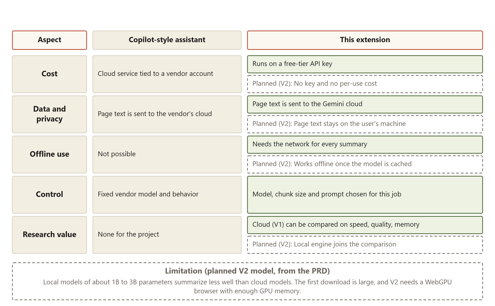

# Background and survey

## Existing tools

Two kinds of tool already summarize a web page.

The first is the browser assistant. Microsoft Copilot is the example the project documents use. An assistant is a chat panel built into a browser or an operating system. It can read the open page and answer questions about it, including a request for a summary. The text of the page is processed by the vendor's service.

The second is the summarizer extension. These are add-ons from independent makers that appear in the Chrome Web Store, the official catalogue of Chrome add-ons. Each one has its own model, price and terms. Many of them send the page text to a service that the maker runs.

The project did not review individual products one by one. This section describes the common pattern that the project's problem statement identifies. A product-by-product review is [to be measured].

## What existing tools leave out

The problem statement names five things that these tools usually leave out.

1. **Cost.** Many services are tied to a vendor account or a subscription. The reader pays for the service whether or not the summary is useful.
2. **Where the text goes.** The page text is sent to the vendor's cloud. For a private page, that can be the wrong place for the text.
3. **Accounts.** The reader must sign in before the first summary.
4. **Offline use.** Most of these tools need a network connection for every summary. Without one, nothing works.
5. **Control.** The vendor fixes the model, the summary length and the way long pages are handled. The reader cannot see or change those settings.

The figure below compares a Copilot-style assistant with this extension, row by row. It uses the same five aspects, plus research value.

Reading the figure: the left column describes a Copilot-style assistant in five rows: cost, data and privacy, offline use, control and research value. The right column gives the position of this extension. The green boxes show what V1 does. The dashed boxes show plans for the later stage. For cost, V1 runs on a free-tier API key. For data, the figure says plainly that V1 sends page text to the Gemini cloud, so privacy is not solved in V1. For offline use, V1 needs the network for every summary. The figure also records the limit of the planned local model: models of about one to three billion parameters summarize less well than cloud models.

## Chrome's built-in Summarizer API

Chrome also ships its own summarizer. It is called the Summarizer API, and it runs a model on the user's computer instead of in the cloud. Chrome's developer documentation describes it under the heading "Summarize with built-in AI" (developer.chrome.com/docs/ai/summarizer-api). The limits below come from the project plan, which records the documentation as checked on 20 October 2026.

Table: Limits of Chrome's built-in Summarizer API, as recorded in the project plan

| Item | What the project plan records |
|---|---|
| First stable release | Chrome 138 |
| Free disk space needed | About 22 GB |
| Hardware needed | A graphics card with more than 4 GB of video memory, or, without one, a processor setup with 16 GB of RAM |
| Languages | Five |

A tutor could ask why the project does not simply use this API. The limits are the answer. The API needs a large amount of free disk space and either a capable graphics card or 16 GB of memory. It supports five languages. It uses the model that Chrome chooses, so the project cannot change the model, the part size or the instructions. The project plan says that whether a small model has a smaller footprint is to be measured in the later stage, and is not assumed. V1 does not use this API. It uses the cloud model described in the system design chapter.

## Building blocks the project uses

### Readability

Readability is a library from Mozilla, the makers of the Firefox browser. It is the same kind of code that powers Firefox's reading view. Its job is to find the main article in a page and leave out the surrounding menus, advertisements and footers. The project plan records its licence as Apache-2.0, as shown on the library's GitHub page. The licence text is kept beside the library in the project folder. The project copies the library into the extension, so the extension does not need a build step to use it. The reference is Mozilla, Readability.js, on GitHub.

### The Gemini API

Gemini is a language model that Google hosts. The Gemini API is the web address and rule set that a program uses to send a prompt and receive text back. The extension sends each request over HTTPS, the encrypted form of the web protocol. A free-tier key allows a limited number of requests. The limits that were measured are given in the technology choices chapter.

### Manifest V3

Manifest V3 is the current extension format for Chrome. Under this format, the background code of an extension runs in a service worker. A service worker is a background script that Chrome starts when it is needed and can stop when it is idle. The project's design has to cope with that behaviour, and the system design chapter explains how.

## The gap this project fills

The gap is not that no summary tool exists. Many do. The gap is the set of things a reader cannot do with the common tools. A reader cannot see the instructions sent to the model, choose the model, change how long pages are split, or measure how the summary behaves. A reader also cannot run the same flow with a different engine later.

V1 fills part of that gap. The reader enters their own key. The code and the prompts are open in the project folder. The part size, the page limit and the timeouts are set in one configuration file. The speed of each model choice and the behaviour under errors were measured, and those measurements are in the technology choices chapter.

V1 does not fill the privacy gap. The page text still leaves the computer and reaches Google. V1 also does not fill the offline gap, because every summary needs a network connection. Those two gaps are the reason the project has a later stage, in which a model would run inside the browser. The report says this plainly so that a reader does not mistake V1 for a private tool.

### What this means in plain words

Common summary tools are easy to use, but they keep the reader out of the process. This project gives the reader more control than an assistant does, and it measures what it builds. It does not keep the page private in this version. The honest summary is that V1 is a cloud tool with more visible control, not a private tool.

### Questions this chapter answers

**Why not just use Chrome's built-in summarizer?**
Chrome's built-in summarizer needs a large amount of disk space and either a strong graphics card or a lot of memory. It supports five languages, and it uses the model that Chrome picks, so the project could not change the model or the way pages are split. The project's aim is to choose and measure those things.

**Is a cloud summary tool any different from Copilot?**
In V1, the page text still goes to a cloud service, so the privacy concern is the same. The differences are the cost (a free key the reader controls), the visible code and prompts, and the chance to measure speed and errors. The difference is not in where the text goes.

**What does V1 do about privacy?**
V1 does not solve it. The report says so in the requirements and system design chapters. Privacy is the main reason for the later stage, in which the page text would stay on the user's computer.
