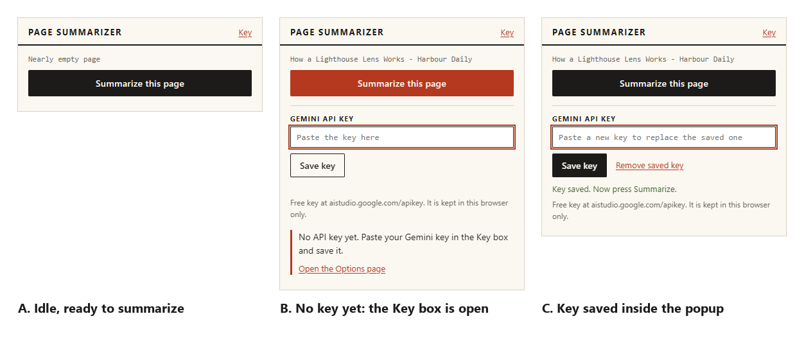
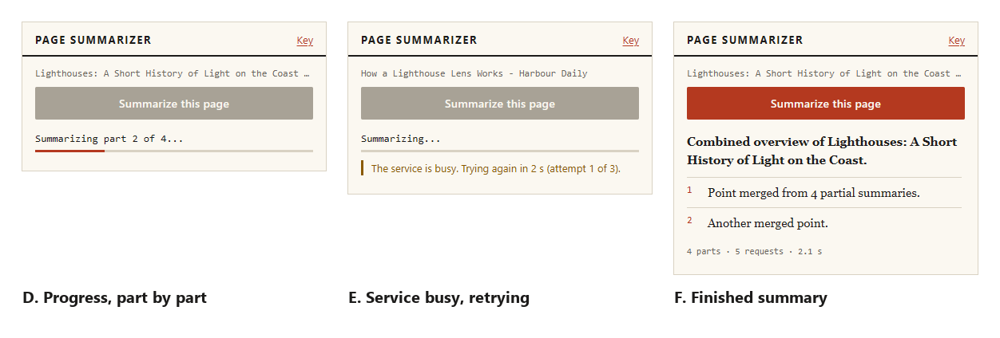
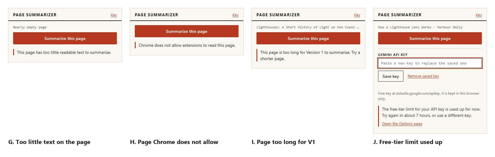
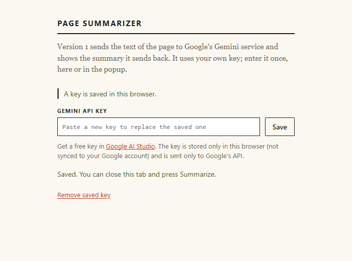

# The user interface

## What this part does and why it exists

The popup is the only screen the reader uses. It opens from the Chrome toolbar icon and is 380 pixels wide (`midsem/project/src/ui/ui.css`). It holds a Summarize button, a Key box for the Gemini key, a progress line, a notice line, an error area and the finished summary.

Chrome closes a popup as soon as the reader clicks elsewhere (`midsem/V1_PLAN.md`). The popup therefore does no summarizing itself. It asks the service worker to start the job, then shows the job's current state. The Options page is a second, optional place to change the key.

## The popup in each state

The summaries in these screenshots come from a mock server, so the sentences are not real model output.

Panel A shows the idle popup: the page title, a dark Summarize button and a Key link in the top right corner. Panel B shows no key saved. The Key box is open, its input is outlined in red, and a red-edged note says "No API key yet. Paste your Gemini key in the Key box and save it." with an "Open the Options page" link. Panel C shows a saved key. The placeholder changes to "Paste a new key to replace the saved one", a "Remove saved key" link appears, and a green line says "Key saved. Now press Summarize." The button is red in panel B and dark in A and C. The stylesheet turns the button red on hover, which is the likely cause, but the screenshot does not confirm it.

Panel D shows a run in progress: "Summarizing part 2 of 4...", a thin red progress line, and a grey button, which is disabled while a job runs. Panel E shows a retry. The label reads "Summarizing...", an ochre note says "The service is busy. Trying again in 2 s (attempt 1 of 3).", and the progress line has no fill. Panel F shows the finished summary: a bold overview line, numbered points with red numbers, and the line "4 parts · 5 requests · 2.1 s".

Panels G, H and I show three single-message states: too little text, a page Chrome does not allow, and a page too long for Version 1. Panel J shows the quota case. It says the free-tier limit is used up and gives a wait of "about 7 hours", with the Key box open below it and an "Open the Options page" link.

### What this means in plain words

The popup shows one state at a time: idle, asking for a key, working, retrying, showing a summary, or showing one short message.

## The Key box and why nothing opens in a new tab

The Key link in the header opens the Key box. The box also opens by itself when no key is saved or when a key problem appears. The reader pastes the key and presses "Save key" or Enter. The box checks the input before saving. An empty box gives "Paste a key first." A key with a space gives "A key has no spaces. Check what you pasted." A good key gives "Key saved. Now press Summarize." The key is stored in `chrome.storage.local`, which keeps it in this browser only.

An earlier version opened the Options page in a new tab. The project owner watched a test run and said the extension should open in a popup, not in a new tab (DEVLOG.md, the design change entry). Now nothing opens by itself. The "Open the Options page" link appears only for key problems, and it opens a tab only when the reader presses it.

### What this means in plain words

The reader can fix a missing or rejected key without leaving the popup. A tab opens only when the reader asks for one.

## The Options page

The Options page saves or removes the same key, in the same storage. The screenshot shows a green line "A key is saved in this browser.", the key field with the placeholder "Paste a new key to replace the saved one", a Save button, the line "Saved. You can close this tab and press Summarize." and a red "Remove saved key" link. The Save button keeps its normal width, so the key field stays usable. An earlier layout squeezed the field, which the test run recorded as a visual problem.

## The printed-page design

The popup looks like a printed page. The background is warm paper (`#fbf8f1`) and the text is near-black ink (`#1c1b1a`). One red accent (`#b4391f`) marks the hover colour of the main button, the error rule, the progress line and the numbers. The summary is set in a serif font (Georgia, 15 pixels). Small labels are uppercase. Sections are separated by thin rules, not boxes. Corners are square, with a 2-pixel radius on buttons and none on inputs. Points are numbered by the stylesheet.

DEVLOG records the reason. The first interface used a common blue look with rounded cards. The project owner said it looked AI-made. The printed-page style was chosen as a deliberate contrast. The owner's remark is the only evidence for the change. No reader test has measured how the style is received.

### What this means in plain words

The popup is styled like a printed page, with one accent colour and a serif summary, chosen to avoid a generic template look.

## Accessibility: what the code does and does not do

The code supports these points:

- The Summarize button, the Key link and Save key are real button elements. The key input has a visible label linked with `for="key-input"`.
- The progress section is a live region (`aria-live="polite"`). The error section uses `role="alert"`. The key message uses `role="status"`.
- The Key link sets `aria-expanded`.
- Inputs get a 2-pixel red focus outline.
- The summary is written with `textContent`, so markup from the model is never rendered.

These points are not met or not checked:

- The stylesheet has no dark colour scheme and no reduced-motion rule. The progress line keeps its animation whatever the reader's motion setting.
- Colour contrast has not been measured: [to be measured].
- No screen reader or keyboard test is recorded in the evidence files: [to be measured].

### What this means in plain words

The popup uses real controls and announces important messages. It has not been checked against accessibility standards, and it does not follow the reader's dark-mode or reduced-motion settings.

## Closing and reopening the popup

The popup reads the job from storage when it opens and re-checks it every five seconds. Closing the popup does not stop the summary. Test T11 closes the popup during a run and reopens it. The reopened popup shows the same run, and the summary arrives. Test T16 reopens the popup after a finished run and shows the same summary with no new request. Test T17 changes the tab to another page, so the old summary is hidden.

### What this means in plain words

The popup is only a window onto the job. Closing it changes nothing, and reopening it shows where the job is.

## Questions this chapter answers

**Why is there no separate window or new tab?**
The popup closes when the reader clicks elsewhere, so the work runs in the background and the popup only shows it. The Key box lets the reader fix a key without a new tab.

**Why a serif font and numbered points?**
Both follow the printed-page style chosen for the popup. The project records the style choice, not a separate reason for each element.

**What does the reader see if the popup is closed mid-summary?**
The same progress or the finished summary, when the popup is reopened. The job keeps running while the popup is closed.

**Is the interface accessible?**
It uses the standard controls and live-region markup described above. Contrast and screen reader use have not been measured, and the stylesheet has no reduced-motion or dark-mode rule.
