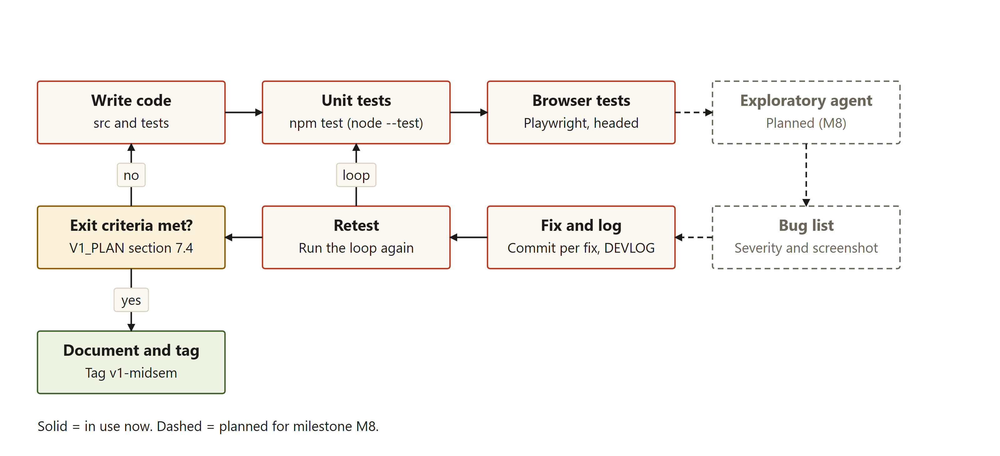

# Setting up and running the extension

## What this part does and why it exists

The extension is not in the Chrome Web Store. The client installs it from the project folder with Chrome's Load unpacked feature, which runs an extension straight from a folder. Two Windows batch files (small scripts that Windows runs line by line) make this easier. setup.bat checks that Chrome and the project files are ready. run.bat opens the pages the user needs and prints the remaining steps. The aim is a setup that takes about ten minutes. That time has not been measured on a client laptop: [to be measured].

Before you start, the client needs a Windows computer with Google Chrome 116 or newer, the whole project folder, and a free Gemini API key. A key is a secret code that identifies the user to Google's service. The free key comes from aistudio.google.com/apikey. Node.js is not needed, because only the developer's test tools use it.

## What setup.bat does, step by step

setup.bat writes each check to setup.log in the project folder. It runs four steps.

1. **Finds Chrome** in the usual install folders, then in the Windows registry, the settings database. It saves the path for run.bat. If Chrome is missing, it says where to download it and stops.
2. **Checks the version.** Chrome records its version in the registry. Version 116 or newer passes. If the version cannot be read, the script continues with a note. The project files do not record why 116 was chosen. The check is split into subroutines, which are named blocks the script jumps to. Chapter 13 explains why.

Source: `midsem/project/setup.bat`, lines 135 to 143.

```bat
:check_chrome_version
set "CHROME_VER="
set "CHROME_MAJOR="
for /f "tokens=3" %%V in ('reg query "HKCU\Software\Google\Chrome\BLBeacon" /v version 2^>nul') do set "CHROME_VER=%%V"
if not defined CHROME_VER goto :cv_unknown
for /f "delims=." %%M in ("%CHROME_VER%") do set "CHROME_MAJOR=%%M"
call :say "  Chrome version %CHROME_VER%"
if %CHROME_MAJOR% lss 116 goto :cv_old
exit /b 0
```

3. **Checks the extension files** with `scripts/check-extension.ps1`, a PowerShell script. It reads manifest.json, the file that tells Chrome what the extension is. It checks that the file reads, that it uses Manifest V3 (the current extension format), and that every file it names exists. A partial download fails here, with the missing file's name.

Source: `midsem/project/scripts/check-extension.ps1`, lines 36 to 38.

```powershell
foreach ($file in ($files | Select-Object -Unique)) {
    if (-not (Test-Path (Join-Path $root $file))) { $problems += "A file the extension needs is missing: $file" }
}
```

4. **Skips developer tools** unless setup is run with `--dev`. That option checks for Node.js 20 or newer, then runs npm install and downloads Playwright's test browser, about 200 MB, with three tries for each network step.

On success, setup.bat writes a marker file, .setup-ok, holding the Chrome path and the date, then prints SETUP COMPLETE. run.bat refuses to run without the marker. On failure, the script deletes the marker, prints "What failed" and "How to fix", and names setup.log.

**What this means in plain words.** setup.bat is a checklist. It confirms that Chrome is present and new enough, and that the extension folder is complete. If something is wrong, it says what to do.

## What run.bat does, and why it does not load the extension

run.bat checks the marker, reads the Chrome path, and copies the folder path to the clipboard. It opens chrome://extensions, the page that lists Chrome's extensions, and a Wikipedia article about lighthouses. Then it prints four steps.

Source: `midsem/project/run.bat`, lines 40 to 44.

```bat
if not "%RUN_NOCLIP%"=="1" <nul set /p ="%EXT%" | clip

start "" "%CHROME%" chrome://extensions
timeout /t 2 /nobreak >nul
start "" "%CHROME%" https://en.wikipedia.org/wiki/Lighthouse
```

run.bat does not load the extension itself. Chrome once had a command-line flag, `--load-extension`, that loads a folder at start-up. On the developer laptop, the installed Chrome 155 started with that flag, and no extension service worker appeared within eight seconds. A service worker is the background part of an extension. Playwright's bundled Chromium 156 loaded it at once. DEVLOG.md cites the Chromium team's April 2025 announcement that branded Chrome from version 137 drops the flag. The check is `tests/e2e/chrome-flag-check.mjs`. So the client clicks Load unpacked. Step 4 of run.bat still points to Options for the key, but the popup's Key box saves the same key.

**What this means in plain words.** Chrome no longer lets a script load an extension on its own. run.bat does what it can and prints the rest.

## The ten setup checks

`tests/bat/test-bat-scripts.ps1` runs both batch files on temporary copies of the project. For the success case, a fake Chrome file that only writes its arguments to a text file stands in for the browser.

Table: The ten setup checks and what each proves

| Check | What it proves |
|---|---|
| B1 | run.bat before setup tells the user to run setup.bat first, and exits with 1 |
| B2 | setup.bat on a complete copy prints SETUP COMPLETE and exits with 0 |
| B2b | Setup leaves the marker file and setup.log |
| B3 | run.bat opens chrome://extensions and the Wikipedia article |
| B3b | run.bat's output names Developer mode, Load unpacked and Options |
| B4 | A missing manifest.json gives SETUP FAILED, exit code 1, and no marker |
| B5 | An unreadable manifest.json is reported as unreadable |
| B6 | A missing popup.html is named in the message |
| B7 | Running --dev without Node.js explains how to install it |
| B8 | --dev --reset rebuilds the test tools and completes |

Three things are not covered. The clipboard step is not tested, because the test must not touch the user's clipboard. The "Chrome missing" and "Chrome too old" messages are checked only by reading the script. The script's summary line is not saved in the evidence folder. run-3.md says these checks must be run again before they are quoted, so the current result is [to be measured].

**What this means in plain words.** The checks run the real scripts on copies of the project. They confirm the scripts succeed when they should, and fail with a clear message when they should.

## The manual smoke test in real Chrome

The automated browser tests (chapter 12) cannot click the toolbar icon, and they add an extra permission for the test server. So they do not prove that the unmodified extension installs and works in real Chrome. The file `midsem/docs/MANUAL_SMOKE_TEST.md` sets out 11 steps for that. The person runs it on the developer laptop, and again on the client's laptop before the viva.

Table: The manual smoke test, step by step

| Step | What the person does | What should appear |
|---|---|---|
| 1 | Double-click run.bat | The extensions page and a Wikipedia article open |
| 2 | Turn on Developer mode, click Load unpacked, click Select Folder | A Page Summarizer card with no red Errors button |
| 3 | Pin the extension | Its icon shows on the toolbar |
| 4 | Press Summarize with no key saved | A red message and an Options button |
| 5 | Open Options, paste the key, click Save | "Saved." and "A key is saved in this browser." |
| 6 | Summarize the Wikipedia Lighthouse article | Progress, then a summary and a stats line |
| 7 | Close the popup, wait 10 seconds, reopen it | The summary, or the progress, is still there |
| 8 | Press Summarize on chrome://extensions | "Chrome does not allow extensions to read this page." |
| 9 | Press Summarize on a page with a few words | "This page has too little readable text to summarize." |
| 10 | Replace the key with "wrong", then summarize | A message that the key was rejected |
| 11 | Put the correct key back | Summaries work again |

Three things need attention before the viva. The wording expected in steps 4 and 10 is older than the code. The current messages are "No API key yet. Paste your Gemini key in the Key box and save it." and "Your API key was rejected. Paste a correct key in the Key box." The results column is empty, so the report keeps placeholders: [Insert date and result of the developer laptop run] and [Insert client laptop model, Windows version and date]. The six screenshots the file asks for, M01 to M06, are not in the screenshots folder yet.

**What this means in plain words.** This is the only check on real Chrome and the real toolbar icon. Its steps are written down, but its results are not recorded yet.

## The developer loop



**Reading the figure:** The top row runs left to right: write code, unit tests, browser tests. The two dashed boxes on the right, the exploratory agent and the bug list, are planned for milestone M8 and are not in use yet. The bottom row runs right to left: fix and log, retest, then "Exit criteria met?" A "no" sends the work back to Write code, and the loop arrow from Retest goes back to the unit tests. A "yes" leads to documenting and tagging v1-midsem.

**What this means in plain words.** Each change is tested by a script first and then in a browser. Each bug is fixed, written down, and tested again until the agreed finish conditions are met.

## Installing the extension in about ten minutes

1. Download the project folder, or clone it, and keep all of it together.
2. Double-click setup.bat and wait for SETUP COMPLETE. If you see SETUP FAILED, read the "How to fix" line and run it again.
3. Double-click run.bat. Chrome opens the extensions page and a sample article. The folder path is already on the clipboard.
4. On the extensions page, turn on Developer mode in the top right corner.
5. Click Load unpacked, press Ctrl and V to paste the folder path, then click Select Folder.
6. Pin Page Summarizer from the puzzle-piece menu in the toolbar.
7. Click the Page Summarizer icon. The Key box opens by itself when no key is saved. Paste the Gemini key and click Save key.
8. Open an article, click the icon, and press Summarize this page.

## Questions this chapter answers

**Why does run.bat not load the extension itself?** Chrome removed the command-line flag that did this, in branded builds from version 137. A test on Chrome 155 confirmed it. So the client loads the folder by hand with Load unpacked.

**What happens if the client's Chrome is too old?** setup.bat stops at step 2 and writes no marker, so run.bat refuses to start until Chrome is updated and setup is run again.

**What does the manual check prove that the automated tests cannot?** It proves that the unmodified extension installs through Load unpacked and works through the toolbar in the client's own Chrome.
