<div align="center">


<br>

**AI-Powered Web Page Summarizer**

*A Chrome Extension with a Cloud Engine (V1) and an In-Browser Local Model (V2)*

**Mid-Semester Report (Version 1)**

</div>

| Field | Details |
|---|---|
| Student Name | [Insert Student Name] |
| BITS ID | [Insert BITS ID] |
| Degree Program | [Insert Degree Program] |
| Course No. | [Insert Course No.] |
| Project Carried Out At | [Insert Organization Name & Location] |

<div align="center">

**BIRLA INSTITUTE OF TECHNOLOGY & SCIENCE, PILANI (RAJASTHAN)**

Pilani, Rajasthan 333031

[Insert Month and Year]

</div>

<div style="page-break-after: always"></div>

<div align="center">

**CERTIFICATE**

</div>

This is to certify that the [Insert Course Title] entitled "AI-Powered Web Page Summarizer" and submitted by [Insert Student Name], having BITS ID No. [Insert BITS ID], for the partial fulfillment of the requirements of the [Insert Degree Program] degree programme of BITS, embodies the Bonafide work done by him/her under my supervision.

<br>
<br>
<br>
<br>

<div align="center">

Signature of the Mentor

Name, Designation & Organization & Location: [Insert]

Place: [Insert]

Date: [Insert]

</div>

<div style="page-break-after: always"></div>

<div align="center">

**Mid-Semester Progress Report**

</div>

**Work Completed So Far:**

**Planning and abstract**

- The abstract, with the cover details and eight references, is written. The V1 plan is approved (midsem/V1_PLAN.md).
- The product requirements are written (prd.md). They fix the scope of V1 and V2 and the requirements FR1 to FR8.

**Version 1 build**

- The Chrome extension (Manifest V3) has a toolbar popup with a Summarize button, a service worker that runs the job, a text extractor, a chunker, a merger, and a Gemini engine.
- The page text is read with Mozilla Readability. Long pages are split into parts, each part is summarized, and the part summaries are merged into one summary.
- The Gemini key is entered once, in the popup or on the Options page, and is kept in the browser.
- The model is gemini-3.5-flash-lite with the thinking setting low. This was chosen by measuring speed on the real task, not by guessing.
- Errors have plain English messages: missing or rejected key, busy service, network, timeout, restricted pages, too little text, and pages that need too many parts.

**Testing**

- Unit tests (node:test, no browser) and browser tests (Playwright Chromium with the extension loaded, against a mock Gemini service) are in the repository.
- The latest run passed 65 unit tests and 28 browser scenarios, with no failures (midsem/docs/test-runs/run-3.md).
- Browser tests found four product bugs in the first run. All four were fixed and the second run passed (midsem/docs/test-runs/run-1.md and run-2.md).
- Live runs on real pages used the real Gemini service. Seven pages were summarized and two error cases were checked (midsem/docs/test-runs/live-measurements.md).

**Setup scripts**

- setup.bat checks that Chrome is installed and new enough, checks that the extension files are complete, and writes setup.log. It ended with SETUP COMPLETE on the development machine.
- run.bat opens Chrome's extensions page, copies the folder path, and shows the four steps to load the extension by hand.
- A test script runs both .bat files on their success and failure paths (midsem/project/tests/bat/test-bat-scripts.ps1).

**Remaining Tasks:**

**Version 2: in-browser model**

- Study small models of about 1 to 3 billion parameters for speed, memory and summary quality, and choose one for the client's laptop.
- Build the local engine with a first-run download, a progress bar, and caching in the browser.
- Add the WebGPU check at startup and its clear messages.
- Make summaries work with no network once the model is cached.
- Confirm the client laptop's operating system, memory and graphics card, because they set the model size.

**Comparison and final documents**

- Run the cloud engine and the local engine on the same pages and compare speed, summary quality and memory use.
- Final testing, the final report, the presentation and the knowledge-transfer document for the final semester.

**Evaluation:**

| EC No. | Component | Excellent | Good | Fair | Poor |
|---|---|---|---|---|---|
| 1. | Design Project Outline |  |  |  |  |
| 2. | Work Progress & Achievements |  |  |  |  |
| 3. | Initiative and Originality |  |  |  |  |
| 4. | Documentation & Expression |  |  |  |  |
| 5. | Research & Innovation |  |  |  |  |
| 6. | Relevance to the work environment |  |  |  |  |

<br>

Signature of the Mentor: ____________________        Date: [Insert]

<div style="page-break-after: always"></div>

# [nonum] Table of Contents

The page numbers are added when the report is converted to PDF.

1. Introduction
2. Background and survey
3. Requirements
4. System design
5. Technology choices
6. Text extraction
7. Long pages
8. The cloud model and errors
9. The user interface
10. Storage and jobs
11. Setting up and running the extension
12. Testing and results
13. Problems and solutions
14. Limitations and next steps
15. Conclusion
16. References
- Appendix A: Repository File Guide
- Appendix B: Messages and Settings

# [nonum] List of Figures

This list is generated when the report is converted to PDF.

# [nonum] List of Tables

This list is generated when the report is converted to PDF.


<div style="page-break-after: always"></div>

# Introduction

## The problem

Many web pages are long, and the one fact a reader needs is often buried. A news article, a documentation page or an encyclopedia entry can run to several thousand words. Menus, banners, cookie notices and lists of related articles surround the text. To learn whether a page is worth reading, the reader has to scroll through much of it first.

A one-click summary would save that time. The reader presses one button while the page is open and gets a short account of what the page says, beside the page and without copying text into another service.

## Why the problem matters

Three concerns make this more than a convenience.

The first is cost and accounts. Many summary tools need a sign-in or a subscription before the first summary.

The second is where the text goes. A summary tool reads the page text, and that text travels to whoever runs the tool. For a public article this is harmless. For a private document, an internal wiki or an email, the reader may not want the text sent to a vendor's cloud.

The third is control. A ready-made assistant chooses its own model, summary length and handling of long pages. The reader cannot see the instructions sent to the model, or change how a long page is split.

This project tackles these concerns in stages. The first version, described here, addresses cost and control in part. It does not address where the text goes, and the background chapter explains that gap.

## What the project builds

Page Summarizer is a Google Chrome extension. An extension is a small add-on that Chrome loads from a folder of web files and runs alongside the browser. The first version, called V1 in the project documents, adds a toolbar button. When the user presses Summarize, the extension reads the main text of the open tab and sends it to Gemini, a language model hosted by Google that writes text in answer to a prompt. The extension calls Gemini through the Gemini API, the web address and rules that let a program send requests to Google's service. The summary comes back and appears in the popup, the small window that opens from the toolbar button. Long pages are split into parts, each part is summarized, and the part summaries are merged into one.

The user supplies their own key, a secret string that tells Google which account is making the requests. Google issues a free key through its AI Studio website. The user pastes it once, and the extension keeps it in the browser.

## Objectives

The objectives come from the project abstract. The table marks which ones V1 delivers.

Table: Project objectives and whether V1 delivers them

| No. | Objective | In V1? |
|---|---|---|
| 1 | Build a Manifest V3 Chrome extension whose popup summarizes the active tab with one button press. | Yes |
| 2 | Extract only the main readable text, leaving out menus, advertisements and footers. | Yes |
| 3 | Split pages longer than the model's limit, summarize each part, and merge the results into one summary. | Yes |
| 4 | Connect to a cloud language model with a user-entered key, with a progress indicator and clear messages for common errors. | Yes |
| 5 | Run a small language model inside the browser, with no key and no network. | No, later stage |
| 6 | Compare the cloud engine with the in-browser engine on speed, summary quality and memory use. | No, later stage |

Manifest V3 is the current format for Chrome extensions. The manifest is a file that tells Chrome what the extension contains and what it may do.

## Scope

V1 covers Google Chrome on a desktop computer, loaded from the project folder with "Load unpacked". It covers a popup with a Summarize button, a progress line, a numbered summary and a statistics line. It covers text extraction with a check for pages that have too little text, splitting and merging of long pages, a key box in the popup and an Options page, plain-English error messages, two setup scripts (setup.bat and run.bat), and automated and manual tests. The setup scripts are written for Windows.

The following are out of scope for V1: other browsers, PDF files, video pages, anything beyond summarizing the open page, a model that runs on the user's computer, use without a network, a history of summaries, export, other languages, and a cancel button. A running summary can only finish, fail, or be replaced when the reader presses Summarize on a different page.

## How to read this report

The chapters after this one cover the background and the existing tools, the requirements and how each was checked, the system design, and the technology choices. Technical terms are explained the first time they appear. Each technical section ends with a short paragraph headed "What this means in plain words". Numbers come from measured test runs and live runs. Where a number was not measured, the report says [to be measured]. Student details are left as placeholders.

### Questions this chapter answers

**Why build this when Chrome and Copilot-style assistants already summarize pages?**
Those tools cover the general need. They usually send the page to a vendor's cloud, require an account, and give the reader no say over the model or the handling of long pages. This project tests a narrower idea: the reader supplies the key, every setting is visible in the code, and the results are measured. The cost is that V1 still sends the page text to Google.

**Why is V1 a cloud version and not a local one?**
A local model needs a capable graphics card and a large first download, and its summary quality was not yet known. The cloud route let the core flow (read, split, summarize, merge, show) be built and tested first. The local engine is a later stage that reuses the same flow.

**Does V1 keep the page private?**
No. The extracted text of the page, with a short instruction and the page title, is sent to Google for each request. The connection is encrypted (HTTPS), but Google receives the text. The report states this limitation in several places.

**What counts as a working V1?**
A summary of a short page and of a long page appears in the popup, the common errors show plain messages, and the key stays in the browser. The requirements chapter lists how each requirement was checked.


<div style="page-break-after: always"></div>

# Background and survey

## Existing tools

Two kinds of tool already summarize a web page.

The first is the browser assistant. Microsoft Copilot is the example the project documents use. An assistant is a chat panel built into a browser or an operating system. It can read the open page and answer questions about it, including a request for a summary. The text of the page is processed by the vendor's service.

The second is the summarizer extension. These are add-ons from independent makers that appear in the Chrome Web Store, the official catalogue of Chrome add-ons. Each one has its own model, price and terms. Many of them send the page text to a service that the maker runs.

The project did not review individual products one by one. This section describes the common pattern that the project's problem statement identifies. A product-by-product review is [to be measured].

## What existing tools leave out

The problem statement names five things that these tools usually leave out.

1. **Cost.** Many services are tied to a vendor account or a subscription. The reader pays for the service whether or not the summary is useful.
2. **Where the text goes.** The page text is sent to the vendor's cloud. For a private page, that can be the wrong place for the text.
3. **Accounts.** The reader must sign in before the first summary.
4. **Offline use.** Most of these tools need a network connection for every summary. Without one, nothing works.
5. **Control.** The vendor fixes the model, the summary length and the way long pages are handled. The reader cannot see or change those settings.

The figure below compares a Copilot-style assistant with this extension, row by row. It uses the same five aspects, plus research value.


Reading the figure: the left column describes a Copilot-style assistant in five rows: cost, data and privacy, offline use, control and research value. The right column gives the position of this extension. The green boxes show what V1 does. The dashed boxes show plans for the later stage. For cost, V1 runs on a free-tier API key. For data, the figure says plainly that V1 sends page text to the Gemini cloud, so privacy is not solved in V1. For offline use, V1 needs the network for every summary. The figure also records the limit of the planned local model: models of about one to three billion parameters summarize less well than cloud models.

## Chrome's built-in Summarizer API

Chrome also ships its own summarizer. It is called the Summarizer API, and it runs a model on the user's computer instead of in the cloud. Chrome's developer documentation describes it under the heading "Summarize with built-in AI" (developer.chrome.com/docs/ai/summarizer-api). The limits below come from the project plan, which records the documentation as checked on 20 October 2026.

Table: Limits of Chrome's built-in Summarizer API, as recorded in the project plan

| Item | What the project plan records |
|---|---|
| First stable release | Chrome 138 |
| Free disk space needed | About 22 GB |
| Hardware needed | A graphics card with more than 4 GB of video memory, or, without one, a processor setup with 16 GB of RAM |
| Languages | Five |

A tutor could ask why the project does not simply use this API. The limits are the answer. The API needs a large amount of free disk space and either a capable graphics card or 16 GB of memory. It supports five languages. It uses the model that Chrome chooses, so the project cannot change the model, the part size or the instructions. The project plan says that whether a small model has a smaller footprint is to be measured in the later stage, and is not assumed. V1 does not use this API. It uses the cloud model described in the system design chapter.

## Building blocks the project uses

### Readability

Readability is a library from Mozilla, the makers of the Firefox browser. It is the same kind of code that powers Firefox's reading view. Its job is to find the main article in a page and leave out the surrounding menus, advertisements and footers. The project plan records its licence as Apache-2.0, as shown on the library's GitHub page. The licence text is kept beside the library in the project folder. The project copies the library into the extension, so the extension does not need a build step to use it. The reference is Mozilla, Readability.js, on GitHub.

### The Gemini API

Gemini is a language model that Google hosts. The Gemini API is the web address and rule set that a program uses to send a prompt and receive text back. The extension sends each request over HTTPS, the encrypted form of the web protocol. A free-tier key allows a limited number of requests. The limits that were measured are given in the technology choices chapter.

### Manifest V3

Manifest V3 is the current extension format for Chrome. Under this format, the background code of an extension runs in a service worker. A service worker is a background script that Chrome starts when it is needed and can stop when it is idle. The project's design has to cope with that behaviour, and the system design chapter explains how.

## The gap this project fills

The gap is not that no summary tool exists. Many do. The gap is the set of things a reader cannot do with the common tools. A reader cannot see the instructions sent to the model, choose the model, change how long pages are split, or measure how the summary behaves. A reader also cannot run the same flow with a different engine later.

V1 fills part of that gap. The reader enters their own key. The code and the prompts are open in the project folder. The part size, the page limit and the timeouts are set in one configuration file. The speed of each model choice and the behaviour under errors were measured, and those measurements are in the technology choices chapter.

V1 does not fill the privacy gap. The page text still leaves the computer and reaches Google. V1 also does not fill the offline gap, because every summary needs a network connection. Those two gaps are the reason the project has a later stage, in which a model would run inside the browser. The report says this plainly so that a reader does not mistake V1 for a private tool.

### What this means in plain words

Common summary tools are easy to use, but they keep the reader out of the process. This project gives the reader more control than an assistant does, and it measures what it builds. It does not keep the page private in this version. The honest summary is that V1 is a cloud tool with more visible control, not a private tool.

### Questions this chapter answers

**Why not just use Chrome's built-in summarizer?**
Chrome's built-in summarizer needs a large amount of disk space and either a strong graphics card or a lot of memory. It supports five languages, and it uses the model that Chrome picks, so the project could not change the model or the way pages are split. The project's aim is to choose and measure those things.

**Is a cloud summary tool any different from Copilot?**
In V1, the page text still goes to a cloud service, so the privacy concern is the same. The differences are the cost (a free key the reader controls), the visible code and prompts, and the chance to measure speed and errors. The difference is not in where the text goes.

**What does V1 do about privacy?**
V1 does not solve it. The report says so in the requirements and system design chapters. Privacy is the main reason for the later stage, in which the page text would stay on the user's computer.


<div style="page-break-after: always"></div>

# Requirements

## Where the requirements come from

The requirements come from the project requirements document (the PRD). The PRD lists eight functional requirements, FR1 to FR8, which say what the product must do, and a short set of non-functional requirements, which say how well it must do it and on which platform.

The table below restates each functional requirement in plain words. The Version column says which version must deliver it. The last column names the tests that checked V1. The T numbers are the scenario IDs used in the browser test files and the test run reports. Unit tests are named by file.

## Functional requirements

Table: Functional requirements, what each one means, which version delivers it, and how V1 was checked

| ID | Requirement in plain words | Version | How V1 was checked |
|---|---|---|---|
| FR1 | The user opens the extension on a page, presses Summarize, and the summary appears in the popup. | V1 and V2 | Smoke test, T01, T11, T16. Live run L01. |
| FR2 | The extension reads the main text and drops menus, advertisements and footers. | V1 and V2 | Smoke test (noise removed), T13, T21. Live runs L04, L06. |
| FR3 | Text longer than the model's limit is split, each part is summarized, and the parts are merged into one. | V1 and V2 | T01 (four parts, merged in order), T23 (page refused when too long), chunker, merger and pipeline unit tests. Live runs L02 to L05, L07. |
| FR4 | A progress indicator shows while the parts are processed. | V1 and V2 | T01 (shows "part 2 of" while running), T05 (retry notice), T11 (reopened popup shows progress). |
| FR5 | The user enters their own key once, and it is stored in the browser. | V1 | T03, T15 (Options page save and remove), T25 (key entered in the popup; no recorded run yet). |
| FR6 | The model downloads on first use with a progress bar, and is cached. | V2 | Not in V1; not built. |
| FR7 | Summaries work with no network once the model is cached. | V2 | Not in V1; not built. |
| FR8 | Clear messages for a missing or invalid key, rate limits, no WebGPU and too little text. | V1 and V2 | T02 to T10, T12b, T23, T24 (no recorded run yet). Live runs L08, L09. gemini.test.js unit tests. The "no WebGPU" message is V2 only. |

WebGPU is a browser feature that lets a web page use the graphics card for calculations. Only the later version runs a model in the browser, so only that version needs the WebGPU check.

## Non-functional requirements

- **Platform.** Chrome on a desktop computer, using Manifest V3. The check script that setup.bat runs (scripts/check-extension.ps1) confirms that manifest.json declares version 3.
- **Installation.** The extension is loaded with "Load unpacked" from the project folder. setup.bat and run.bat check the files and open the right pages. The bat test script has 10 checks, and the result of its last run is [to be measured]. The manual check in the real Chrome browser has not yet been recorded, so its result is [to be measured].
- **Privacy of the key.** The key is kept in local browser storage, which is not synced to the Google account. It is sent only in a request header, never in the web address. The unit test "sends the key in a header, not in the URL, and returns the text" checks this, and T25 checks the key saved in the popup.
- **Reliability.** A request with no answer within 25 seconds is stopped. Busy replies and server errors are retried up to three times. Checks: T06, T07, T08 and the gemini.test.js unit tests.
- **Cost control.** A page can cause at most 30 part requests, plus merge requests, before the run stops. This protects a free-tier key. Check: T23.
- **Plain-English errors.** Every failure has a short message, and technical detail goes to the console log only. Checks: the unit test "every error code has a plain-English message" and browser scenarios T02 to T10.

## Traceability

The table below links each requirement to its code and to its evidence. A tutor can follow any row from the requirement to the file and then to the result.

Table: Traceability from requirement to code, test and evidence

| Requirement | Main code files | Tests | Evidence file |
|---|---|---|---|
| FR1 | ui/popup.js, background/service-worker.js | Smoke, T01, T11, T16 | test-runs/run-1.md, run-2.md |
| FR2 | background/extract-tab.js, content/extract.js, lib/readability.js | Smoke, T13, T21 | test-runs/run-1.md, examples.md |
| FR3 | core/chunker.js, core/merger.js, core/pipeline.js | T01, T23, unit tests | test-runs/run-2.md, live-measurements.md |
| FR4 | ui/popup.js, core/pipeline.js | T01, T05, T11 | test-runs/run-1.md |
| FR5 | ui/options.js, ui/popup.js, core/config.js | T03, T15, T25 | test-runs/run-1.md |
| FR8 | core/errors.js, engines/gemini.js | T02 to T10, T12b, T23, T24, gemini unit tests | test-runs/run-1.md, live-measurements.md |

## Test status

Two test runs are recorded. In test run 1, the 56 unit tests all passed, and 21 of the 25 browser scenarios passed. The four failures (T19 to T22) were real product bugs: a silent refusal when Summarize was pressed on a new page, a popup that kept showing progress after its worker had stopped, table cells that ran together, and a stored record that survived a closed tab. Each was fixed.

In test run 3 (midsem/docs/test-runs/run-3.md), all 65 unit tests and all 28 browser scenarios passed. Run 3 includes T24 (the daily quota limit) and T25 (the key saved inside the popup), and the unit tests for the quota wait times.

### What this means in plain words

Each requirement has a named test, so a tutor can ask for the evidence. The first run found real bugs, and the second run passed after the fixes. Two requirements belong to the later version. Some of the newest tests have no recorded result yet.

### Questions this chapter answers

**Which requirements are in V1?**
FR1 to FR5 and most of FR8. FR6 and FR7 belong to the later version, and the "no WebGPU" message is later work too.

**How do you know the summary is correct?**
The tests check the steps: extraction, splitting, merging, retries and messages. The live runs on real pages show that the steps work with the real service. Summary quality was not scored formally, and the report says so.

**What is not yet tested?**
The results of T24, T25 and the five added unit tests, a clean-copy run of the setup scripts, and the manual check in the real Chrome browser. Each is marked [to be measured].


<div style="page-break-after: always"></div>

# System design

## The big picture

The extension is a set of small files that Chrome runs together. The popup shows the button and the summary. A service worker, the background script that Chrome runs for the extension, does the work. A small extractor script reads the page. The Gemini engine calls Google's service. Chrome's storage keeps the key and the state of the current job.

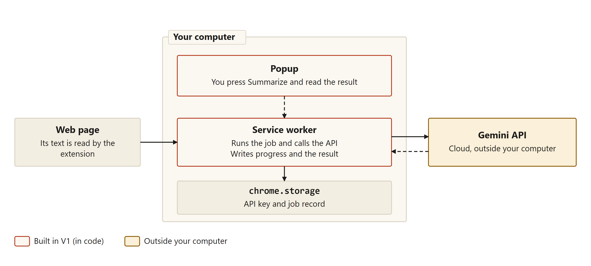

Reading the figure: the web page supplies its text to the extension. Inside the box labelled "Your computer" sit the popup, where the user presses Summarize and reads the result, the service worker, which runs the job and writes progress, and Chrome's storage, which holds the key and the job record. The Gemini API sits outside the computer. A solid arrow carries the request to it, and a dashed arrow carries the answer back. Red outlines mark what V1 builds.

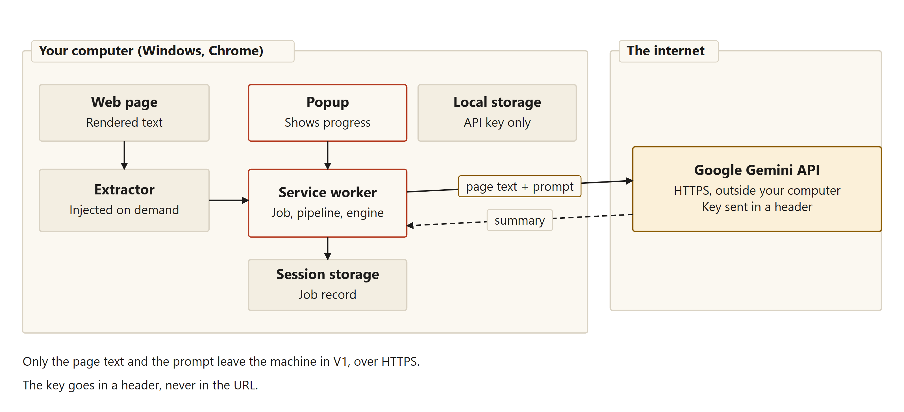

Reading the figure: the left box, labelled "Your computer (Windows, Chrome)", holds the page, the extractor, the popup, the service worker and two storage areas. Local storage holds only the API key. Session storage holds the job record. The right box, labelled "The internet", holds the Gemini API. The arrow labelled "page text + prompt" is the only data that leaves the machine, and the caption adds that the key goes in a header and never in the web address.

### What this means in plain words

The popup only shows things. The service worker does the real work. The only traffic that leaves the computer is the page text and the instructions.

## The layers

The code is split into five layers, and each layer calls only the one below it.

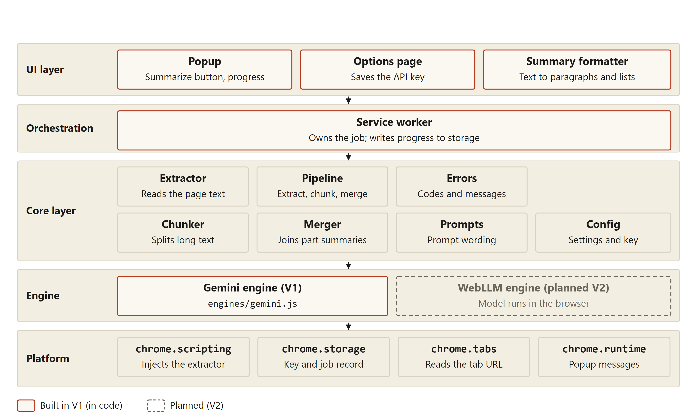

Reading the figure: five bands run from top to bottom. The UI layer holds the popup, the Options page and the summary formatter. Orchestration holds the service worker, which owns the job. The core layer holds the extractor, pipeline, errors, chunker, merger, prompts and config. The engine band holds the built Gemini engine, with a dashed box beside it for a planned local engine that belongs to the later stage. The platform band lists the Chrome calls the code uses. Arrows point down the figure.

The core layer does not know about Chrome, so its logic can be tested in plain Node.js. Only the engine knows the details of the cloud service.

### What this means in plain words

The code works like floors in a building. The top floor shows things to the user, the middle floors do the work, and the bottom floor talks to Chrome. The part that talks to Google sits on one floor, so it can be swapped without touching the rest.

## The components

The first component figure covers the files the user sees and the files that reach into the page.

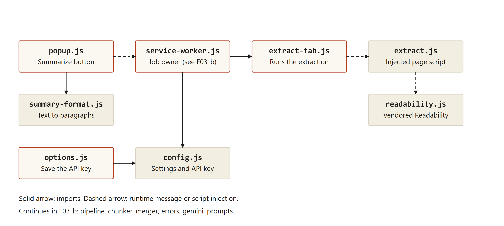

Reading the figure: the popup script sends a message to the service worker, shown dashed. The service worker imports the config file and calls the tab helper, which injects the extractor script and the vendored Readability library into the page. The popup imports the summary formatter. The options script saves the key through the config file. Solid arrows are imports. Dashed arrows are messages or injections.

The second component figure covers the core files.

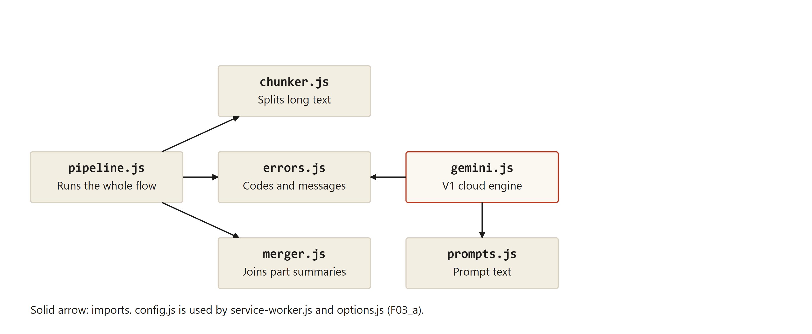

Reading the figure: the pipeline file runs the whole flow. It imports the chunker, which splits the text, the merger, which joins the part summaries, and the errors file, which holds the codes and plain messages. The Gemini engine imports the errors file and the prompts file. It is the only file in the figure that makes a network call.

### What this means in plain words

Each file has one main job. A reader who opens any file can see which other files it depends on.

## One summary, step by step

The sequence figure shows the order of messages for one summary.

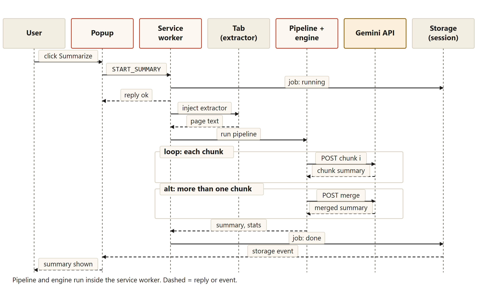

Reading the figure: seven lanes run across the top, from the user to the session storage. The user clicks Summarize, and the popup sends a start message. The service worker writes a job marked running, replies "ok", and injects the extractor, which returns the page text. The pipeline then sends one request for each part, and a merge request follows if there is more than one part. The service worker writes the job as done, storage tells the popup, and the popup shows the summary. The pipeline and engine run inside the service worker.

The steps, in order, are these.

1. The user clicks the toolbar icon and presses Summarize this page. The popup reads the id of the active tab.
2. The popup sends a START_SUMMARY message with the tab id. The service worker refuses a second start for the same tab at the same moment. If an unfinished job for the same page exists, the popup shows its progress. Otherwise the service worker writes a new job record with status "running" and replies "ok".
3. The service worker loads the key and settings from Chrome's local storage and builds the Gemini engine.
4. The extractor runs. The service worker first checks that the page is not one that Chrome forbids extensions to read, such as a settings page or the Chrome Web Store. It then injects the Readability library and the extractor. The extractor runs Readability on a copy of the page and turns the article into plain text, with blank lines between paragraphs and table cells joined by " | ". If the result is under 200 characters and the visible text is longer, the visible text is used instead. This covers pages such as dashboards.
5. Text under 200 characters stops the run with a "too little readable text" message. No request is sent.
6. The text is split into parts of at most 8,000 characters. A page that needs more than 30 parts stops with a "too long" message, again before any request.
7. One request is sent for each part. A one-part page gets a prompt for the final summary. A longer page gets a prompt for a short summary of that part. After each part, the job record is updated, so the popup can show "Summarizing part 2 of 4".
8. If there is more than one part, the part summaries are merged. They are packed into groups that fit one request, and the groups are merged until one summary remains.
9. The service worker writes the job as done, with the summary, the title and the statistics: parts, requests and elapsed time.
10. The popup receives the change, and shows the summary as numbered points with the statistics line.

### A worked example

The fixture page article-long.html, at the default part size, shows the flow. The extractor returns 10,532 characters. The chunker makes two parts, of 7,960 and 2,570 characters. The pipeline sends two part requests and one merge request. The live run on this page, recorded as L02, took 5.9 seconds. Its summary begins: "This page provides a short history of lighthouses, covering their evolution from ancient fires to modern automated navigation backups and preservation efforts." Five bullet points follow, each with a fact from the page.

### What happens when a step fails

- **Wrong key.** The first request is refused. There is no retry, and the popup shows the key message with a button to open the key box. The live run L09 stopped after 0.5 seconds. Test T04 checks that only one request is sent.
- **Service busy.** A busy reply (HTTP 429) or a server error (HTTP 5xx) is retried after 2, 4 and 8 seconds, or after the wait the service names. The popup shows, for example, "The service is busy. Trying again in 2 s (attempt 1 of 3)." Tests T05 and T06 check this.
- **Quota used up.** If the service asks for a wait longer than 25 seconds, the extension stops at once and tells the reader how long to wait. A short retry cannot help when the quota returns hours later. The unit test "a 429 with a long RetryInfo is QUOTA_EXHAUSTED at once, with no pointless retries" checks this. Browser test T24 covers it end to end, and it has no recorded run yet.
- **Model too slow.** A request with no answer within 25 seconds is stopped and reported as taking too long. Test T08 checks this.
- **Chrome stops the worker.** The next worker marks an unfinished job as interrupted, and the popup says so. Test T18 checks this.
- **Popup closed.** The job keeps running in the service worker, and reopening the popup shows it. Test T11 checks this.

### What this means in plain words

One click starts a chain of steps. Each step can stop the chain, and the reader is told why in plain words.

### The pipeline code

The pipeline file makes the checks in steps 5 and 6 and runs the loop in step 7. The first block below shows the two checks, which run before any request.

Source: midsem/project/src/core/pipeline.js, lines 33 to 42. The text check and the page-length limit, before any request is sent.

```javascript
  const text = normalizeText(page.text);
  if (text.length < settings.minTextChars) {
    throw new AppError(ERROR_CODES.TOO_LITTLE_TEXT, `${text.length} readable characters`);
  }

  const chunks = chunkText(text, settings.chunkChars);
  const total = chunks.length;
  if (settings.maxChunks && total > settings.maxChunks) {
    throw new AppError(ERROR_CODES.TOO_LONG, `${total} parts needed, the limit is ${settings.maxChunks}`);
  }
```

Reading the code: the errors are thrown, so the job stops and the service worker writes the error to the job record. The second block is the loop that sends one request for each part.

Source: midsem/project/src/core/pipeline.js, lines 47 to 58. The loop that sends one request for each part and records progress after each one.

```javascript
  for (let i = 0; i < total; i += 1) {
    throwIfAborted(signal);
    const summary = await engine.summarizeChunk(chunks[i], {
      title: page.title,
      index: i + 1,
      total,
      signal,
    });
    calls += 1;
    partials.push(summary);
    onProgress({ phase: 'summarizing', current: i + 1, total });
  }
```

Reading the code: the loop checks for cancellation before each request. It counts each call for the statistics line, and the progress callback after each part is what moves the popup's "part N of M" line forward.

### What this means in plain words

The two checks stop a bad job before it costs a request. The loop sends the parts one at a time and reports each one as it finishes.

## What leaves the computer in V1

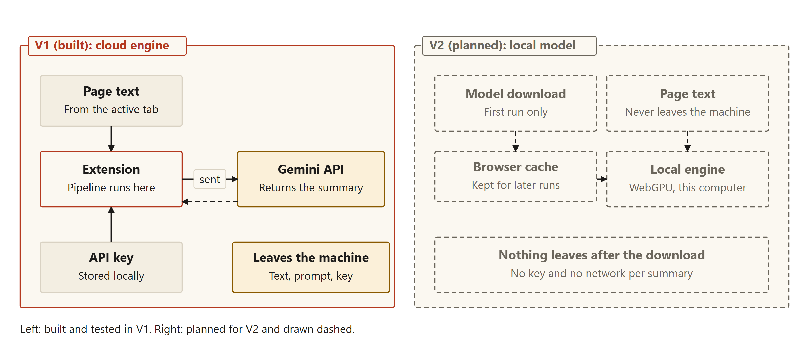

Reading the figure: the left box, labelled "V1 (built): cloud engine", shows the page text feeding the extension. An arrow labelled "sent" carries the text and the prompt to the Gemini API, and a dashed arrow returns the summary. The API key is stored on the computer and read by the extension. A box labelled "Leaves the machine" lists the text, the prompt and the key. The dashed box on the right is the later-stage design, in which the page text would stay on the machine. The caption says the left side is built and tested, and the right side is planned.

On every request in V1, the following leave the computer.

- The extracted main text of the page, in parts of up to 8,000 characters. Menus and advertisements are removed first. The examples file shows that none of the noise phrases from the test article reached the model.
- The page title and a fixed instruction text, which tells the model to treat the page as material, not as instructions.
- For a merge, the part summaries that earlier requests produced. They are sent again.
- The key, in a request header, and only to Google.

The page's HTML, the page address and the job record do not leave the computer. The web address of the request names only the model.

The point to make to a tutor is plain. The page text is not private in V1. It reaches Google for each part.

### What this means in plain words

The main text of the page, the instructions and the key go to Google. Nothing else from the page is sent. The text is not kept private in this version.

## The seam where the model can be swapped

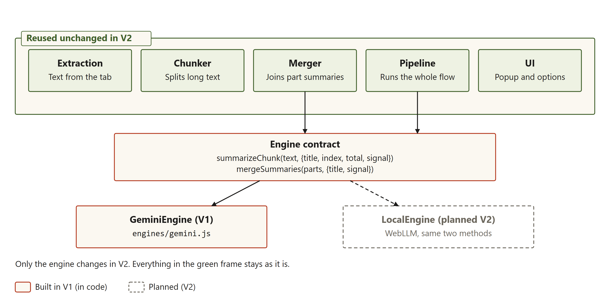

Reading the figure: a green frame at the top lists the parts that stay unchanged when a second engine is added at a later stage: extraction, the chunker, the merger, the pipeline and the user interface. Two arrows run down to a red box, the engine contract, which lists the two methods. Below it, the solid box is the Gemini engine, built in V1. The dashed box is a local engine planned for the later stage, which would offer the same two methods. The figure's point is that only the engine changes.

The contract has two methods. summarizeChunk takes one part and returns its summary. mergeSummaries takes a list of part summaries and returns one. The pipeline calls only these methods, and its header comment says it knows nothing about Chrome or any one provider. A new engine would need to offer the same two methods, and a one-part page would need the final summary format. This is a design property. The report does not claim that a second engine has been built or tested.

### What this means in plain words

The flow asks the engine for two things: a summary of one part, and a merge of several summaries. Any engine that answers those two requests can take the Gemini engine's place.

### Questions this chapter answers

**Why does the service worker run the job and not the popup?**
A popup closes as soon as the reader clicks elsewhere, which would stop a summary halfway. The service worker keeps running, and the popup reads the job record when it is opened again. Test T11 checks this.

**What would break first in this design?**
The service worker. Chrome can stop it during a job. The design writes progress, marks unfinished jobs as interrupted, and tests this in T18. The 30-part limit is also a cost control, because a very long page could use up a free-tier quota quickly.

**Where does the page text go?**
To Google, in parts of up to 8,000 characters, with the page title and the instructions. Nothing else from the page is sent.


<div style="page-break-after: always"></div>

# Technology choices

This chapter records the main decisions as short decision records. Each record gives the question, the options considered, the choice, the reasons against the others, and the trade-off accepted. Where a choice changed during the build, the record says so.

## Programming language

**The question.** Should the extension be written in plain JavaScript or in TypeScript?

Table: Language options compared

| Option | Build step before loading | Type checking |
|---|---|---|
| Plain JavaScript with ES modules and JSDoc comments | None; Chrome loads the files as they are | Editor hints from comments |
| TypeScript | A compiler must run first | Full checks at compile time |

**The choice.** Plain JavaScript, with ES modules (the import and export format that browsers and Node.js both read) and JSDoc comments, which describe parameter types in structured comments.

**Why not TypeScript.** The setup script would have to run a compiler on the client's computer, and a compiler update could break the build. The project plan chose no build step, so setup stays simple.

**Trade-off accepted.** The tests and careful reading must catch the type mistakes that a compiler would catch.

**What this means in plain words.** The code runs as written. Setup stays simple, but the tests carry more of the checking.

## Where the extension shows itself

**The question.** Should the interface be a toolbar popup, a side panel or a new tab?

Table: Interface options compared

| Option | Stays open while the reader works on the page? |
|---|---|
| Toolbar popup | No; it closes when the reader clicks elsewhere |
| Side panel | Yes, while it is open |
| New tab | Yes |

**The choice.** The toolbar popup. The project owner asked for a popup or a side panel and no new tab. The key box was placed inside the popup, so the reader does not leave it to add a key. The Options page still exists and opens in its own tab only when the reader chooses it.

**Why not the others.** The side panel was not built, so it was not tested. An early test harness opened the popup and the Options page as tabs. The owner noticed that the product looked as if it opened tabs, so the key moved into the popup and the harness opened the popup as a small window.

**Trade-off accepted.** The popup closes easily, so the work has to run in the background (see the next record).

**What this means in plain words.** The reader never leaves the page to use the tool, and the popup can disappear at any time.

## Text extraction

**The question.** How should the extension find the main text of a page and leave out menus, advertisements and footers?

Table: Extraction options compared

| Option | Fit for article pages | Effort |
|---|---|---|
| Mozilla Readability, copied into the project | Built to find the main article | Low; one file |
| Hand-written rules for each site | Depends on the rules | High; breaks when a layout changes |
| Raw visible text | Keeps menus and footers | Lowest |

**The choice.** Readability. The extractor uses it first. If the result is under 200 characters and the visible text is longer, the visible text is used. This fallback covers pages such as dashboards, which browser test T13 checks.

**Why not the others.** Rules would need one set per site. Raw text kept the noise. In the test article, 2,164 characters were visible, 1,711 characters were sent to the model, and none of the noise phrases such as "SUBSCRIBE NOW" reached it. Readability is the library behind Firefox's reading view.

**Trade-off accepted.** Readability can miss content. A defect shows the risk: table cells ran together in the text sent to the model. Browser test T21 caught it, and the fix joins cells with " | ".

**What this means in plain words.** The project uses a library built to pull out articles, plus a second method for pages it cannot read.

## Where the work runs

**The question.** Should the summary run in the popup or in the background service worker?

Table: Where the work can run

| Option | Keeps running when the popup closes? |
|---|---|
| Popup script | No; a multi-part summary would stop halfway |
| Service worker | Yes, while Chrome keeps it alive |

**The choice.** The service worker. It writes progress and the result to Chrome's session storage, which lasts until the browser restarts. The popup only sends a start message and reads the stored record.

**Why not the popup.** Closing the popup would kill the job. A full tab was ruled out for the reason in the interface record.

**Trade-off accepted.** Chrome can stop an idle worker mid-job. The design writes progress as it goes, marks a job found "running" after a restart as interrupted, and gives each job an id so that a replaced job can be stopped. The first version of this handling missed some cases. The browser tests found them, and they were fixed. Test T18 covers the stopped worker.

**What this means in plain words.** The summary keeps going when the popup closes. The cost is extra care, because Chrome can stop the background part at any time.

## How the cloud is called

**The question.** Should the extension call Google's API with a plain web request, or with Google's software development kit (SDK)?

Table: Ways to call the cloud service

| Option | Build step | Testability |
|---|---|---|
| Plain HTTPS request (fetch) | None | One endpoint, easy to fake |
| Official SDK | A bundler to package it | Harder to fake |

**The choice.** A plain HTTPS request with the browser's fetch function. The engine file, about 180 lines, holds the timeout, the retries and the mapping from HTTP status codes to the project's error codes.

**Why not the SDK.** The SDK needs a bundler, which adds a build step. A single endpoint is easy to replace with a fake server in the tests.

**Trade-off accepted.** The project owns the retry and error logic, which means more code to maintain. A timeout helper that the platform provides did not keep the test runner alive, so a test ended early. The project replaced it with its own timer that the code clears itself. The development log records this as a lesson about test harnesses.

**What this means in plain words.** The extension calls Google directly with a standard web request. The project handles failures itself.

## Where the key is stored

**The question.** Where should the Gemini key be kept?

Table: Key storage options compared

| Option | Where it is kept | Leaves this computer? |
|---|---|---|
| chrome.storage.local | This browser profile on this computer | No |
| chrome.storage.sync | Synced to the user's Google account | Yes, copied to the account |

**The choice.** chrome.storage.local. The popup and the Options page both say the key is kept in this browser only.

**Why not sync.** The project plan records that sync would copy the key to the user's Google account. Typing the key for every summary was also rejected as too much friction.

**Trade-off accepted.** The key is stored without encryption in the browser profile on disk. Anyone who can open that user account's profile could read it. The report states this as a limitation.

**What this means in plain words.** The key stays on the reader's computer, in the browser only, and it is not encrypted on disk.

## Which cloud model

**The question.** Which Gemini model should the extension call, and with which thinking setting?

Some models think before they answer, and the thinking takes time. The benchmark sent one request of about 7,000 characters to each candidate, three times per candidate.

Table: Measured request time for each candidate, from the model benchmark

| Model and setting | Measured time per request |
|---|---|
| gemini-3.8-flash, default thinking | 11.4 to 12.6 s |
| gemini-3.8-flash, thinking level low | 3.9 s, 3.9 s and 12.5 s |
| gemini-3.5-flash-lite, default | 1.6 to 2.0 s |
| gemini-2.5-flash, thinking off | 2.4 to 2.7 s |

The quota probe sent requests to each model until the service refused one, up to a ceiling of 30 requests. None of the four reached 30.

Table: Quota probe results, from the quota probe file

| Model | Successful requests before the first error | The first error |
|---|---|---|
| gemini-3.5-flash-lite | 16 | Quota error naming a limit of 15 |
| gemini-2.5-flash-lite | 11 | Quota error naming a limit of 10 |
| gemini-2.5-flash | 6 | Quota error naming a limit of 5 |
| gemini-3.1-flash-lite | 3 | Service reply 503, "high demand" |

The probe does not record the time window for each limit, so that window is [to be measured]. The first model recorded 16 successful requests against a named limit of 15, and the reason for that difference is [to be measured].

**The choice.** gemini-3.5-flash-lite with the thinking setting low. This is the default in the configuration file, and the live runs on real pages used it.

**How the choice changed.** The first choice was gemini-3.8-flash with low thinking. The development log records that its default setting took about 11 to 13 seconds per request, too close to the 25-second limit for a page with several parts. Low thinking cut the typical time to about 3.9 seconds, but one run in three still took 12.5 seconds. The project owner then asked for cheap models, and the default became gemini-3.5-flash-lite. It was the fastest in the benchmark and had the highest named limit in the probe.

**Why not the others.** The 3.8 model was slower and more variable. The 2.5 model with thinking off was slower, with a lower limit. The 2.5 lite model was not benchmarked, so its speed is [to be measured].

**Trade-off accepted.** The summary quality of the cheaper models was not compared formally. The live summaries show odd wording at times, for example "contagious error management" in the WebGPU summary, L07.

**What this means in plain words.** The project picked the fastest model the free tier allowed, after measuring the options on the same text. It did not measure whether the cheaper model writes better or worse summaries.

## Testing tools

**The question.** Which tools should run the unit tests and the browser tests?

**The choice.** The node:test runner, which is built into Node.js, for the unit tests. Playwright with its Chromium browser for the browser tests. The browser tests load the extension, open fixture pages, and call a small mock server in place of Google's API. The mock records each request and can simulate busy replies, errors, timeouts and empty answers.

**Why not the others.** Jest and Vitest add dependencies that node:test does not need. Selenium can drive a browser, but Playwright could also load the extension and take screenshots. Manual clicking alone cannot be repeated after each fix.

**A constraint that shaped the choice.** The project first tried to load the extension into the installed Google Chrome 155 with a command-line flag. The flag did not work. The development log records that Chrome 137 removed it from branded builds. So run.bat opens the extensions page and shows the steps, and the automated tests run on Playwright's Chromium, which still accepts the flag.

**Trade-off accepted.** The test copy adds a host permission for the local test server, so the browser tests do not exercise the real toolbar grant. The manual smoke test covers that path, and its results are [to be measured]. The mock also means the browser tests say nothing about the real model's answers. Live runs cover that, for the pages listed.

**What this means in plain words.** The tests run on a copy of the extension with a fake Google service, so they are repeatable and free. A manual check in the real browser is still needed.

## Look of the interface

**The question.** How should the popup and the Options page look?

**The choice.** A printed-page style: a paper background, dark ink, one red accent, a serif font for the summary, hairline rules, square corners, and numbered points. The owner said the first design looked as if an AI had made it, so the design was redrawn. A printed page suits a short text to read.

The screenshot shows the three popup states.


Reading the screenshot: panel A shows the idle popup with a single black Summarize button. Panel B shows the state with no key. The key box is open, with the message "No API key yet. Paste your Gemini key in the Key box and save it." Panel C shows the key saved inside the popup, with "Key saved. Now press Summarize." and a link to remove the key.

**Trade-off accepted.** The style is hand-written CSS, which the project must maintain. No formal usability test was run, so clarity to readers is [to be measured]. The first run found a layout fault on the Options page, where the Save button squeezed the key field, and the second run records a fix. A note from the first run, that the progress bar looks stuck during a retry, is not recorded as fixed.

**What this means in plain words.** The popup looks like a printed page, which suits reading. Whether readers find it clear has not been tested.

## What was prioritised and what was left for later

The project put its effort into the path a reader uses every day: press Summarize, read the page, split long text, summarize the parts, merge them, show the result, and show a plain message when something fails. The key handling sits on that path, since nothing else can be tested with real pages without it. The tests and the live runs were built to catch the failures a reader would meet. The midsem deliverable is a working cloud version, and a comparison with a later engine needs a working first engine to compare against.

Left for later are the local engine, offline use and the model download. These depend on the client's laptop, because the model size depends on its graphics card and memory. The abstract's plan of work places them in weeks 8 to 14, and the comparison depends on them. Also still open are a run of the setup scripts on a clean copy of the project, and the recorded manual check in the real Chrome browser. Both results are [to be measured].

### What this means in plain words

The cloud version is built, tested and measured where measurement was possible. The local model, the comparison and the client's laptop check come later. The clean-copy and manual checks still need their results recorded.

### Questions this chapter answers

**Why Gemini and not another service?**
The requirements document left the provider open between Gemini and NVIDIA. The plan chose Gemini because it needs one request call, offers a free tier and uses a simple key. The report does not compare other providers.

**Why keep the cheaper model when its quality was not tested?**
Speed and quota were measured, and they decided the choice. Quality was not compared formally, and the report states that limit.

**What does the key-storage choice cost the reader?**
The key sits unencrypted in the browser profile on the reader's computer. Anyone who can open that account's profile could read it.


<div style="page-break-after: always"></div>

# Text extraction

## What this part does and why it exists

Before a summary can be made, the extension needs the words of the page. This step is called extraction. It reads the page the reader has open, keeps the main article text, removes what is not article text (menus, cookie notices, adverts and footers), and passes the clean text to the next step.

A web page is built from HTML, the markup that tells a browser which part is a heading, a paragraph or a menu. Copying every word would waste the model's input on navigation links, cookie banners and footers.

Extraction also decides when to stop. A page with almost no readable text, or a page that Chrome does not let an extension read, is refused before any request is sent.

## How it works

Extraction is split between the service worker (the background script Chrome runs for the extension) and a small script that runs inside the page. The steps follow `midsem/project/src/background/extract-tab.js` and `midsem/project/src/content/extract.js`.

**Step 1: check the address.** The service worker asks Chrome for the tab's address. If the address starts with a scheme Chrome keeps for itself (`chrome://`, `edge://`, `about:`, `view-source:`, `file:`, `data:` or `blob:`), or the page is the Chrome Web Store, the code stops with RESTRICTED_PAGE. No request is sent. Test T10 opens `chrome://version` and checks this result with zero requests.

**Step 2: inject the reader.** Chrome lets the extension run two small scripts inside the tab, a content script (a script that runs inside the page you are reading). They are Readability and then `extract.js`. Only the main page is read, because the call does not ask Chrome to include frames. If Chrome refuses the script, the error text decides the code. A permission-type refusal becomes RESTRICTED_PAGE, and any other failure becomes EXTRACT_FAILED.

**Step 3: find the article.** Readability is a library maintained by Mozilla, and it is the library behind Reader View in Firefox. The extension gives it a copy of the page (`document.cloneNode(true)`), so the page on screen is not changed. Readability returns the main article as HTML. The library is copied into the project as one file, its Apache 2.0 licence sits beside it, and no build tool is needed.

**Step 4: turn the article into plain text.** `extract.js` walks the tags and skips `script`, `style`, `noscript`, `template`, `svg`, `canvas` and `iframe` contents. Blocks such as paragraphs, headings, list items and tables start on a new line. Table cells are separated by " | ", and each row ends on its own line. Repeated spaces are collapsed, and runs of blank lines are cut to one.

**Step 5: fall back to the visible text.** If the article text is under 200 characters, the code reads the text the browser shows for the page body, and keeps it only when it is longer. This covers dashboards and app-style pages where Readability finds no article.

midsem/project/src/content/extract.js, lines 71 to 77:

```js
    if (text.length < 200) {
      const fallback = tidy(document.body ? document.body.innerText : '');
      if (fallback.length > text.length) {
        text = fallback;
        method = 'fallback-innerText';
      }
    }
```

**Step 6: check the length.** The pipeline (`midsem/project/src/core/pipeline.js`) cleans the whitespace again. If fewer than 200 characters remain, the code raises TOO_LITTLE_TEXT and stops. The popup shows "This page has too little readable text to summarize." and no request is made.

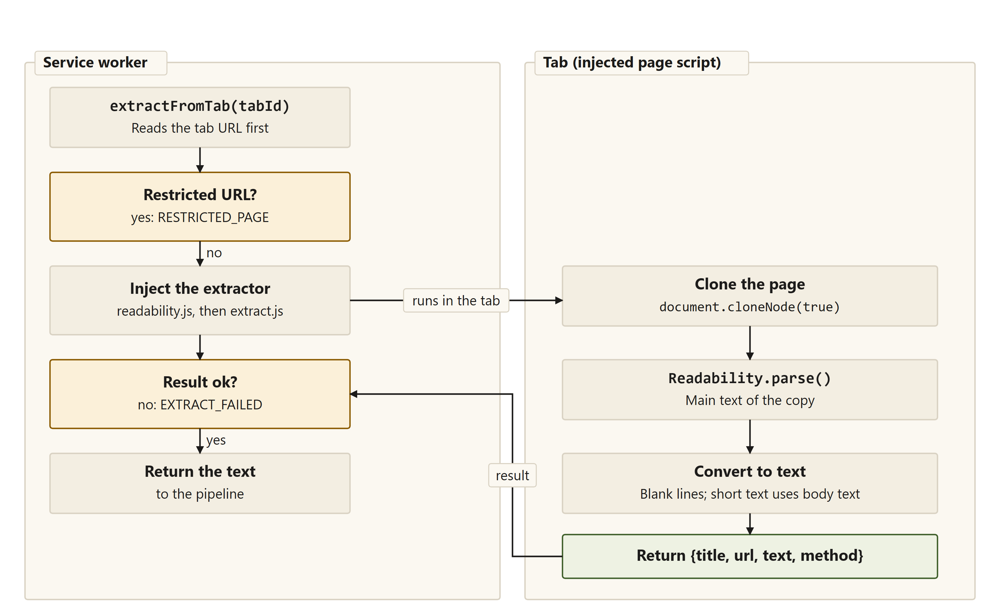

Reading the figure: two columns. The left column is the service worker. It reads the tab address, checks for a restricted address, injects the two scripts and checks the result. The right column is the tab. It clones the page, runs Readability, converts the article to text and returns the title, address, text and method name. The arrow labelled "result" carries that answer back to the "Result ok?" check, which either returns the text or stops with EXTRACT_FAILED.

### What this means in plain words

The extension copies the page, picks out the article with a known library, turns it into plain text, and uses the visible text only when the article is too short. Each known failure becomes a short popup message.

## Design decisions

Table: Options considered for finding the article text

| Option | Decision | Reason |
|---|---|---|
| Mozilla Readability, copied into the project as one file | Chosen | Built to drop menus, adverts and footers. No build step is needed. |
| Hand-written heuristics, meaning the project's own rules for finding the main block | Rejected | The V1 plan judged a purpose-built library better for this job. |
| The whole visible text of the page | Kept only as a fallback | It includes menus, cookie text and footers. |

The trade-offs are one extra third-party file with a licence to credit, and the chance that Readability drops real text on an unusual layout. The fallback helps only when Readability returns very little.

### What this means in plain words

The project uses a known article finder with a simple fallback. It accepts that the finder sometimes misses text on unusual pages.

## Worked example

The fixture page `article-short.html` shows the effect of extraction. The page held 2164 visible characters. The text sent to the model had 1711 characters, so 453 characters (about 21 percent) were removed. The raw text began "Harbour Daily HomeWorldScienceTravelSubscribe How a Lighthouse Lens Works". The text sent to the model began "A lighthouse lamp on its own is weak." The page held six kinds of noise: "SUBSCRIBE NOW", "Accept all cookies", "Related articles", "Advertise with us", "SPONSORED" and "Terms of use". None reached the model (`midsem/docs/test-runs/examples.md`).

Table: Extraction results on the fixture pages (examples.md)

| Page | Outcome | Method | Characters |
|---|---|---|---|
| article-short.html | Summarized | readability | 1711 |
| dashboard.html | Summarized | fallback-innerText | 384 |
| late-content.html (300 ms delay) | Summarized | readability | 602 |
| near-empty.html | Refused: too little readable text | none | none |

The real pages in the live runs also used the readability method. The Wikipedia article on lighthouses gave 36,752 characters (L04), and the Wikipedia article on Fresnel lenses gave 48,289 characters (L05) (`midsem/docs/test-runs/live-measurements.md`).

## Failure cases and how they are handled

- **Restricted page.** Refused before any request (T10).
- **Almost no text.** Refused with TOO_LITTLE_TEXT and no request (T02, near-empty page).
- **Script refused by Chrome.** RESTRICTED_PAGE or EXTRACT_FAILED, depending on the error text.
- **Late text.** The extension does not wait. It reads the page when Summarize is pressed. A page whose text arrives 500 ms after load is summarized (T12). A page whose text is still missing is refused (T12b).

## What went wrong while building it

The table bug (B3) was the most serious extraction problem. On `table-article.html`, the model received "QuarterRevenueMargin" and "Q14.5M12%" instead of separate cells. The popup still showed a normal summary, so nothing on screen revealed the damage (`run-1.md`).

The cause was that the text walker added no separator between cells. The fix puts " | " between cells and ends each row on its own line, so a row reads "Q1 | 4.5M | 12%". The first attempt made every row its own paragraph, and test T21 caught that too. Run 2 tightened T21 to require the single-line format, and then passed 26 of 26 browser scenarios.

Test T12b also had a timing problem. Its page started a timer on load, so under load the text had arrived before the test pressed Summarize. The delay was raised from 4 seconds to 20 seconds (`run-1.md`, section 3).

### What this means in plain words

The most serious bug changed numbers in the text the model read and showed no error. The lesson recorded is that silent damage is worse than a visible error, so the test uses markup that real sites produce, with no spaces between cells.

## How it was tested

- `midsem/project/tests/e2e/smoke.test.js`: a short article, with noise removed before the model sees it.
- `midsem/project/tests/e2e/pipeline.test.js`: T02 (near-empty page), T10 (restricted page), T12 and T12b (late content), T13 (dashboard fallback) and T21 (table cells).
- Six fixture pages in `midsem/project/tests/fixtures/`.
- No unit test calls `extract.js` directly. The browser scenarios check it. The chunker unit tests cover the text after extraction.

## Limitations

- **Frames.** Text inside an iframe is not read. Not tested with a real framed page.
- **Pages behind a login.** The extension reads only what the tab shows and does not sign in. A page showing only a sign-in form gives a summary of that form, or a too-little-text refusal. Not tested with a real login.
- **Text drawn without HTML.** Text on a `canvas` or inside `svg` is skipped, and the fallback cannot see it either. Not tested.
- **Few live sites.** Four real websites (L04 to L07) were run live, plus fixture pages.

## Questions this chapter answers

**Why not copy the whole page?**
Menus, cookie notices and footers would reach the model and dilute the summary. Extraction keeps the article and drops the rest.

**What happens when a page has almost no text?**
The extension stops before any request is sent and shows the too-little-text message. The check uses 200 characters, the same limit as the fallback step.

**Why was the table bug not caught by eye?**
The summary on screen looked normal, and the popup reported success. The model had been given fused numbers such as "Q14.5M12%". Only a test that inspects the text sent to the model could show the problem.

**What would break first on a page drawn with a canvas?**
The text is not in the page's HTML, so neither Readability nor the visible-text fallback can read it. The most likely result is the too-little-text message. This case has not been tested.


<div style="page-break-after: always"></div>

# Long pages

## What this part does and why it exists

Many pages are too long to summarize in one request. The extension splits a long page into parts, summarizes each part, and combines the part summaries into one summary.

The project splits pages for two reasons. The requirement list asks for it (FR3 in `midsem/V1_PLAN.md`). Each request must also finish within 25 seconds. The plan says plainly that a large-context cloud model does not strictly need splitting. The step is kept so that the path is built and tested, and the part size is a setting. The popup shows progress as it goes: "Summarizing part 2 of 4..." and then "Combining 4 summaries...".

## How it works

The splitting and merging code is pure logic with no browser code in it. It lives in `midsem/project/src/core/chunker.js`, `merger.js` and `pipeline.js`, so it can be tested on its own.

**Step 1: check the size.** The default part size is 8,000 characters (`chunkChars` in `config.js`). A page that fits in one part skips splitting.

**Step 2: split into parts.** The splitter works from coarse to fine. Paragraphs (separated by blank lines) are packed together until the next one would exceed the limit. A paragraph that is too long is split at sentence ends. A sentence still too long is cut at the last space before the limit, unless that space sits in the first half of the limit, in which case the cut is at the limit. A run of characters with no spaces is cut at the limit. No part is empty or too long, and the order is kept.

midsem/project/src/core/chunker.js, lines 72 to 81:

```js
  for (const unit of units) {
    if (current.length === 0) {
      current = unit;
    } else if (current.length + 2 + unit.length <= maxChars) {
      current += '\n\n' + unit;
    } else {
      chunks.push(current);
      current = unit;
    }
  }
```

**Step 3: summarize each part.** The parts go to the cloud service one at a time, in page order. Each prompt names the part ("This is part 2 of 4 of one long web page") and asks for three to six short sentences with no bullets.

**Step 4: combine the summaries.** If the part summaries fit together in one request, one merge request makes the final summary. If they do not, the code merges them in groups, merges the group results, and repeats until one summary is left. Every request stays within the part size.

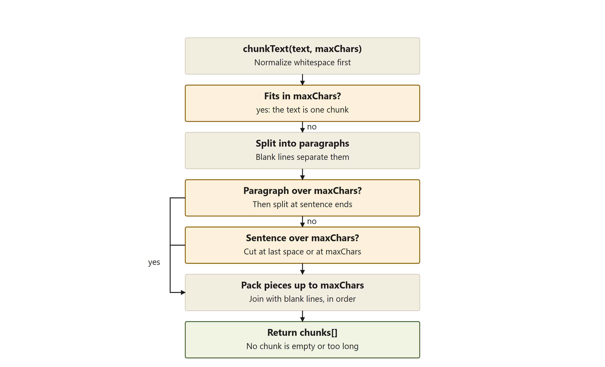

Reading the figure: the top box normalizes the whitespace. The first question is whether the whole text fits the limit. If it does, the text is one part. If not, it is split into paragraphs. Each paragraph over the limit is split at sentence ends, and each sentence still over the limit is cut at a space or at the limit. The "yes" arrow on the left carries the pieces to the packing box, which joins them back up to the limit in order. The last box returns the parts.

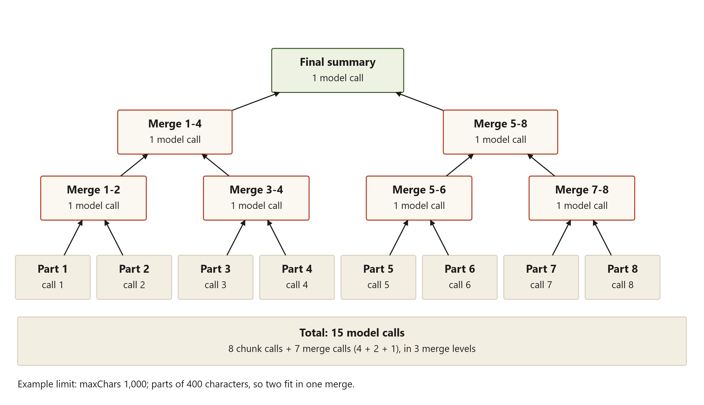

Reading the figure: this is an illustration, not a real run. It assumes a limit of 1,000 characters and parts of 400 characters, so two parts fit in one merge request. Eight parts make four merges, then two, then one. The total is 15 requests: 8 for the parts and 7 for the merges.

### What this means in plain words

A long page is cut into pieces no bigger than the limit. Each piece is summarized. The piece summaries are combined in small groups until one summary is left. Each request stays small enough to finish in time.

## Design decisions

Table: Options considered for long pages

| Option | Decision | Reason |
|---|---|---|
| Split by paragraph, then sentence, then word | Chosen | Cuts fall at natural breaks where possible. |
| Cut the text every N characters | Rejected | Cuts fall mid-sentence, so part summaries start and stop in odd places. |
| Send the whole page in one request | Rejected | One large request must finish within 25 seconds, and the requirement list asks for splitting. |
| Merge the part summaries in small groups, repeated as needed | Chosen | Each merge request stays within the part size. |
| Merge all part summaries in one request | Rejected | On a long page the request can grow past the part size. |
| Refuse pages over 30 parts | Chosen | Protects the free quota. |

The trade-off is that a page over the limit is refused rather than partly summarized.

### What this means in plain words

The extension cuts at natural breaks, keeps each request within the part size, and refuses pages that would need too many requests.

## Worked example

The fixture page `article-long.html` has 10,532 characters of text. The tables below come from `midsem/docs/test-runs/examples.md`. The summary text in that file came from a mock server, but the page text, the splitting and the prompts are real.

Table: Parts at 3,000 characters per part (examples.md; the start and end of each part are cut short in the file)

| Part | Characters | Starts with | Ends with |
|---|---|---|---|
| 1 of 4 | 2720 | Join The Coastal Review Members Club today and receive a fre... | run low might be fined or dismissed. The Eddystone problem |
| 2 of 4 | 2580 | Building a lighthouse on land is hard enough, but the most d... | still turn on their original mechanisms. The keeper's life |
| 3 of 4 | 2656 | Behind every lamp was a keeper, and often a family. A keeper... | ar weather and is only a guide. Radio, radar and satellites |
| 4 of 4 | 2570 | For most of the twentieth century, lighthouses were joined b... | l remain on the coast long after their original job is done. |

Four parts gave five model requests (four parts and one merge).

Table: Parts at 8,000 characters per part (examples.md; text cut short in the file)

| Part | Characters | Starts with | Ends with |
|---|---|---|---|
| 1 of 2 | 7960 | Join The Coastal Review Members Club today and receive a fre... | ar weather and is only a guide. Radio, radar and satellites |
| 2 of 2 | 2570 | For most of the twentieth century, lighthouses were joined b... | l remain on the coast long after their original job is done. |

Two parts gave three model requests (two parts and one merge).

The parts add up to slightly less than the page. At 3,000 characters the parts total 10,526, which is 6 less than 10,532. At 8,000 they total 10,530, which is 2 less. Each gap is the blank line between two parts, and it is dropped when a new part starts. That makes three gaps at the smaller size and one at the larger size.

The live runs show the same pattern on real pages. The Wikipedia article on lighthouses (36,752 characters) gave five parts, six requests and 17.8 seconds. The Wikipedia article on Fresnel lenses (48,289 characters) gave seven parts, eight requests and 23 seconds (`midsem/docs/test-runs/live-measurements.md`, L04 and L05). A one-part page skips the merge. The short article in run L01 made one request in 1.7 seconds.

## The 30-part limit

A page that needs more than 30 parts is refused before any request is sent. The popup shows "This page is too long for Version 1 to summarize. Try a shorter page." At the default part size, 30 parts is about 240,000 characters.

The limit protects the free quota. The quota probe (`midsem/docs/test-runs/quota-probe.json`) sent requests until the service refused one. For the chosen model, the first quota error came after 16 successful requests, and the error named a limit of 15 requests. The probe file does not state the time window. One huge page could therefore use up the quota in a single summary. The live run L08 lowered the limit to 10 parts on a very long article, and the page was refused in 0.6 seconds, before any model call.

The limit counts parts only. The merge requests come on top of that count.

### What this means in plain words

The limit counts parts, not requests. A page at the limit still sends merge requests, so its quota cost is higher than the part count alone.

## What went wrong while building it

A review of the test results found that nothing stopped a huge page from making many requests. DEVLOG records this as a missing guard rather than a defect. The fix was the 30-part limit, which has its own test, T23.

The known weakness is in `midsem/project/src/core/merger.js`, line 46. If no two part summaries fit together, the code merges all of them in one request, even when each fits alone. The probe in run 1 (finding O1) gave three parts of 400 characters with a limit of 500, and the result was one merge request of 1,204 characters. This happens only when part summaries are large, about half the part size (roughly 4,000 characters at the default). That makes it unlikely with the default settings. The code has not been changed. A unit test named "parts too big to share a request are merged at once instead of looping forever" checks that the merge finishes instead of repeating forever.

### What this means in plain words

The limit protects the quota and is the only cap on requests per page. One merge case sends more text than intended, but it is rare with the default settings, and the code does not yet fix it.

## How it was tested

- `midsem/project/tests/unit/chunker.test.js`: 10 tests, including sentence splitting, hard cuts on long words, and the rule that no part is empty or too long.
- `midsem/project/tests/unit/merger.test.js`: 8 tests, including grouped merges and the forced single merge.
- `midsem/project/tests/unit/pipeline.test.js`: 7 tests, including a long page split, summarized part by part and merged in order.
- `midsem/project/tests/e2e/pipeline.test.js`: T01 (four parts go out in order and are merged), T11 (popup closed mid-run, every part sent once) and T23 (over the limit, refused before any model call).
- Live runs L02, L03, L04, L05, L07 and L08.

## Limitations

- The merge step sees only the part summaries, not the page text. A fact that a part summary leaves out cannot come back.
- A cut can fall in the middle of an argument. Each part is summarized alone, so the summary may not connect one part to the next. This has not been measured with readers.
- The effect of other part sizes on summary quality is [to be measured].
- The live runs are single measurements, one row per page.

## Questions this chapter answers

**Why split a page at all?**
The requirement list asks for it, and each request must finish within 25 seconds. The plan also says the cloud model does not strictly need it, so the step is kept as a tested path with an adjustable size.

**Why refuse a 31-part page instead of summarizing part of it?**
A partial summary would look complete while quietly leaving out part of the article. A clear refusal is more honest, and the limit also protects the free quota.

**What happens if one part fails?**
The run stops at that part and nothing is merged. The popup shows the message for that failure. A unit test checks that nothing is merged after a failure.

**Why did the merge need a tree?**
Merging all the part summaries in one request could exceed the part size on a long page. Merging in small groups keeps every request within the part size.


<div style="page-break-after: always"></div>

# The cloud model and errors

## What this part does and why it exists

This part sends the prompt to Google's Gemini API, reads the answer, and handles each way a request can fail. Gemini is a language model hosted by Google that writes the summary. The extension only sends text and receives text. Nothing runs on the reader's computer.

Many things can go wrong: the key may be wrong, the free quota may be used up, the service may be busy, the network may drop, or the answer may be empty. Each failure becomes one short code with one plain message, and some failures are retried first. The model is `gemini-3.5-flash-lite` (`midsem/project/src/core/config.js`). Chapter 5 explains how it was chosen.

## One request in plain words

Each request does five things. The code is in `midsem/project/src/engines/gemini.js`.

1. **Build the address.** The address is the service's base address, then the model name, then the word for generating content. The extension may contact only this one host, as listed in `manifest.json`.
2. **Attach the key in a header.** A header is a small label sent with the request, separate from the address. The key goes there:

midsem/project/src/engines/gemini.js, lines 115 to 121:

```js
        response = await fetchImpl(url, {
          method: 'POST',
          // The key goes in a header, never in the URL, so it cannot end up in logs or history.
          headers: { 'Content-Type': 'application/json', 'x-goog-api-key': settings.apiKey },
          body,
          signal: requestSignal,
        });
```

An address appears in the address bar, can be saved in history, and is easy to copy into a log. A header is not part of the address, so copying a link never copies the key.

3. **Send the prompt and settings.** The body holds the prompt, a temperature of 0.2 (a setting that controls how much the wording can vary), and a speed setting called `thinkingLevel`, set to `low`. In the benchmark, the larger model took 11.4 to 12.6 seconds with its default setting. With `low`, it took about 3.9 seconds in two runs and 12.5 seconds in the third. The chosen model answered in 1.6 to 2.0 seconds in all three runs (`midsem/docs/test-runs/model-bench.json`).
4. **Wait at most 25 seconds.** The code starts its own timer for each attempt. No answer within 25 seconds is reported as TIMEOUT.
5. **Read the answer.** The summary is taken from the answer's text. If the text is empty, or the service blocks the answer, the code reports EMPTY_OR_BLOCKED.

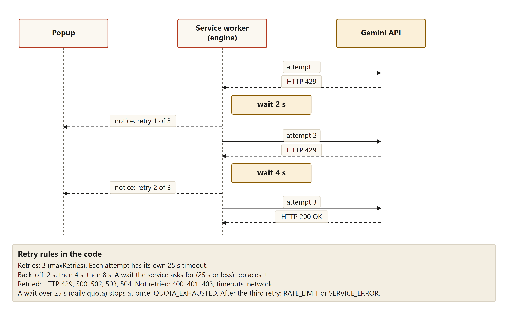

Reading the figure: three lanes show the popup, the service worker and the Gemini service. The first attempt gets HTTP 429, which means too many requests. The service worker waits 2 seconds and sends a notice to the popup. The second attempt also gets 429, so it waits 4 seconds and sends another notice. The third attempt succeeds. The footer mentions a 60-second cap on the Retry-After header. The code has no such cap on server waits. The only cap is the 25-second limit on rate-limit waits, described below.

### What this means in plain words

The extension sends one request with the key in a header and the prompt in the body. It waits up to 25 seconds and then reads the text that comes back.

## The prompts in plain words

The prompts are built in `midsem/project/src/core/prompts.js`. A single-part page gets a prompt asking for one overview sentence and three to six bullets. The bullets hold key facts, names and numbers in page order. The prompt says to use only what is in the text.

The page text sits between two markers, `<<<PAGE TEXT START>>>` and `<<<PAGE TEXT END>>>`. A line before it tells the model that the text is web page content to summarize, never instructions to follow. The file's own comment says this limits the risk from a hostile page but does not remove it. The merge prompt is weaker. It wraps the part summaries in their own markers, but it does not repeat that line. Its input comes from page text, so this is a known gap.

## Hostile output shown as plain text

Test T14 checks what happens when the model returns HTML markup. The popup builds its text with `textContent`, so markup is shown as typed characters and never becomes page content.

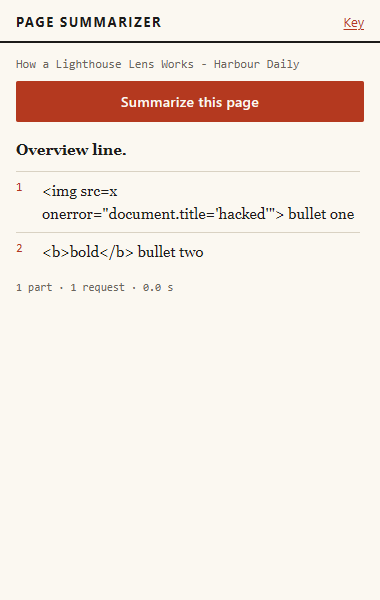

The first line of the hostile answer is a plain paragraph. The two numbered points show an image tag and a bold tag as raw text. The stats line reads "1 part · 1 request · 0.0 s" because the answer came from a mock server.

### What this means in plain words

Whatever the model writes appears as words, never as a picture, link or bold text.

## Retries and waiting

Some failures are temporary, so the code retries them. The retried codes are 429 (too many requests) and 500, 502, 503 and 504 (server problems). There are three retries, so one part can make up to four requests.

midsem/project/src/engines/gemini.js, lines 153 to 159:

```js
      if (RETRYABLE_STATUS.has(response.status) && attempt < settings.maxRetries) {
        // Prefer the wait the server asked for; otherwise back off 1x, 2x, 4x the base delay.
        const delayMs = waitSeconds !== null ? waitSeconds * 1000 : settings.retryBaseDelayMs * 2 ** attempt;
        onNotice({ type: 'retry', code, attempt: attempt + 1, maxRetries: settings.maxRetries, delayMs });
        await sleep(delayMs, signal);
        continue;
      }
```

The wait is the server's own time when the server gives one. The server can send it in a `Retry-After` header, in a detail in the error body, or in a sentence such as "Please retry in 50.102032823s." (the wording seen in the quota probe). Without a server time, the waits are 2, 4 and 8 seconds. Before each wait, the popup shows a notice such as "The service is busy. Trying again in 2 s (attempt 1 of 3)." Test T05 checks the notice, and test T06 checks that a rate limit that never clears stops after four requests.

Errors that waiting cannot fix are not retried: wrong keys (401 and 403), bad requests (400), 404, timeouts, network failures and empty answers. The code does not retry a timeout, since that request has already used its 25 seconds.

### The quota case

A 429 can also mean the free quota is used up. The server then gives a long wait. If the wait is longer than 25 seconds, the code stops at once and shows the wait in words. Screenshot J in the popup shows this message with a wait of about 7 hours.

The quota probe (`midsem/docs/test-runs/quota-probe.json`) sent requests until the service refused one. The table applies the 25-second rule to each first error in that file. The probe file does not state the time window for each limit.

Table: First error in the quota probe, and what the rule in gemini.js does with it

| Model | Limit named in the error | Successful requests before the first error | Wait named by the service | Result under the rule |
|---|---|---|---|---|
| gemini-3.5-flash-lite | 15 | 16 | 50.1 seconds | Stops at once as quota used up |
| gemini-2.5-flash-lite | 10 | 11 | 33.3 seconds | Stops at once as quota used up |
| gemini-2.5-flash | 5 | 6 | 22.2 seconds | Waits 22.2 seconds, then retries |
| gemini-3.1-flash-lite | not named | 3 | none; answer was HTTP 503 | Retries with 2, 4 and 8 second waits, then SERVICE_ERROR |

The weakness is visible in the first row. A 50-second wait is reported as "used up for now". That may be wrong if the limit is short, and the probe file cannot settle it.

### What this means in plain words

Short, temporary failures are retried with the wait the service asks for. A long wait stops at once, with a message that the quota is used up. Whether that label is always right is not yet known.

## Error codes and messages

The table lists all 14 codes from `midsem/project/src/core/errors.js`. The message column is the exact text the reader sees. The popup shows the message, and the technical detail goes only to the console.

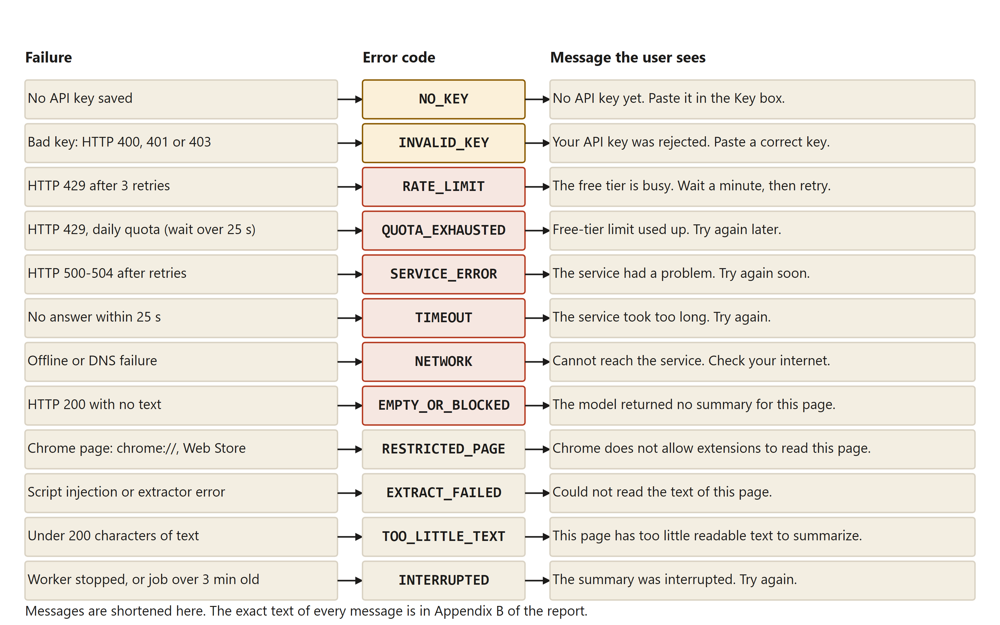

Reading the figure: each row runs from a failure on the left, through an error code in the middle, to a message on the right. The two yellow boxes are the key problems. The pink boxes are rate-limit, service, timeout, network and empty-answer problems. The figure does not show QUOTA_EXHAUSTED, TOO_LONG or CANCELLED. Some of its messages are older than the code, so the table below is the reference.

Table: Error codes, messages and triggers

| Code | Message the reader sees | What triggers it |
|---|---|---|
| NO_KEY | No API key yet. Paste your Gemini key in the Key box and save it. | No key is saved when Summarize is pressed. |
| INVALID_KEY | Your API key was rejected. Paste a correct key in the Key box. | HTTP 401 or 403 (not a 403 about location), or HTTP 400 that mentions the key. Not retried. |
| RATE_LIMIT | The free tier is busy right now. Wait a minute and try again. | HTTP 429 that still fails after the retries. |
| QUOTA_EXHAUSTED | The free-tier limit for your API key is used up for now. Try again {wait}, or use a different key. | HTTP 429 with a server wait over 25 seconds. Not retried. |
| NETWORK | Cannot reach the service. Check your internet connection. | The request fails before any answer. Not retried. |
| TIMEOUT | The service took too long to answer. Try again. | No answer within 25 seconds. Not retried. |
| SERVICE_ERROR | The service had a problem. Try again in a moment. | HTTP 500, 502, 503 or 504 after the retries. Also other statuses, such as 404 or a 403 about location. Not retried. |
| TOO_LITTLE_TEXT | This page has too little readable text to summarize. | Under 200 characters of text. No request sent. |
| TOO_LONG | This page is too long for Version 1 to summarize. Try a shorter page. | More than 30 parts needed. No request sent. |
| RESTRICTED_PAGE | Chrome does not allow extensions to read this page. | A Chrome address, a Web Store page, or a script Chrome refuses. No request sent. |
| EXTRACT_FAILED | Could not read the text of this page. | The reader script fails for another reason. No request sent. |
| EMPTY_OR_BLOCKED | The model returned no summary for this page. | The answer has no text, or the service blocks it. Not retried. |
| INTERRUPTED | The summary was interrupted. Press Summarize to try again. | The worker stopped during a job, or a running job has been silent for 3 minutes. |
| CANCELLED | Cancelled. | The tab moved to another page or was closed. This message is never shown. |

In QUOTA_EXHAUSTED, "{wait}" becomes "in about 7 hours" when the server gives a time, and "later" when it does not. Waits under 90 seconds read "a minute". Longer waits are shown in minutes or hours.

### What this means in plain words

Every failure has one code and one message. Temporary failures are retried. Failures that waiting cannot fix stop at once and tell the reader what to do.

## Timeouts, empty answers and blocked answers

A request that takes longer than 25 seconds is cut off, and the reader sees "The service took too long to answer. Try again." Test T08 makes the model slower than the limit and checks for exactly one request and no retry. The benchmark times of 1.6 to 2.0 seconds leave a wide margin.

If the service returns no text, the reader sees "The model returned no summary for this page." Test T09 checks an empty answer, and test T09b checks an answer blocked for safety. In both cases the code makes one request and does not retry. The service's reason is kept in the console detail.

### What this means in plain words

A slow request is cut off after 25 seconds. An empty or blocked answer is reported once, and no second request is made.

## What went wrong while building it

The timeout tests first showed four tests as cancelled. Two causes were found. The timer from `AbortSignal.timeout()` did not keep the test runner alive, and the fake fetch returned one response object that could only be read once. The engine now uses its own timer, cleared in a `finally` block, and the fake returns a copy each time (DEVLOG).

The first model took 11.4 to 12.6 seconds per summary request, and one request returned HTTP 503. That was too close to the 25-second limit. The fix was the speed setting and a faster model (DEVLOG).

Every HTTP 403 was first reported as an invalid key. A 403 about the caller's location is now SERVICE_ERROR. Other 403 answers still give INVALID_KEY, so the fix is partial (DEVLOG; quoted as O4 in run 1).

### What this means in plain words

Most real problems in the request path were about timing and wording, not logic. The timing problem was fixed with a faster model and a speed setting. The wording problem was fixed by reading the location text in the 403 message.

## How it was tested

- `midsem/project/tests/unit/gemini.test.js`: 18 tests with a fake fetch, covering the header, retries, back-off, timeouts, empty and blocked answers, and caller aborts.
- `midsem/project/tests/unit/fixes.test.js`: the 403 location case, the reading of wait times, and the quota case with no retries.
- `midsem/project/tests/e2e/pipeline.test.js`: T04 (wrong key), T05 (busy twice, then success), T06 (busy every time), T07 (server error every time), T08 (timeout), T09 and T09b (empty and blocked answers), T14 (hostile output) and T24 (quota used up). The evidence files do not record a run of T24, so its result is [to be measured].
- Live run L09, a wrong key on the real service, gave INVALID_KEY in 0.5 seconds. Live run L08 gave TOO_LONG with no request.

## Limitations

- The merge prompt does not repeat the "treat as material" line.
- The no-cap rule for long waits applies only to 429. For a 500-level error, the code waits for the server's stated time with no limit.
- A 403 for a reason other than location is still reported as an invalid key.
- The quota's time window is not recorded, so the 25-second rule cannot be checked against it.
- Automated tests use a mock service. The live runs are single measurements, one row per case.
- The faster model was not compared with the larger one for summary quality (DEVLOG).

## Questions this chapter answers

**Why is the key sent in a header?**
An address is easy to copy, save and log, while a header is not part of the address. The code comment gives the same reason.

**Why are only some errors retried?**
Retrying a wrong key or a bad request cannot help, and a timeout has already used its time. Busy and rate-limit errors are the ones likely to clear after a short wait.

**Why stop at once on a long wait?**
A wait of hours cannot be shortened by retrying in a few seconds. The reader is told when to come back.

**What happens if the model returns something hostile?**
It appears on screen as plain words, because the popup builds its text with `textContent`.


<div style="page-break-after: always"></div>

# The user interface

## What this part does and why it exists

The popup is the only screen the reader uses. It opens from the Chrome toolbar icon and is 380 pixels wide (`midsem/project/src/ui/ui.css`). It holds a Summarize button, a Key box for the Gemini key, a progress line, a notice line, an error area and the finished summary.

Chrome closes a popup as soon as the reader clicks elsewhere (`midsem/V1_PLAN.md`). The popup therefore does no summarizing itself. It asks the service worker to start the job, then shows the job's current state. The Options page is a second, optional place to change the key.

## The popup in each state

The summaries in these screenshots come from a mock server, so the sentences are not real model output.


Panel A shows the idle popup: the page title, a dark Summarize button and a Key link in the top right corner. Panel B shows no key saved. The Key box is open, its input is outlined in red, and a red-edged note says "No API key yet. Paste your Gemini key in the Key box and save it." with an "Open the Options page" link. Panel C shows a saved key. The placeholder changes to "Paste a new key to replace the saved one", a "Remove saved key" link appears, and a green line says "Key saved. Now press Summarize." The button is red in panel B and dark in A and C. The stylesheet turns the button red on hover, which is the likely cause, but the screenshot does not confirm it.


Panel D shows a run in progress: "Summarizing part 2 of 4...", a thin red progress line, and a grey button, which is disabled while a job runs. Panel E shows a retry. The label reads "Summarizing...", an ochre note says "The service is busy. Trying again in 2 s (attempt 1 of 3).", and the progress line has no fill. Panel F shows the finished summary: a bold overview line, numbered points with red numbers, and the line "4 parts · 5 requests · 2.1 s".


Panels G, H and I show three single-message states: too little text, a page Chrome does not allow, and a page too long for Version 1. Panel J shows the quota case. It says the free-tier limit is used up and gives a wait of "about 7 hours", with the Key box open below it and an "Open the Options page" link.

### What this means in plain words

The popup shows one state at a time: idle, asking for a key, working, retrying, showing a summary, or showing one short message.

## The Key box and why nothing opens in a new tab

The Key link in the header opens the Key box. The box also opens by itself when no key is saved or when a key problem appears. The reader pastes the key and presses "Save key" or Enter. The box checks the input before saving. An empty box gives "Paste a key first." A key with a space gives "A key has no spaces. Check what you pasted." A good key gives "Key saved. Now press Summarize." The key is stored in `chrome.storage.local`, which keeps it in this browser only.

An earlier version opened the Options page in a new tab. The project owner watched a test run and asked for the product to stay in the popup, because it looked as if it opened tabs (DEVLOG.md, the design change entry). Now nothing opens by itself. The "Open the Options page" link appears only for key problems, and it opens a tab only when the reader presses it.

### What this means in plain words

The reader can fix a missing or rejected key without leaving the popup. A tab opens only when the reader asks for one.

## The Options page


The Options page saves or removes the same key, in the same storage. The screenshot shows a green line "A key is saved in this browser.", the key field with the placeholder "Paste a new key to replace the saved one", a Save button, the line "Saved. You can close this tab and press Summarize." and a red "Remove saved key" link. The Save button keeps its normal width, so the key field stays usable. An earlier layout squeezed the field, which the test run recorded as a visual problem.

## The printed-page design

The popup looks like a printed page. The background is warm paper (`#fbf8f1`) and the text is near-black ink (`#1c1b1a`). One red accent (`#b4391f`) marks the hover colour of the main button, the error rule, the progress line and the numbers. The summary is set in a serif font (Georgia, 15 pixels). Small labels are uppercase. Sections are separated by thin rules, not boxes. Corners are square, with a 2-pixel radius on buttons and none on inputs. Points are numbered by the stylesheet.

DEVLOG records the reason. The first interface used a common blue look with rounded cards. The project owner said it looked AI-made. The printed-page style was chosen as a deliberate contrast. The owner's remark is the only evidence for the change. No reader test has measured how the style is received.

### What this means in plain words

The popup is styled like a printed page, with one accent colour and a serif summary, chosen to avoid a generic template look.

## Accessibility: what the code does and does not do

The code supports these points:

- The Summarize button, the Key link and Save key are real button elements. The key input has a visible label linked with `for="key-input"`.
- The progress section is a live region (`aria-live="polite"`). The error section uses `role="alert"`. The key message uses `role="status"`.
- The Key link sets `aria-expanded`.
- Inputs get a 2-pixel red focus outline.
- The summary is written with `textContent`, so markup from the model is never rendered.

These points are not met or not checked:

- The stylesheet has no dark colour scheme and no reduced-motion rule. The progress line keeps its animation whatever the reader's motion setting.
- Colour contrast has not been measured: [to be measured].
- No screen reader or keyboard test is recorded in the evidence files: [to be measured].

### What this means in plain words

The popup uses real controls and announces important messages. It has not been checked against accessibility standards, and it does not follow the reader's dark-mode or reduced-motion settings.

## Closing and reopening the popup

The popup reads the job from storage when it opens and re-checks it every five seconds. Closing the popup does not stop the summary. Test T11 closes the popup during a run and reopens it. The reopened popup shows the same run, and the summary arrives. Test T16 reopens the popup after a finished run and shows the same summary with no new request. Test T17 changes the tab to another page, so the old summary is hidden.

### What this means in plain words

The popup is only a window onto the job. Closing it changes nothing, and reopening it shows where the job is.

## Questions this chapter answers

**Why is there no separate window or new tab?**
The popup closes when the reader clicks elsewhere, so the work runs in the background and the popup only shows it. The Key box lets the reader fix a key without a new tab.

**Why a serif font and numbered points?**
Both follow the printed-page style chosen for the popup. The project records the style choice, not a separate reason for each element.

**What does the reader see if the popup is closed mid-summary?**
The same progress or the finished summary, when the popup is reopened. The job keeps running while the popup is closed.

**Is the interface accessible?**
It uses the standard controls and live-region markup described above. Contrast and screen reader use have not been measured, and the stylesheet has no reduced-motion or dark-mode rule.


<div style="page-break-after: always"></div>

# Storage and jobs

## What this part does and why it exists

A summary can take a while. The reader may close the popup or change tabs while it runs. This part explains where the extension keeps its data, how long each kind lasts, and how a summary keeps running after the popup closes.

The service worker (the background script Chrome runs for the extension) owns the job. It writes the job's progress into a record in browser storage. The popup only reads that record. Because the popup keeps no state of its own, closing it cannot lose the summary.

## Where data is kept

The extension uses two storage areas. Both belong to the extension, not to the page.

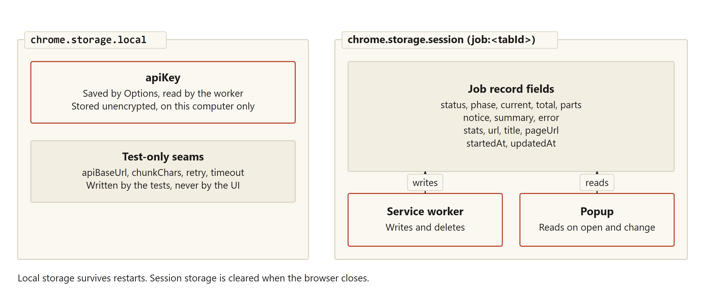

Reading the figure: the left box is `chrome.storage.local`. It holds the saved key (`apiKey`) and a box of test-only settings that the reader never sees. The right box is `chrome.storage.session`, which holds one job record per tab, keyed `job:<tabId>`. The service worker writes and deletes these records, and the popup reads them. The caption says local storage survives restarts and session storage is cleared when the browser closes. Two details differ from the code. The figure says the Options page saves the key, but the popup's Key box also saves it (`popup.js`). The figure also leaves out `jobId`, which the code stores in every record.

Table: What is stored, where, and for how long

| Data | Storage area | How long it lasts |
|---|---|---|
| The Gemini key | `chrome.storage.local` | Until the reader removes it. Survives browser restarts. |
| The job record for a tab | `chrome.storage.session` | Until the tab closes, the browser closes, or a new summary starts on that tab. |
| Test-only settings | `chrome.storage.local` | Written by the tests, never by the reader. |

The key is stored without encryption on this computer. It is sent only to the Gemini service.

### What this means in plain words

The key lasts until it is removed. A summary lasts only while the browser session and the tab last. Nothing is kept on a server.

## The job record

`startJob` in `midsem/project/src/background/service-worker.js` creates the record when a summary starts. Each later step adds to it.

Table: Main fields of the job record

| Field | Set when | Meaning |
|---|---|---|
| `jobId` | At start | A random id for this job (`crypto.randomUUID()`). |
| `status`, `phase` | At start, then at each step | `running`, `done` or `error`, and the step name. |
| `current`, `total` | Per part | Parts finished, and parts in the page. |
| `parts` | At each merge step | Summaries combined in that step. |
| `notice` | On a retry | The retry notice, or `null`. |
| `summary`, `stats` | When done | The final summary text, and the run's numbers. |
| `error` | On failure | An object with `code`, `message` and `detail`. |
| `url`, `title` | At start | The tab's address and title. The title is replaced when done. |
| `pageUrl` | When done | The address the page text came from. |
| `startedAt`, `updatedAt` | At start; `updatedAt` on every write | Start time, and time of the last write. |

Every write goes through one function that checks the job id first:

midsem/project/src/background/service-worker.js, lines 34 to 37:

```js
      if (closedTabs.has(tabId)) return;
      const current = (await chrome.storage.session.get(key))[key];
      if (!current || current.jobId !== jobId) return; // replaced by a newer job, or removed
      await chrome.storage.session.set({ [key]: { ...current, ...patch, updatedAt: Date.now() } });
```

A write is applied only if the stored record still belongs to this job. This stops an old job from overwriting a newer one. The first line handles closed tabs.

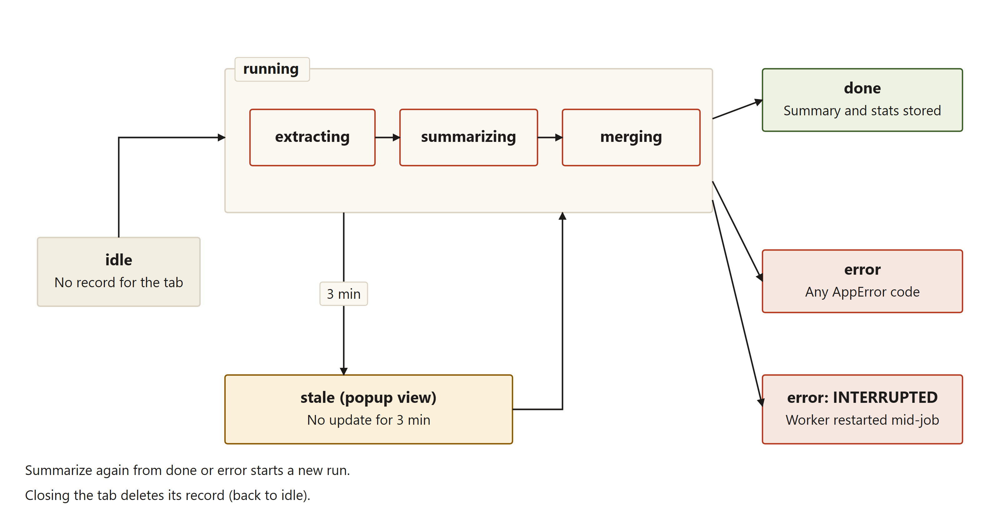

Reading the figure: a job starts from idle, which means no record for the tab. It moves through extracting, summarizing and merging, then ends as done or as an error. The stale box is a popup view. After three minutes with no update, the popup shows the job as interrupted. An arrow runs from that box back to the running box. In the code, the stale view writes nothing, so the stored record stays "running" until the worker restarts or a new summary replaces it.

### What this means in plain words

Every step updates one record for the tab. The job-id check makes sure only the current job can change it. The record ends as done, as an error, or as interrupted.

## Interrupted jobs and the three-minute rule

Chrome can stop an idle service worker. If that happens during a summary, the record still says "running", but nothing is working on it. Two checks deal with this.

When the worker starts, `sweepOrphans` looks for records that are still running and were last updated before the worker started. It marks each one as an error with the code INTERRUPTED.

The three-minute rule covers the rest. A running record with no update for three minutes counts as dead. The constant `STALE_MS` is three minutes in both the service worker and the popup. A new summary on the same page is refused while the record is alive. On a different page, the old job is replaced. The popup re-checks every five seconds, so an open popup does not keep showing a dead job as busy.

Why three minutes? Working from the code's own limits, each request attempt has a 25-second timeout, and a rate-limit wait is capped at 25 seconds. A notice is written before each wait, and a progress line after each part. The gap between writes should therefore stay near 50 seconds at most. Three minutes is a wide margin. One gap in this reasoning is a server-given wait on a 500-level error, which has no cap. A wait that long could look like a dead job.

Test T18 stops the worker during a job, wakes it, and checks that the record becomes INTERRUPTED and the popup says so. Test T20 stops the worker while the popup is open and checks that the popup stops showing progress after the limit.

### What this means in plain words

A stopped worker leaves its job marked interrupted. A job silent for three minutes counts as dead, and the reader can press Summarize again.

## Fixes for bugs B1 and B4

Bugs B1 and B4 concerned the job record. Both were found in run 1 and fixed, and run 2 passed their tests. Bug B2, the stale popup, is covered by the three-minute rule above.

Bug B1: pressing Summarize on a new page while the old summary was still running did nothing, and the popup stayed blank. The service worker refused the new job, and the popup ignored the refusal. The fix gives each job an id. If the tab has moved to another page, the old job is aborted and replaced, and its later writes are dropped. The popup now shows the running job or an error. Test T19 checks this.

Bug B4: after a tab was closed during a summary, a record holding the full summary stayed in storage. The close handler deleted the record, but the job kept running and wrote it back. The fix remembers closed tabs, aborts their job, and applies a write only when the job id still matches. Test T22 checks this.

### What this means in plain words

A replaced job or a closed tab can no longer write to the tab's record. The popup shows either the current job or a clear error.

## Why a finished summary is still shown

The record stays in session storage after the job is done. When the reader reopens the popup, the popup reads the record and shows the summary again, with no new request. The record is removed when the tab closes, or replaced when a new summary starts. Test T16 checks that a second popup shows the finished summary with no new model call. If the tab has moved to another page, the popup compares addresses and hides the old summary (test T17).

### What this means in plain words

The finished summary waits in the tab's record. Reopening the popup shows it again, and closing the tab or starting a new summary clears it.

## Failure cases

- **Popup closed mid-run.** The job keeps running. Test T11 checks that a reopened popup shows the progress or the result.
- **Tab closed mid-run.** The job is aborted and its record removed (T22).
- **Worker stopped mid-run.** The record becomes INTERRUPTED at the next worker start (T18).
- **Browser closed mid-run.** Session storage is cleared, so the job is lost. The key is kept.
- **Two presses at the same moment, for example from two popups.** A per-tab lock refuses the second start. The lock was added after a review. No test is recorded for it.

## What went wrong while building it

The popup's check for a dead job ran only when the popup opened or storage changed. A dead worker writes nothing, so the check never ran. The popup now re-checks every five seconds (DEVLOG, bug B2). The lesson recorded is that a timeout checked only on events never fires when the thing it guards has stopped sending events.

A cleanup handler could not win against a job that kept running. The fix stopped the work as well as the cleanup (DEVLOG, bug B4).

## How it was tested

- `midsem/project/tests/e2e/pipeline.test.js`: T11, T16, T17, T18, T19, T20 and T22. T19, T20 and T22 failed in run 1 and passed in run 2.
- The service worker has no unit test file. Its logic depends on Chrome's storage and tab APIs, so it is tested only through the browser scenarios.

## Limitations

- A summary running when the browser closes is lost, because session storage is cleared.
- The key is stored unencrypted on this computer.
- The three-minute rule can wrongly mark a healthy job as dead when a server asks for a very long wait on a 500-level error.
- Only one job runs per tab. A second press on the same page shows the current job. A press on a new page replaces it.
- The "Cancelled." message is never shown. A cancelled job stops without writing a message.

## Questions this chapter answers

**Why are there two storage areas?**
The key must last across restarts, so it goes in local storage. The job record is temporary, so it goes in session storage, which is cleared when the browser closes.

**What happens if the browser closes mid-summary?**
The job record is cleared, so the summary is lost. The reader must press Summarize again. The key is kept.

**Why three minutes?**
Each request attempt has a 25-second timeout, and a rate-limit wait is capped at 25 seconds. A healthy job should therefore write progress at most about 50 seconds apart. Three minutes is a wide margin above that.

**Why does a finished summary still show after reopening the popup?**
The finished record stays in session storage until the tab closes, the browser closes, or a new summary replaces it. The popup reads the record when it opens.


<div style="page-break-after: always"></div>

# Setting up and running the extension

## What this part does and why it exists

The extension is not in the Chrome Web Store. The client installs it from the project folder, using a Chrome feature called Load unpacked. That feature runs an extension straight from a folder on the computer. Two Windows batch files (small scripts that Windows runs line by line) make the job easier. setup.bat checks that Chrome and the project files are ready. run.bat opens the pages the user needs and prints the steps that remain.

The aim is a setup that a client can finish in about ten minutes. The project calls this its "10-minute check". That time has not been measured on a client laptop: [to be measured].

## Before you start

- A Windows computer with Google Chrome 116 or newer.
- The whole project folder, downloaded or cloned from the repository, which is the online copy of the project's code.
- A free Gemini API key. A key is a secret code that identifies the user to Google's service. The free key comes from aistudio.google.com/apikey.

Node.js is not needed. Only the developer's test tools use it.

## What setup.bat does, step by step

setup.bat writes each check to setup.log in the project folder. It runs four steps.

1. **Finds Chrome.** It looks in the usual install folders, then in the Windows registry, the settings database that Windows keeps. It saves the Chrome path for run.bat. If Chrome is missing, it stops and says where to download it.
2. **Checks the Chrome version.** Chrome records its version in the registry. Version 116 or newer passes. If the version cannot be read, the script continues with a note. An older Chrome stops the setup. The project files do not record why 116 was chosen. The check is written as separate subroutines, which are named blocks the script jumps to. Chapter 13 explains why.

Source: `midsem/project/setup.bat`, lines 135 to 143.

```bat
:check_chrome_version
set "CHROME_VER="
set "CHROME_MAJOR="
for /f "tokens=3" %%V in ('reg query "HKCU\Software\Google\Chrome\BLBeacon" /v version 2^>nul') do set "CHROME_VER=%%V"
if not defined CHROME_VER goto :cv_unknown
for /f "delims=." %%M in ("%CHROME_VER%") do set "CHROME_MAJOR=%%M"
call :say "  Chrome version %CHROME_VER%"
if %CHROME_MAJOR% lss 116 goto :cv_old
exit /b 0
```

3. **Checks the extension files.** It runs `scripts/check-extension.ps1`, a PowerShell script. The script reads manifest.json, the file that tells Chrome what the extension is. It checks that the file reads, that it uses Manifest V3 (the current extension format), and that every file it names exists. A partial download fails here, with the missing file's name, instead of failing later inside Chrome.

Source: `midsem/project/scripts/check-extension.ps1`, lines 36 to 38.

```powershell
foreach ($file in ($files | Select-Object -Unique)) {
    if (-not (Test-Path (Join-Path $root $file))) { $problems += "A file the extension needs is missing: $file" }
}
```

4. **Skips developer tools** unless setup is run with `--dev`. That option checks for Node.js 20 or newer, runs npm install, and downloads Playwright's test browser, about 200 MB. Each network step gets three tries.

On success, setup.bat writes a marker file called .setup-ok, which holds the Chrome path and the date. It prints SETUP COMPLETE and pauses. run.bat refuses to run without the marker. On failure, the script deletes the marker, prints "What failed" and "How to fix", and names setup.log.

**What this means in plain words.** setup.bat is a checklist. It confirms that Chrome is present and new enough, and that the extension folder is complete. If something is wrong, it says what to do.

## What run.bat does, and why it does not load the extension

run.bat checks the marker, reads the Chrome path, and copies the folder path to the clipboard. It opens two pages: chrome://extensions, where Chrome lists its extensions, and a Wikipedia article about lighthouses to summarize. Then it prints four steps.

Source: `midsem/project/run.bat`, lines 40 to 44.

```bat
if not "%RUN_NOCLIP%"=="1" <nul set /p ="%EXT%" | clip

start "" "%CHROME%" chrome://extensions
timeout /t 2 /nobreak >nul
start "" "%CHROME%" https://en.wikipedia.org/wiki/Lighthouse
```

run.bat cannot load the extension itself. Chrome once had a command-line flag, `--load-extension`, that loaded a folder at start-up. The project tested it. On the developer laptop, the installed Chrome 155 started with the flag, and no extension service worker appeared within eight seconds. A service worker is the background part of an extension. Playwright's bundled Chromium 156 loaded the extension at once. DEVLOG.md cites the Chromium team's April 2025 announcement that branded Chrome from version 137 drops this flag. The check is in `tests/e2e/chrome-flag-check.mjs`. So the client clicks Load unpacked. Step 4 of run.bat still points to Options for the key, but the popup's Key box saves the same key.

**What this means in plain words.** Chrome no longer lets a script load an extension on its own. run.bat does what it can and prints the rest.

## The ten setup checks

`tests/bat/test-bat-scripts.ps1` runs both batch files on temporary copies of the project. For the success case, a fake Chrome file stands in for the browser. It only writes its arguments to a text file, so no window opens.

Table: The ten setup checks and what each proves

| Check | What it proves |
|---|---|
| B1 | run.bat before setup tells the user to run setup.bat first, and exits with 1 |
| B2 | setup.bat on a complete copy prints SETUP COMPLETE and exits with 0 |
| B2b | Setup leaves the marker file and setup.log |
| B3 | run.bat opens chrome://extensions and the Wikipedia article |
| B3b | run.bat's output names Developer mode, Load unpacked and Options |
| B4 | A missing manifest.json gives SETUP FAILED, exit code 1, and no marker |
| B5 | An unreadable manifest.json is reported as unreadable |
| B6 | A missing popup.html is named in the message |
| B7 | Running --dev without Node.js explains how to install it |
| B8 | --dev --reset rebuilds the test tools and completes |

Three things are not covered. The clipboard step is not tested, because the test must not touch the user's clipboard. The "Chrome missing" and "Chrome too old" messages need a computer without Chrome, so they are checked only by reading the script. The script's summary line is not saved in the evidence folder. run-3.md says these checks were last run before the popup redesign and must be run again before they are quoted, so the current result is [to be measured].

**What this means in plain words.** The checks run the real scripts on copies of the project. They confirm the scripts succeed when they should, and fail with a clear message when they should.

## The manual smoke test in real Chrome

The automated browser tests (chapter 12) cannot click the toolbar icon, and they add an extra permission for the test server. So they do not prove that the unmodified extension installs and works in real Chrome. The file `midsem/docs/MANUAL_SMOKE_TEST.md` covers that in 11 steps. The person runs it on the developer laptop, and again on the client's laptop before the viva.

Table: The manual smoke test, step by step

| Step | What the person does | What should appear |
|---|---|---|
| 1 | Double-click run.bat | The extensions page and a Wikipedia article open |
| 2 | Turn on Developer mode, click Load unpacked, click Select Folder | A Page Summarizer card with no red Errors button |
| 3 | Pin the extension | Its icon shows on the toolbar |
| 4 | Press Summarize with no key saved | A red message and an Options button |
| 5 | Open Options, paste the key, click Save | "Saved." and "A key is saved in this browser." |
| 6 | Summarize the Wikipedia Lighthouse article | Progress, then a summary and a stats line |
| 7 | Close the popup, wait 10 seconds, reopen it | The summary, or the progress, is still there |
| 8 | Press Summarize on chrome://extensions | "Chrome does not allow extensions to read this page." |
| 9 | Press Summarize on a page with a few words | "This page has too little readable text to summarize." |
| 10 | Replace the key with "wrong", then summarize | A message that the key was rejected |
| 11 | Put the correct key back | Summaries work again |

Three things need attention before the viva. First, the wording expected in steps 4 and 10 is older than the code. The current messages are "No API key yet. Paste your Gemini key in the Key box and save it." and "Your API key was rejected. Paste a correct key in the Key box." Second, the results column is empty. The report keeps placeholders: [Insert date and result of the developer laptop run] and [Insert client laptop model, Windows version and date of the client run]. Third, the file asks for six screenshots, M01 to M06, and none of them is in the screenshots folder yet.

**What this means in plain words.** This is the only check on real Chrome and the real toolbar icon. Its steps are written down, but its results are not recorded yet.

## The developer loop


**Reading the figure:** The top row runs left to right: write code, unit tests, browser tests. The two dashed boxes on the right, the exploratory agent and the bug list, are planned for milestone M8 and are not in use yet. The bottom row runs right to left: fix and log, retest, then "Exit criteria met?" A "no" sends the work back to Write code. The loop arrow from Retest goes back to the unit tests. A "yes" leads to documenting and tagging v1-midsem.

## Installing the extension in about ten minutes

1. Download the project folder, or clone it, and keep all of it together.
2. Double-click setup.bat and wait for SETUP COMPLETE. If you see SETUP FAILED, read the "How to fix" line, then run setup.bat again.
3. Double-click run.bat. Chrome opens the extensions page and a sample article. The folder path is already on the clipboard.
4. On the extensions page, turn on Developer mode, in the top right corner.
5. Click Load unpacked, press Ctrl and V to paste the folder path, then click Select Folder.
6. Click the puzzle-piece icon in Chrome's toolbar and pin Page Summarizer.
7. Click the Page Summarizer icon. The Key box opens by itself when no key is saved. Paste the Gemini key and click Save key.
8. Open an article, click the icon, and press Summarize this page.

## Questions this chapter answers

**Why does run.bat not load the extension itself?** Chrome removed the command-line flag that did this, in branded builds from version 137. A test on Chrome 155 confirmed it, so the client loads the folder by hand with Load unpacked.

**What happens if the client's Chrome is too old?** setup.bat stops at step 2 and writes no marker, so run.bat refuses to start until Chrome is updated and setup is run again.

**What does the manual check prove that the automated tests cannot?** It proves that the unmodified extension installs through Load unpacked and works through the toolbar in the client's own Chrome.


<div style="page-break-after: always"></div>

# Testing and results

## How the testing is layered

The project was tested at five levels. Each level catches a different kind of mistake.

- **Unit tests** check small pieces of code one at a time. The network is replaced by a fake, so no request leaves the computer.
- **Browser scenarios** run the whole extension in a Chromium browser. Chromium is the open-source browser that Chrome is built from. A tool called Playwright drives it from a script. The real Gemini service is replaced by a mock, which is a stand-in server that gives fixed answers.
- **Setup checks** run the two batch files on copies of the project.
- **Live runs** send a few real pages to the real Gemini service, using the developer's own key.
- **The manual smoke test** is done by hand in real Chrome. Chapter 11 describes it.

The numbers in this chapter come from the files in `midsem/docs/test-runs/`, from the test source, and from the project log, DEVLOG.md.

## Unit tests

The unit tests run with `npm test`. That command starts Node's built-in test runner on the files in `tests/unit/`. Node.js runs JavaScript outside the browser. Each test gives a small piece of code some input and checks the output. The engine tests replace the network with a fake, so the tests run without the internet.

Table: The six unit test files and what they cover

| File | Tests | What it covers |
|---|---|---|
| chunker.test.js | 10 | Splitting page text into parts: paragraphs, sentence ends, long words, empty text |
| merger.test.js | 8 | Joining part summaries, including several merge levels and an aborted merge |
| pipeline.test.js | 7 | The whole flow without Chrome: short pages, long pages, errors, cancellation, timing |
| gemini.test.js | 18 | The cloud engine: the key sent in a header, each HTTP error, retries, timeouts, empty and blocked answers |
| fixes.test.js | 9 | Checks added after run 1: same-page test, part limit, 403 location case, reading retry times, quota detection |
| small.test.js | 13 | Summary formatting, default settings, error messages, prompt markers, restricted pages |

The evidence files record three runs. Run 1 recorded 56 passing unit tests, and run 2 recorded 60, with none failing. Run 3, the latest record, recorded all 65 passing and none failing (run-3.md). That matches the 65 tests in the files.

**What this means in plain words.** The unit tests check each small rule on its own, without Chrome and without the internet. They catch a broken rule before the browser tests run.

## Browser scenarios

The browser scenarios load the extension into Playwright's Chromium. A test helper opens the popup in a small window, because the test cannot click the toolbar icon. Six fixture pages, which are saved copies of web pages kept for testing, are served from a local server. The mock Gemini server answers each request and records it. A scenario passes when the popup shows the expected text and the mock received the expected number of requests.

The test copy of the manifest adds one extra permission, for the local test server. The permission that Chrome grants when a user clicks the toolbar icon, called activeTab, is therefore not tested by these scenarios. Chapter 14 returns to this point.

Table: The 28 browser scenarios and their results in run 1 and run 2

| ID | What it checks | Run 1 | Run 2 |
|---|---|---|---|
| smoke | A short article gives one summary, and menus and cookie text are removed before the model sees the page | Pass | Pass |
| T01 | A long article in four parts: parts sent in page order, merged, progress shown | Pass | Pass |
| T02 | A near-empty page is refused before any request | Pass | Pass |
| T03 | No key saved: a message and an Options button that opens the options page | Pass | Pass |
| T04 | Wrong key: one request only, no retry, a clear message | Pass | Pass |
| T05 | Rate limited twice, then works: the popup shows a retry notice | Pass | Pass |
| T06 | Rate limited every time: stops after four requests | Pass | Pass |
| T07 | Server error every time: stops after four requests | Pass | Pass |
| T08 | Model too slow: cut off, reported as too long, not retried | Pass | Pass |
| T09 | Empty answer: reported as no summary | Pass | Pass |
| T09b | Blocked answer: reported as no summary | Pass | Pass |
| T10 | A chrome:// page: refused before any request | Pass | Pass |
| T11 | Popup closed mid-run, then reopened: same job, each part sent once | Pass | Pass |
| T12 | Content that arrives late: waits, then summarizes it | Pass | Pass |
| T12b | Content still missing when Summarize is pressed: refused as too little text | Pass | Pass |
| T13 | A dashboard page with little article text is still summarized | Pass | Pass |
| T14 | Hostile model output: markup shown as plain text, never rendered | Pass | Pass |
| T15 | Options page: save, remove, empty key and key with a space | Pass | Pass |
| T16 | A finished summary is still there when the popup reopens, with no new request | Pass | Pass |
| T17 | A finished summary is hidden after the tab moves to another page | Pass | Pass |
| T18 | Service worker stopped mid-job: the job is marked interrupted | Pass | Pass |
| T19 | Summarize pressed on a new page while the old one still runs: the press gets a reply | Fail (bug B1) | Pass |
| T20 | Worker stopped with the popup open: progress stops once the job is stale | Fail (bug B2) | Pass |
| T21 | A table on the page: cells stay separate in the text sent to the model | Fail (bug B3) | Pass |
| T22 | Tab closed mid-run: no job record is left behind | Fail (bug B4) | Pass |
| T23 | A page needing too many parts is refused before any request | Not in run 1 | Pass |
| T24 | Daily quota used up: stops at once and says how long to wait | Not in run 1 | Not in run 2 |
| T25 | Key typed into the popup, then a summary, with no Options tab opened | Not in run 1 | Not in run 2 |

The suite holds 28 scenarios: the smoke test plus 27 in `tests/e2e/pipeline.test.js`. Run 2 ran 26 of them, all passing. T24 and T25 were added after run 2. Run 3, the latest record, passed all 28, with none failing (run-3.md).

Three test assertions were corrected during run 1. The test harness was at fault in each case, not the product. T12b used to wait 4 seconds for the late content. Under load, the harness pressed Summarize after the content had already loaded, so the delay was raised to 20 seconds. T20 waited 10 seconds after making the job old, which landed exactly on the 3-minute limit, so the wait was raised to 15 seconds. The text search in T21 matched the page title first, so it was moved to the page body.

**What this means in plain words.** The browser scenarios play out the user's steps in a real browser. They check what the popup shows and how many requests reach the mock service. They prove the extension handles each case, but not how good a real summary is.

## The first run: four bugs, T19 to T22

The first full run added four scenarios on purpose. Earlier exploratory probes had shown four problems that no test covered. All four failed on the first run. Each failure was a real defect in the product, not a mistake in the test. The bugs were recorded as B1 to B4 in run-1.md.

- **B1: Summarize ignored after a page change (T19, medium).** When the tab moved to a new page while the old summary was still running, pressing Summarize left the popup blank. The service worker refused the second job, and the popup hid the running job because its address did not match, and it threw away the refusal. Nothing on the screen explained the problem.
- **B2: Progress kept showing in an open popup (T20, medium).** A dead job kept showing "Summarizing..." with a disabled button, while the popup stayed open. The popup checked for stale jobs only when it opened or when storage changed. A dead worker writes nothing, so the check never ran.
- **B3: Table cells ran together (T21, medium).** The text sent to the model read "QuarterRevenueMargin" and "Q14.5M12%". The summary still looked normal, so nothing on screen showed the damage.
- **B4: A closed tab's record was kept (T22, low).** A finished job record was written back after its tab had closed. It stayed in the browser's temporary session storage until the browser restarted.

Run 2 fixed all four. Each job now has an id, and a replaced or closed job is stopped. An open popup re-checks its job every five seconds. Table cells are joined with " | " and each row is one line. A page that needs more than 30 parts is refused, which also answers a risk listed in run 1 about one huge page costing many requests. A per-tab start lock stops two popups from starting the same job. A 403 error about the caller's location is now reported as a service problem, not as a rejected key. Run 2 recorded 60 unit tests and 26 browser scenarios, all passing. Run 3, the latest, recorded 65 unit tests and 28 browser scenarios, all passing (run-3.md).

One finding from run 1 is not listed as fixed in the log. The merge step can send every part in one request when the part summaries are very long. With the default settings, that needs part summaries of about 4,000 characters or more, so it is unlikely.

**What this means in plain words.** The first run found four real faults, all of them silent. Each one was fixed, and the same tests then passed.

## Live runs against the real service

Live runs send real pages to the real Gemini service with the developer's key. The scripts read the key but never print it. The runs used a hidden Chromium window with the extension loaded. The test measured the times. The settings were the model gemini-3.5-flash-lite, the "low" thinking setting, and parts of 8,000 characters. The thinking setting controls how much hidden working the model does before it writes an answer. Run 3 notes that these live runs were made before the popup redesign and were not repeated.

Table: The live runs, from live-measurements.md

| Case | Page (text characters) | Parts, requests, merge levels | Time (s) | What it shows |
|---|---|---|---|---|
| L01 | Short article, fixture (1,711) | 1, 1, 0 | 1.7 | A one-part page needs one request and no merge |
| L02 | Long article, fixture (10,532) | 2, 3, 1 | 5.9 | Two parts are summarized, then merged into one summary |
| L03 | Same article in 3,000-character parts (10,532) | 4, 5, 1 | 7.2 | Smaller parts mean more requests |
| L04 | Wikipedia: Lighthouse (36,752) | 5, 6, 1 | 17.8 | A real encyclopedia page works from start to end |
| L05 | Wikipedia: Fresnel lens (48,289) | 7, 8, 1 | 23.0 | The slowest successful case, still under the part limit |
| L06 | Chrome documentation: Manifest V3 (521) | 1, 1, 0 | 1.9 | A short real page takes the one-request path |
| L07 | MDN: WebGPU API (29,599) | 4, 5, 1 | 7.5 | A technical documentation page works |
| L08 | Wikipedia: World War II, part limit set to 10 | not run | 0.6 | Refused before any request, with the "too long" message |
| L09 | Real service, wrong key | not run | 0.5 | The key is rejected and the popup says so |

The popup's own stats line shows slightly different times. It shows 5.7 seconds for L02 and 17.6 seconds for L04. The two timers start at slightly different moments, so they differ by a fraction of a second.

Two summaries from the live runs are quoted below exactly as printed in live-summaries.md. Both are model output. Nobody scored them for accuracy, so the report does not claim they are correct.

Case L02, a long article with two parts:

```text
This page provides a short history of lighthouses, covering their evolution from ancient fires to modern automated navigation backups and preservation efforts.

- Dangerous coastal waters led to the creation of lighthouses, starting with the Pharos of Alexandria in the third century BC.
- John Smeaton built a pioneering dovetail granite tower at the Eddystone Rocks in 1759.
- Lighting technology improved with Aime Argand's 1780s oil lamps and Augustin Fresnel's 1823 stepped glass lens system.
- Britain's last keepered lighthouse at North Foreland in Kent was automated in 1998, though Boston Light in the United States remains staffed.
- In 1999, the tallest brick lighthouse in the United States, Cape Hatteras in North Carolina, was moved 2,900 feet inland to protect it from erosion.
```

Case L06, a short Chrome documentation page:

```text
This page provides an overview of Manifest V3, the latest version of the Chrome extensions platform.
- Manifest V3 is the newest version of the extensions platform, featuring changes to available APIs and new features.
- The platform aims to improve the privacy, security, and performance of extensions as a first step in the platform vision.
- Another goal is to give users more understanding and control over what extensions can do.
- The platform changes will take several years to complete.
```

**What this means in plain words.** All nine live cases ended with a summary or a clear message, as the code intends. Times generally rise with the amount of text, from under two seconds for a short page to about 23 seconds for the longest one. This is a handful of pages on one day, so it is a sample and not a promise of speed.

## Choosing the model: speed and length

The project had to choose which Gemini model to call. The benchmark script sent the same prompt, about 7,000 characters of a long article, to several settings. It ran each setting three times and recorded the time and the answer length. The saved results are in model-bench.json. The table shows the four settings that have saved rows.

Table: Benchmark of four settings, three runs each (model-bench.json)

| Setting | Three runs (seconds) | Answer length (characters) |
|---|---|---|
| gemini-3.8-flash, default thinking | 12.3, 11.4, 12.6 | 1,072 to 1,238 |
| gemini-3.8-flash, thinking setting "low" | 3.9, 3.9, 12.5 | 1,268 to 1,444 |
| gemini-3.5-flash-lite, default | 2.0, 1.6, 1.6 | 1,147 to 1,418 |
| gemini-2.5-flash, thinking turned off | 2.4, 2.7, 2.4 | 1,420 to 1,441 |

The larger model, with its default thinking, took between 11 and 13 seconds for each request. Its usage data showed far more hidden thinking work than visible answer text, roughly six to seven times as much. Setting the thinking level to "low" cut most runs to under four seconds. One run in three still took 12.5 seconds. The Flash-Lite model was the fastest and the most consistent, between 1.6 and 2.0 seconds. The answers were similar in length across all four settings, so length does not show which answer is better.

The benchmark measured speed and length. It did not measure the quality of the answers, and the quality of the cheaper model was not formally compared with the larger one. The choice therefore rests on measured speed and on the free quota, not on a scored comparison of summaries.

Two details need care. DEVLOG.md says six settings were compared, and that the lowest setting was rejected with an error. The saved file holds four settings, so the other two have no saved numbers. The setting the product sends is Flash-Lite with the "low" thinking setting. That exact pairing is not one of the four rows. The live runs did use it. Case L01, a one-request page, took 1.7 seconds.

**What this means in plain words.** The faster model answered in about two seconds in these runs. The larger model was slower and sometimes took more than ten seconds. The choice is based on speed, and the answer quality was not formally scored.

## The quota probe

A free key allows only a limited number of requests. The quota probe found the limit for each model. It sent tiny requests one after another until the service refused one, up to 30 requests per model. The results are in quota-probe.json.

Table: Quota probe results (quota-probe.json)

| Model | Successful requests before the first refusal | What the service said |
|---|---|---|
| gemini-3.5-flash-lite | 16 | HTTP 429, a free-tier limit of 15 requests, retry in about 50 seconds |
| gemini-2.5-flash-lite | 11 | HTTP 429, a free-tier limit of 10 requests, retry in about 33 seconds |
| gemini-2.5-flash | 6 | HTTP 429, a free-tier limit of 5 requests, retry in about 22 seconds |
| gemini-3.1-flash-lite | 3 | HTTP 503, "high demand", which is a busy signal and not a limit |

HTTP 429 means "too many requests". HTTP 503 means the service is busy. The probe counted one more success than the named limit for the first two models, 16 against 15 and 11 against 10. For the third model it counted 6 against 5. The probe does not explain this difference, so the table reports the numbers as printed. The error text names a limit but does not say over what period it applies.

The code deals with a used-up quota in a specific way. When the service asks for a wait longer than 25 seconds, the engine stops at once instead of retrying. The message then tells the user how long to wait.

Source: `midsem/project/src/engines/gemini.js`, lines 149 to 151.

```javascript
      if (response.status === 429 && waitSeconds !== null && waitSeconds > MAX_RETRY_WAIT_SECONDS) {
        throw new AppError(ERROR_CODES.QUOTA_EXHAUSTED, detail, { retryAfterSeconds: waitSeconds });
      }
```

**What this means in plain words.** A free key runs out after a handful of requests in one period. The code treats a long wait as an empty quota, stops at once, and tells the user to wait or to use another key.

## Screenshot gallery

The screenshots below come from the test runs. The popup text in the finished-summary panel is the mock's text, not Google's. The quota panel shows a seven-hour wait that the test set in the mock. Each image is followed by a short reading.

### The popup in its states


Panel A shows the idle popup with the page title and the Summarize button. Panel B shows the Key box that opens when no key is saved. Panel C shows the key saved inside the popup, with a Remove saved key link.


Panel D shows progress on part 2 of 4, with a progress bar. Panel E shows the busy notice that says the service will be tried again in 2 seconds, attempt 1 of 3. Panel F shows a finished summary with its stats line, which reads "4 parts · 5 requests · 2.1 s".


Panel G shows the too-little-text message. Panel H shows the restricted-page message for a Chrome page. Panel I shows the too-long message. Panel J shows the used-up quota message, with the Key box open so the user can paste another key.

### The Options page


The Options page shows that a key is saved in this browser. It also shows the field to replace the key and the link to remove it. The page says the key is stored only in this browser.

### Live cases

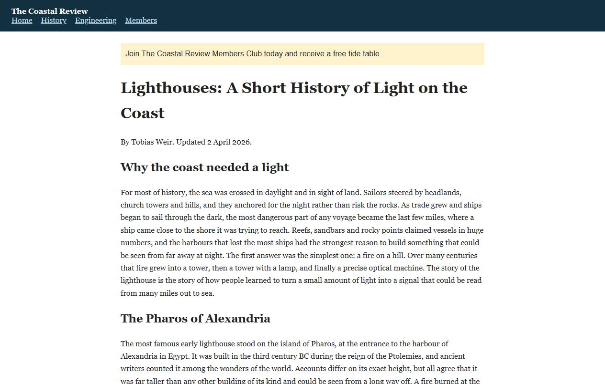

The page for case L02 is the long-article fixture, served from the test's own local server. The popup reads the text of this page, and the summary itself comes from the real service.

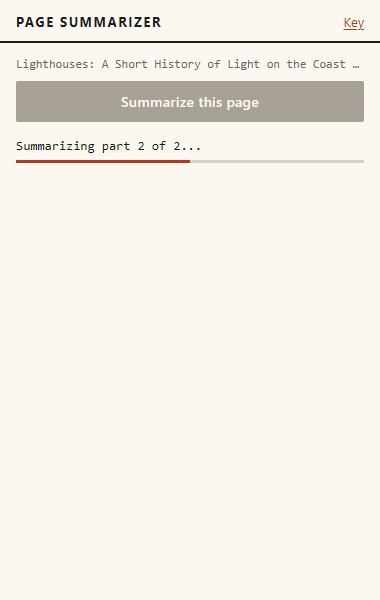

Progress shows part 2 of 2 while the second part is being summarized.

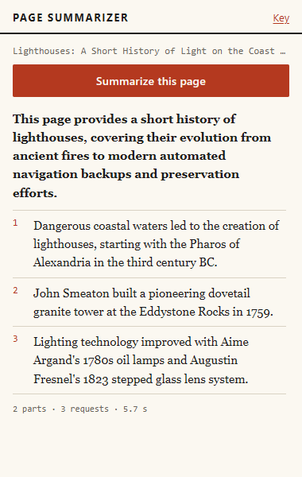

The finished L02 popup shows the overview, the numbered points and the stats line. The screenshot shows the first three of the five points.

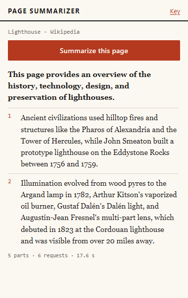

The L04 popup shows a real encyclopedia article summarized in five parts. The text is the model's output for that page.

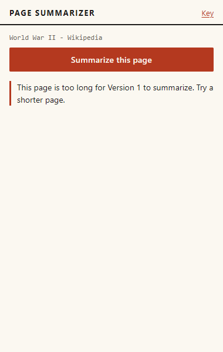

Case L08 was a long Wikipedia article with the part limit set to 10. The popup refused it with the too-long message, and no summary was requested.

## Questions this chapter answers

**How many tests are there, and do they pass?** Run 3, the latest, has 65 unit tests and 28 browser scenarios, and all of them passed. Run 2 had 60 and 26, all passing. Every run is written up in midsem/docs/test-runs.

**Why did four scenarios fail on the first run?** They tested behaviour that no earlier test covered. Each failure was a real defect (B1 to B4). Each was fixed, and the scenarios were run again.

**Why was this model chosen when answer quality was not compared?** The choice rests on measured speed and the free quota. The benchmark did not score the answers, and the report says so.

**Can the tests prove that the real service works?** Not on their own. The browser scenarios use a stand-in service. The live runs sent seven pages to the real service on one day, and tested one wrong key.

**What did you measure, and where is it recorded?** The measures are test counts, request counts, timings for each live case, benchmark timings, and the quota responses. Each one comes from a file in the test-runs folder or from the test output.


<div style="page-break-after: always"></div>

# Problems and solutions

The project log, DEVLOG.md at the root of the repository, holds 14 entries, and every entry is dated 2026-10-20. The log's rule is that nothing is recorded unless it actually happened. The sections below follow the log's order. Each gives the symptom, the root cause, what was done, and what was learned. M0 to M8 are the stages in the project plan, V1_PLAN.md.

## Run.bat cannot load the extension in Chrome 137 and later

**Date and area:** 2026-10-20, run.bat and testing (M0).

**Symptom.** The installed Google Chrome 155, started with a flag that loads a folder, showed no extension service worker within eight seconds. Playwright's bundled Chromium 156 loaded the same extension at once.

**Root cause.** Chrome 137 removed the `--load-extension` flag from branded builds. Chromium still supports it. The log cites the Chromium team's April 2025 announcement. The check is `tests/e2e/chrome-flag-check.mjs`.

**What was done.** run.bat opens chrome://extensions and prints the Load unpacked steps. Automated tests run on Playwright's Chromium.

**What was learned.** Check what a browser flag does on the target machine before building around it. Tests on Chromium do not prove the install path in branded Chrome.

**What this means in plain words.** The plan had listed this as a risk to confirm, and the check confirmed it. The script now guides the user instead of loading the extension.

## Node could not find the unit test folder on Windows

**Date and area:** 2026-10-20, unit tests (M3 and M4).

**Symptom.** `node --test tests/unit` failed with "Cannot find module".

**Root cause.** On Windows, Node 22 treated the folder name as a file to load.

**What was done.** The npm scripts use a glob, a wildcard pattern that matches file names: `tests/unit/*.test.js`.

**What was learned.** Use a glob for test discovery on Windows.

**What this means in plain words.** The runner treated the folder as a file, so it could not find the tests.

## Four engine tests showed as cancelled

**Date and area:** 2026-10-20, Gemini engine tests (M4).

**Symptom.** After a timeout test, four tests showed as cancelled, and several others failed with an empty-answer error.

**Root cause.** There were two faults. A timer from `AbortSignal.timeout()` does not keep Node's event loop alive, so the runner could exit early. The event loop is the list of work Node is still waiting for. The test helper also returned one response object several times, but a response body can be read only once.

**What was done.** The engine uses its own timer and an AbortController, the browser object that cancels a request. The timer is cleared in a finally block, which always runs. The fake fetch returns a copy of the response each time.

**What was learned.** A flaky-looking test is often a fault in the harness. Check what the fake allows before changing the product. The engine change was still worth keeping.

**What this means in plain words.** The test fake reused one reply, and the runner stopped early. The fake was fixed, and the engine's timer was tidied.

## The default model was too slow

**Date and area:** 2026-10-20, cloud model choice (M4).

**Symptom.** gemini-3.8-flash answered a two-word prompt in 9.4 seconds. A real summary request of about 7,000 characters took 11.4 to 12.6 seconds, and one request returned HTTP 503, "high demand".

**Root cause.** By default the model does hidden thinking before it answers. The usage data showed about six times as much hidden thinking as visible answer. With a 25-second limit and several parts per page, the time was too close to the limit.

**What was done.** `scripts/model-bench.mjs` timed several settings, and the results are in model-bench.json. A "low" thinking setting cut a typical request to about 3.9 seconds, though one run in three still took 12.5 seconds. The lowest setting was rejected with HTTP 400. Flash-Lite took 1.6 to 2.0 seconds. The 503 is handled by the retry logic.

**What was learned.** Measure speed on the real task before changing a model or a timeout. A request setting was the cheapest speed-up. The answer quality of the faster models was not compared, which is a limitation.

**What this means in plain words.** The model thought for too long before answering. A setting reduced the wait, and the default model changed later, as the design-change entry below describes.

## setup.bat stopped with "116 was unexpected at this time"

**Date and area:** 2026-10-20, setup.bat (M7).

**Symptom.** The first real run of setup.bat stopped at step 2 with that message.

**Root cause.** The Chrome major version was set and compared inside one parenthesised block, a group of commands wrapped in brackets. A batch file reads the whole block first. So the variable was still empty when the comparison was read, and the line was invalid.

**What was done.** The checks moved into subroutines that use goto to jump between them. Chapter 11 shows the routine.

**What was learned.** A variable set inside a block cannot be read again in that same block. Run the script for real, because reading it looked fine.

**What this means in plain words.** The script used a value before it had been set.

## setup.bat failed after a scripted edit

**Date and area:** 2026-10-20, setup.bat (M7).

**Symptom.** setup.bat failed with "The system cannot find the batch label specified - check_chrome_version". A label is a named place that a batch file can jump to.

**Root cause.** The edit searched for the text `:find_chrome` to insert a subroutine. The first match was the call line in the main flow, so the subroutine was pasted into the middle of a line.

**What was done.** The whole file was rewritten and saved with Windows line endings, called CRLF. The batch test script caught the fault at once.

**What was learned.** Do not patch batch files by searching for text. Rewrite the whole file and list its labels afterwards.

**What this means in plain words.** An automatic edit put code in the wrong place, so the file was rewritten.

## The test script could not find run.bat, then hung

**Date and area:** 2026-10-20, bat tests (M7).

**Symptom.** The test reported that run.bat was "not recognized as an internal or external command", although the file was in the folder. Later a test hung.

**Root cause.** The Windows command prompt, called cmd, does not search the current folder unless the name starts with `.\`. The hang came from the fake Chrome file, which was opened in a cmd window that never closed.

**What was done.** The tests call `.\setup.bat` and `.\run.bat`. The fake Chrome file ends with `exit`.

**What was learned.** A test harness must clean up the processes it starts. The clipboard step is not tested automatically, because the test must not read or overwrite the user's clipboard.

**What this means in plain words.** Windows did not look where the test expected, and a test window was left open.

## Popup ignored a second Summarize (T19, bug B1)

**Date and area:** 2026-10-20, popup and service worker (M8, bug B1).

**Symptom.** The tab moved to another page while a summary was running. Pressing Summarize on the new page did nothing, and the popup stayed blank (test T19).

**Root cause.** The service worker, which is the extension's background part, allowed one job per tab and replied "already running". The popup ignored that reply. It also hid any job whose address differed from the page.

**What was done.** Each job now has an id. If the tab moved to another page, the old job is stopped and replaced, and its late writes are dropped. The popup reads the reply and shows the current job or an error.

**What was learned.** Every refusal must reach the user. A silent "no" looks like a broken button.

**What this means in plain words.** The button was refused quietly, and the popup hid the job that refused it.

## Popup kept showing "Summarizing" (T20, bug B2)

**Date and area:** 2026-10-20, popup (M8, bug B2).

**Symptom.** With the popup open, a job whose service worker had died kept showing "Summarizing..." and a disabled button.

**Root cause.** The popup checked whether a job was stale only when it opened and when stored data changed. A dead worker writes nothing, so nothing triggered the check.

**What was done.** The popup redraws its last job every five seconds. A job older than three minutes now shows as interrupted.

**What was learned.** A timeout that is checked only on events never fires once the thing it guards stops sending events.

**What this means in plain words.** The popup waited for news that never came. Now it checks by itself.

## Table cells ran together (T21, bug B3)

**Date and area:** 2026-10-20, extractor (M8, bug B3).

**Symptom.** The model received "QuarterRevenueMargin" and "Q14.5M12%". The summary still looked normal.

**Root cause.** The text reader treated table rows as blocks but not their cells. Minified pages, which have their spaces removed, had no gap between cells.

**What was done.** A cell that follows another cell in its row now gets " | " before it, and each row is one line. The first fix made every row a separate paragraph, and test T21 caught that too.

Source: `midsem/project/src/content/extract.js`, line 38.

```javascript
      if (CELL_TAGS.has(tag) && node.previousElementSibling) out.push(' | ');
```

**What was learned.** Silent corruption is worse than a visible error. Test with the markup that real sites produce.

**What this means in plain words.** The gaps between cells were lost, so the numbers ran together.

## A closed tab's job record stayed behind (T22, bug B4)

**Date and area:** 2026-10-20, service worker (M8, bug B4).

**Symptom.** After a tab closed mid-job, a record with the full summary stayed in `chrome.storage.session`, which is Chrome's temporary storage for an extension.

**Root cause.** The handler that runs on tab close deleted the record. But the job kept running, and its queued writes created the record again.

**What was done.** Closed tabs are now remembered, and their jobs are stopped. A write is applied only if the stored record still belongs to the job writing it.

**What was learned.** A cleanup handler cannot win against work that is still running. Stop the work as well.

**What this means in plain words.** The cleanup ran first, then the unfinished job wrote the record back.

## Review of the test notes found three missing guards

**Date and area:** 2026-10-20, review of test findings (M8).

**Symptom.** The notes from the test review listed three risks that had no failing test. There was no limit on how many parts one page could need. Two popups clicked at once might start a double job. Every HTTP 403 was reported as a rejected key.

**Root cause.** These were missing guards, not defects that had been seen.

**What was done.** A page-length limit was added, with a default of 30 parts, the error code TOO_LONG, and test T23. A per-tab start lock was added. A 403 about the caller's location is treated as a service problem. The options page Save button no longer squeezes the key field.

**What was learned.** A free key makes one huge page a real cost risk, so the limit is part of error handling, not an extra feature.

**What this means in plain words.** Three things could go wrong without any test failing. Each now has a guard.

## The design changed after the owner's feedback

**Date and area:** 2026-10-20, design change after owner feedback (M8).

**Symptom.** The owner watched a test run and asked for four changes. The extension should open in a popup or side panel, not a new tab. V1 should stay simple. The interface looked as if an AI had made it. Tests should be hidden and use cheap models.

**Root cause.** The test harness opened the popup as a browser tab, because a test cannot click the toolbar icon. The Options page also opened as a tab. So the product seemed to open tabs. The first interface used a common blue, rounded-card look.

**What was done.** The key can be pasted inside the popup. The harness opens the popup as a small popup window. The interface and icon were redrawn in a printed-page style, with one red accent and numbered points. Browser tests run hidden unless HEADED=1 is set. The default model became gemini-3.5-flash-lite, which the log calls the cheap model.

**What was learned.** Watching the test exposed a mismatch. The harness showed something the product does not do, so the harness was fixed to show the truth.

**What this means in plain words.** The test view did not match the real product, so it was changed to match.

## A prompt test matched the wrong marker

**Date and area:** 2026-10-20, prompt tests (M4).

**Symptom.** A prompt test reported that the page text came before the "start" marker.

**Root cause.** The instruction line also names both markers. The test used `indexOf`, which finds the first mention, and that was in the instructions.

**What was done.** The test uses `lastIndexOf`, which finds the last mention. The prompt itself was not changed.

**What was learned.** A marker repeated inside the instructions makes a position check ambiguous.

**What this means in plain words.** The check looked at the wrong mention of the marker. The prompt was fine.

## Questions this chapter answers

**Which problem changed the design the most?** The owner's feedback changed the interface and the test view. The Chrome 137 finding changed how run.bat works. Both are recorded in the log.

**Who found the problems, the product or the tests?** The browser tests found four silent faults in the product (T19 to T22). The test review found three missing guards. Several entries were faults in the test harness itself.

**Why do three entries concern batch files?** A batch file reads a whole block before running it, and the Windows command prompt does not search the current folder for commands. Entries 5 and 7 come from those facts. Entry 6 came from a text-based edit that put code in the wrong place.

**Were the product bugs visible to the user?** No. All four browser bugs failed silently: a blank popup, a stuck progress display, corrupted text, and a stale record. Each fix made the popup answer every press, re-check open jobs, stop work for closed tabs, or separate table cells.


<div style="page-break-after: always"></div>

# Limitations and next steps

## The honest limits of Version 1

These are the limits the report states plainly, so that they are known before anyone finds them.

1. **The browser scenarios use a mock service.** The 28 scenarios run against a stand-in server with fixed answers. They show how each case is handled, such as retries and error messages. They do not show how good a real summary is. Only seven pages reached the real service in the live runs.
2. **The tests use Chromium, not the client's Chrome.** The tests use Playwright's Chromium, with an extra permission for the local test server. The real toolbar path, which uses the activeTab permission, is covered only by the manual smoke test, and that test has not been recorded yet.
3. **Only one cloud provider.** Version 1 calls Google's Gemini service and no other. The engine is one file, `gemini.js`.
4. **Only one language of pages, in practice English.** The prompts and the popup text are in English. No page in another language was tested.
5. **No pages behind a login.** The extension reads what the open tab shows. No login-only page was tested, and the requirements list such pages as a risk.
6. **The free quota can run out.** The quota probe found limits of 5 to 15 requests, depending on the model, and the error text gives no period. When the quota is used up, summaries stop until it resets. The popup then opens the Key box and shows an Options button.
7. **The 30-part limit.** A page that needs more than 30 parts is refused before any request. With the default part size of 8,000 characters, that is about 240,000 characters of page text. The limit protects the free quota, but very long pages get no summary at all.
8. **The key is stored without encryption.** The extension keeps the key in its local storage in this browser, and it does not encrypt it. The key is not synced to the Google account, which is good. But anyone who can read this Windows account's Chrome profile folder could read the key.
9. **Chrome versions and Windows.** setup.bat requires Chrome 116 or newer. The records cover only Chrome 155 on the developer laptop and Chromium 156 for the tests. The setup and run scripts are Windows batch files. The client's Chrome version is [Insert client laptop Chrome version].
10. **Summary quality is not scored.** No one rated the summaries against the source text, and the speed benchmark did not compare answer quality.
11. **Page text can still steer the model.** The prompt tells the model that page text is material to summarize, not instructions. The code comment says this limits the risk but does not remove it. The popup shows replies as plain text, so markup in a reply does not run (test T14).
12. **A rare merge case.** When part summaries are very long, the merge step can send all of them in one request. With the default settings this needs summaries of about 4,000 characters or more, so it is unlikely. The log does not list it as fixed.

Source for limit 8: `midsem/project/src/ui/options.js`, line 39. The popup's Key box makes the same call.

```javascript
  await chrome.storage.local.set({ [STORAGE_KEYS.apiKey]: key });
```

**What this means in plain words.** Version 1 works for the cases its tests cover. Its evidence comes from a stand-in service and a handful of live pages. The client should be told which parts are proven and which are not.

## What Version 2 would add

Version 2 is not built. It is the plan for the final semester.

Version 2 keeps the same popup and the same way of reading a page. The change is where the summary comes from. In Version 2, the summarizing model runs inside the browser on the user's own computer. The model downloads once, on first use, with a progress bar, and the browser keeps it for later use. No API key is needed. The page text never leaves the computer, and summaries work with no internet connection once the download is complete.

Everything else stays the same. The extension still reads the main text, splits long text into parts, joins the part summaries, and shows progress and error messages. The new work is the download, a check that the computer can run the model, the stored copy, and a local engine. The local engine gives the same two kinds of answer that the cloud engine gives now.

The requirements expect a small local model to write less good summaries than a large cloud model. The first download is large, and the browser and computer must meet certain requirements. The size of the gap in speed, quality and memory is [to be measured] in the final work. One design question is still open: whether the cloud engine stays selectable in Version 2, or whether Version 2 runs only on the computer.

### The plan for the remaining weeks

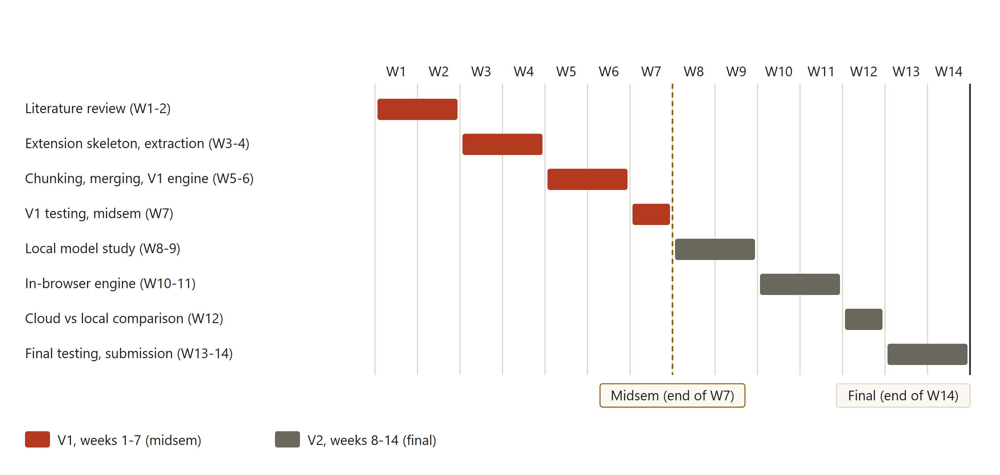

**Reading the figure:** The chart has one bar for each piece of work, laid out across 14 weeks. The red bars are Version 1, from week 1 to week 7, and a dashed line marks the midsem at the end of week 7. The grey bars are Version 2, from week 8 to week 14. The local model study takes weeks 8 and 9, and the in-browser engine takes weeks 10 and 11. The cloud-versus-local comparison takes week 12, and final testing and submission take weeks 13 and 14. This is the plan, not a record of progress.

### What stays the same

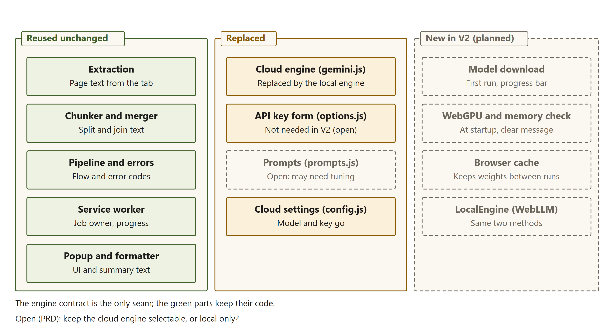

**Reading the figure:** The figure has three columns. The green column lists five parts that are reused unchanged: the extraction, the chunker and merger, the pipeline and its errors, the service worker, and the popup with its summary formatting. The orange column lists what is replaced: the cloud engine, the API key form (not needed in Version 2), and the cloud settings, where the model and key are set. A prompts box sits in the same column with a dashed border, marked as possibly needing tuning. The grey dashed column lists what is new: the model download with its progress bar, a check that the browser and memory can run the model, the browser cache, and a local engine with the same two methods. The footer says that the engine contract is the only seam, the one place where the two versions meet.

**What this means in plain words.** Most of the work carries over. Only the part that writes the summary is swapped for a version that runs on the user's computer.

## Questions this chapter answers

**What would break first in a live demonstration?** The free quota would. Each free key allows a limited number of requests in a period, and a demonstration that summarizes many pages in a row can use them up. The popup then shows the used-up message and waits for the service to reset the quota. The probe results in chapter 12 show the limits.

**Why is the key stored without encryption?** The extension has to read the key each time it makes a request, and Version 1 has no server to hold it. The key stays in this browser and is not synced to the Google account. Stronger storage is not part of Version 1, and the report states this as a limit.

**Is Version 2 built?** No. It is planned for the final semester, in weeks 8 to 14 of the plan.

**What does Version 2 reuse?** It reuses the extraction, splitting, merging, progress display, error messages and popup. Only the engine that writes the summary changes.

**What has not been tested yet?** The manual smoke test has not been recorded on the client's laptop. The quality of the summaries has not been scored. Other Chrome versions and pages behind a login have not been tested.


<div style="page-break-after: always"></div>

# Conclusion

This chapter sums up what Version 1 of the Page Summarizer does, what the build taught, and what is still open. Nothing new is claimed here; every point refers to a chapter or file already described.

## What was built

Version 1 is a Chrome extension. The user opens the toolbar popup on any web page and presses Summarize. The extension reads the text of the page, removes the menus and advertisements, and sends the text to Google's Gemini service. If the page is long, the text is split into parts, each part is summarized, and the part summaries are merged into one. The summary appears in the popup with a progress line while the work runs.

The user enters a free Gemini key once, in the popup or on the Options page. The key is kept only in that browser. The popup gives a plain English message for each failure, such as a rejected key, a busy service, a network problem, or a page with too little text. Appendix B lists every message.

The project also has unit tests, browser tests, live runs on real pages, and two setup scripts, setup.bat and run.bat. The file guide in Appendix A describes each part of the repository.

## What was learned

The build showed that a working summary is not the same as a correct one. Several bugs gave no error on screen. For example, table cells on one test page ran together in the text sent to the model, and the popup still showed a normal summary. Only a test that inspected the text sent to the model found it. The browser tests found four product bugs in the first run, and all four were fixed.

Speed depended on a setting as much as on the model. The first choice of model took about 12 seconds per request. Setting the thinking level to low, and then choosing a faster model, brought the typical request to a few seconds. The measurements are in the test-run files.

The Chrome flag used for automatic loading no longer works in branded Chrome from version 137. For that reason, run.bat does not load the extension itself. It opens the extensions page and shows the manual steps. The lesson was to check what a browser flag does on the target machine before building a launcher around it (DEVLOG.md).

## What is still open

Three things are still open. First, the manual check in the real Google Chrome, described in midsem/docs/MANUAL_SMOKE_TEST.md, has not been recorded yet. The automated browser tests use Playwright's Chromium, so they do not prove the Load unpacked path in branded Chrome. Second, the test counts in the last recorded run are older than some of the current tests, so the test run should be repeated before the figures are quoted in the viva. Third, Version 2 is not started. It will replace only the summarizing engine with a small model that runs in the browser, and it will be compared with the cloud engine on speed, quality and memory use.


<div style="page-break-after: always"></div>

# [nonum] References

1. Chrome for Developers. (n.d.). *Manifest V3*. Google. https://developer.chrome.com/docs/extensions/develop/migrate/what-is-mv3 (accessed 20 October 2026). This is the reference for the extension platform used here, including background code that runs in a service worker.

2. Ruan, C. F., Qin, Y., Parthasarathy, A. R., et al. (2024). *WebLLM: A High-Performance In-Browser LLM Inference Engine*. arXiv:2412.15803. https://arxiv.org/abs/2412.15803. This is the in-browser engine considered for Version 2, which runs language models in the browser with WebGPU and WebAssembly.

3. Mozilla. (n.d.). *Readability.js*. GitHub, licensed under Apache-2.0. https://github.com/mozilla/readability. This is the library that pulls the main article text out of a page, and it is the source of the vendored copy in the extension.

4. Google AI for Developers. (2026). *Text generation* and *Using Gemini API keys*, Gemini API documentation. https://ai.google.dev/gemini-api/docs/text-generation. This is the reference for the cloud service called in Version 1 and for how the user's own key is used.

5. W3C. (2026). *WebGPU*, W3C Candidate Recommendation Draft, 15 September 2026. https://www.w3.org/TR/webgpu/. This is the specification of the GPU interface that Version 2 depends on, which is why a WebGPU check is part of the scope.

6. Liu, N. F., Lin, K., Hewitt, J., Paranjape, A., Bevilacqua, M., Petroni, F., & Liang, P. (2023). *Lost in the Middle: How Language Models Use Long Contexts*. arXiv:2307.03172. https://arxiv.org/abs/2307.03172. This paper shows that accuracy drops when the important information sits in the middle of a long input, which is one reason long pages are split into smaller parts.

7. Meta. (2024). *Llama 3.2: Revolutionizing edge AI and vision with open, customizable models*. Meta AI blog, 25 September 2024. https://ai.meta.com/blog/llama-3-2-connect-2024-vision-edge-mobile-devices/. This announces the 1B and 3B text models built for devices like laptops and phones, which is the size class tested for Version 2.

8. Chrome for Developers. (2025). *Summarize with built-in AI* (Summarizer API). Google. https://developer.chrome.com/docs/ai/summarizer-api. This is Chrome's own on-device summarizing interface, and its hardware, storage and language limits are part of the comparison in the project.


<div style="page-break-after: always"></div>

# [nonum] Appendix A: Repository File Guide

This appendix is a map of the repository. It says where each part lives and what it does. Figure A1 shows the folder tree. The tables below list the extension source, the scripts and the tests, one file per row.

Some terms are used below. A **popup** is the small window that opens when the toolbar icon is clicked. A **service worker** is the background script that Chrome runs for an extension, even when no window is open. A **content script** is a small program that Chrome runs inside the page being read. **Options page** is the settings page of the extension. A **fixture** is a saved test page that the browser tests load instead of a live site.

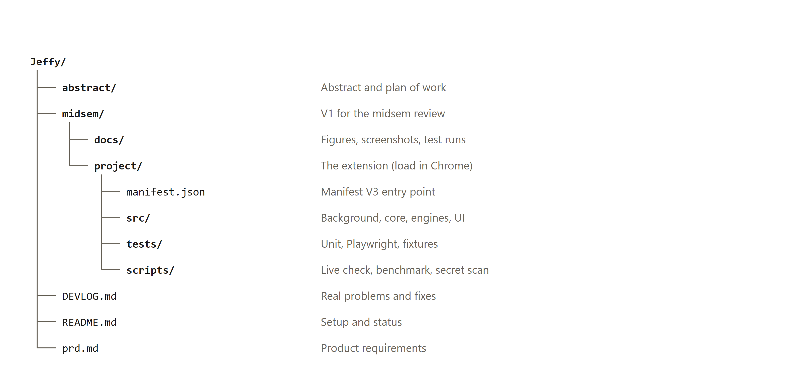

## A.1 Top-level files

| Path | What it is for |
|---|---|
| README.md | Setup steps for the client, status of each stage, and developer commands. |
| DEVLOG.md | The real problems met during the build, with symptom, cause, fix and lesson. |
| prd.md | The product requirements, the Version 1 and Version 2 scope, and the risks. |
| abstract/abstract.md | The project abstract, with the cover fields and the eight references. |
| assets/bits-logo.png | The BITS Pilani logo used on the report cover. |
| midsem/V1_PLAN.md | The approved plan for Version 1: scope, milestones, error table and test plan. |
| midsem/docs/ | Figures, screenshots, test-run reports, the manual smoke test list and the build scripts for the documents. |
| midsem/project/ | The extension. Load this folder in Chrome. It also holds setup.bat, run.bat and the tests. |
| .gitignore, .gitattributes | Keep keys, dependencies and logs out of Git, and set line endings. |

## A.2 Extension source (midsem/project/src)

| File | Job |
|---|---|
| manifest.json (project root) | Tells Chrome the extension name, its permissions, its popup, its options page and its service worker. |
| background/service-worker.js | Runs each summary job in the background, so the job continues when the popup closes. |
| background/extract-tab.js | Injects the extractor into the open tab and refuses pages Chrome does not allow. |
| content/extract.js | Runs in the page, copies it, keeps the main text and table cells, and falls back to the visible text. |
| lib/readability.js | Mozilla Readability, copied in as one file, which finds the article body of a page. |
| lib/READABILITY_LICENSE.md | The Apache-2.0 licence text for the copied Readability file. |
| core/config.js | Holds the default settings and the names of the keys stored in the browser. |
| core/errors.js | Defines the error codes and the plain English message for each one. |
| core/pipeline.js | Runs the whole flow: extract, split, summarize each part, merge, and record the statistics. |
| core/chunker.js | Splits long text into parts no longer than the limit, at paragraph, sentence or word breaks. |
| core/merger.js | Joins the part summaries into one summary, in groups first if there are many. |
| core/prompts.js | Holds the text of each prompt and the markers that wrap the page text. |
| core/url.js | Decides whether two addresses are the same page, ignoring the part after the #. |
| engines/gemini.js | Calls the Gemini service, applies the time limit and retries, and turns each failure into an error code. |
| ui/popup.html | The layout of the popup: the Summarize button, the key box, progress, errors and the result. |
| ui/popup.js | Starts jobs, shows progress and results, saves or removes the key, and handles errors. |
| ui/options.html | The layout of the Options page, with the key field. |
| ui/options.js | Saves or removes the key from the Options page. |
| ui/summary-format.js | Turns the plain-text summary into paragraphs and list items, without reading it as HTML. |
| ui/ui.css | The styles for the popup and the Options page. |

## A.3 Scripts (midsem/project/scripts)

| File | Job |
|---|---|
| check-extension.ps1 | Called by setup.bat. Checks that manifest.json and every file it names are present. |
| secret-scan.mjs | Checks that the real key appears in no file in the repository, before a push. |
| live-check.mjs | Lists the Gemini models the key can use and times one small request. |
| live-run.mjs | Runs the extension on real pages with the real service and records the results. |
| model-bench.mjs | Sends the same request to several models and thinking settings, and records the time. |
| quota-probe.mjs | Sends small requests until the service answers 429, to read the free-tier limit. |
| collect-examples.mjs | Records real extraction, chunking and prompt examples against the mock service. |
| activetab-spike.mjs | Checks the toolbar permission path in automation, as a one-off test. |

## A.4 Tests (midsem/project/tests)

| File | Job |
|---|---|
| unit/chunker.test.js | Checks the splitting rules: order, size limits, empty input and very long paragraphs. |
| unit/merger.test.js | Checks the grouping of part summaries and the merge steps. |
| unit/pipeline.test.js | Checks the whole flow with a fake extractor and a fake engine. |
| unit/gemini.test.js | Checks the Gemini engine against a fake fetch: the key header, retries, and each error code. |
| unit/fixes.test.js | Checks later fixes: the page limit, the 403 location rule, the quota wait and the abort rules. |
| unit/small.test.js | Checks small rules: summary format, settings, messages, prompts and restricted addresses. |
| e2e/pipeline.test.js | Runs browser scenarios T01 to T25 in Chromium with the extension loaded. |
| e2e/smoke.test.js | Runs one browser check on a short article. |
| e2e/chrome-flag-check.mjs | An early check of whether branded Chrome loads an extension through a flag (DEVLOG, first entry). |
| bat/test-bat-scripts.ps1 | Runs setup.bat and run.bat in copies of the project, on success and failure paths. |
| helpers/extension.mjs | Starts Chromium with the extension loaded. It runs hidden unless HEADED=1 is set. |
| helpers/mock-gemini.mjs | A stand-in for the Gemini service that can delay, rate-limit, fail or return empty answers. |
| helpers/fixtures-server.mjs | Serves the fixture pages on localhost for the browser tests. |
| helpers/key.mjs | Finds the live key from the environment or a git-ignored file, and never prints it. |
| fixtures/*.html | Six saved pages: short and long articles, a near-empty page, late content, a dashboard and a table article. |

## A.5 Setup scripts and generated folders

| File | Job |
|---|---|
| setup.bat | Checks Chrome, its version and the extension files, optionally installs the developer tools, and writes setup.log. |
| run.bat | Opens Chrome's extensions page, copies the folder path, and shows the four manual steps. |
| package.json, package-lock.json | Name the developer tools (Playwright) and the test commands. |
| .setup-ok | A record written by setup.bat, read by run.bat to find Chrome. |
| setup.log | The log of the last setup run, for the developer or the client. |
| test-output/ | Screenshots taken by the browser tests. |

## What this means in plain words

The repository has three layers. The first is the extension in src, which is what runs in Chrome. The second is the set of scripts and tests, which check it and measure it. The third is the documentation: the README, the devlog, the requirements and the report folder. A reader who wants to change the summary can start in core/prompts.js. A reader who wants to change how a failure looks can start in core/errors.js.


<div style="page-break-after: always"></div>

# [nonum] Appendix B: Messages and Settings

The first table lists the error messages from core/errors.js, exactly as the code writes them. The text in braces is filled in when the message appears.

## B.1 Error messages

| Code | Exact text | When it appears | What to do |
|---|---|---|---|
| NO_KEY | No API key yet. Paste your Gemini key in the Key box and save it. | Summarize is pressed and no key is saved. No request is sent. | Paste the key in the Key box or on the Options page. |
| INVALID_KEY | Your API key was rejected. Paste a correct key in the Key box. | Google rejects the key. Not retried. | Check the key for typing mistakes, or copy a new one from AI Studio. |
| RATE_LIMIT | The free tier is busy right now. Wait a minute and try again. | Google answers 429 on the first try and on all three retries. | Wait a minute and press Summarize again. |
| QUOTA_EXHAUSTED | The free-tier limit for your API key is used up for now. Try again {wait}, or use a different key. | Google asks for a wait longer than 25 seconds. No retry. {wait} reads "in about a minute", "in about 12 minutes" or "later". | Wait for the time shown, or use another key. |
| NETWORK | Cannot reach the service. Check your internet connection. | The request fails before any answer. Not retried. | Check the connection and try again. |
| TIMEOUT | The service took too long to answer. Try again. | No answer within 25 seconds. Not retried. | Press Summarize again. |
| SERVICE_ERROR | The service had a problem. Try again in a moment. | Google answers 500 to 504 after the retries, or another unexpected error. | Wait a moment and try again. |
| TOO_LITTLE_TEXT | This page has too little readable text to summarize. | Fewer than 200 characters are found. No request is sent. | Try a page with more text. |
| TOO_LONG | This page is too long for Version 1 to summarize. Try a shorter page. | The page needs more than 30 parts. No request is sent. | Try a shorter page. |
| RESTRICTED_PAGE | Chrome does not allow extensions to read this page. | Chrome settings pages, the Chrome Web Store, file and blank pages. No request is sent. | Open an ordinary web page. |
| EXTRACT_FAILED | Could not read the text of this page. | The extractor returns nothing or cannot be injected. | Reload the page and try again. |
| EMPTY_OR_BLOCKED | The model returned no summary for this page. | The answer has no text, or Google blocks it for safety. Not retried. | Try again. If it repeats, try another page. |
| INTERRUPTED | The summary was interrupted. Press Summarize to try again. | Chrome stopped the background worker mid-job, or a job has had no update for 3 minutes. | Press Summarize again. |
| CANCELLED | Cancelled. | The tab moved to another page or was closed. The popup never shows it. | Nothing to do. |

Other short messages come from the popup and the Options page:

- "Paste your Gemini key to begin." (popup, no key saved)
- "Reading the page...", "Summarizing part N of M...", "Combining N summaries..." (popup, progress)
- "The service is busy. Trying again in N s (attempt x of y)." (popup, retry)
- "Key saved. Now press Summarize." and "Paste a key first." (popup key box)
- "Saved. You can close this tab and press Summarize." (Options page)

## B.2 Settings

The defaults are in core/config.js. A user never edits them. The keys stored in chrome.storage.local can override some of them. Only the apiKey is meant for users. The others are test seams, which let the browser tests point at the mock service and force retries, timeouts and several parts on a short page.

| Setting | Default | Plain description | Test only? |
|---|---|---|---|
| model | gemini-3.5-flash-lite | The Google model that writes the summaries, chosen by measurement. | No |
| thinkingLevel | low | How much the model thinks before it answers. Low keeps answers fast. | No |
| apiBaseUrl | https://generativelanguage.googleapis.com | The address the requests go to. | Yes, tests point it at the mock service |
| chunkChars | 8000 | The longest part sent in one request, in characters. | Yes, tests force small parts |
| minTextChars | 200 | Pages with less text than this are refused. | No |
| maxChunks | 30 | Pages that need more parts than this are refused. | Yes, tests lower it |
| requestTimeoutMs | 25000 | How long to wait for one answer, in milliseconds. | Yes, tests shorten it |
| maxRetries | 3 | How many times a 429 or 5xx answer is retried. | No |
| retryBaseDelayMs | 2000 | The first retry wait. It doubles on each retry. | Yes, tests shorten it |
| temperature | 0.2 | A low value keeps the summary close to the page text. | No |
| apiKey | none (empty) | The user's key, kept in chrome.storage.local and never synced to the Google account. | No |

The config file calls chunkChars a test seam, but its default of 8000 is also the size used in normal use.

## What this means in plain words

Each message says what happened and what to do next. Technical detail, such as the HTTP status or the reason for a block, goes to the console and the job record, not to the screen. All limits sit in one file, so a change to a page size or a timeout is made in one place.

